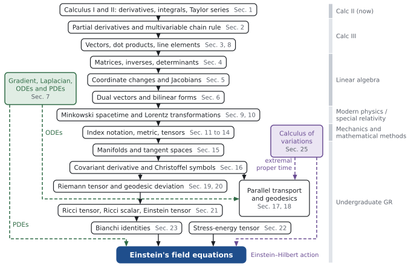
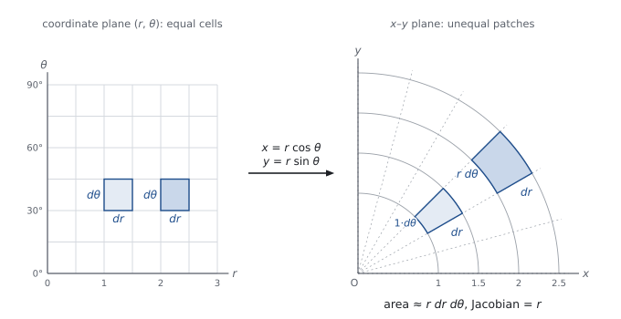
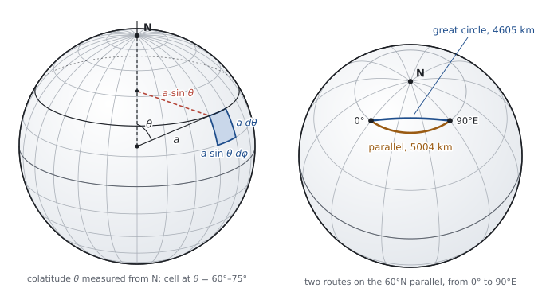
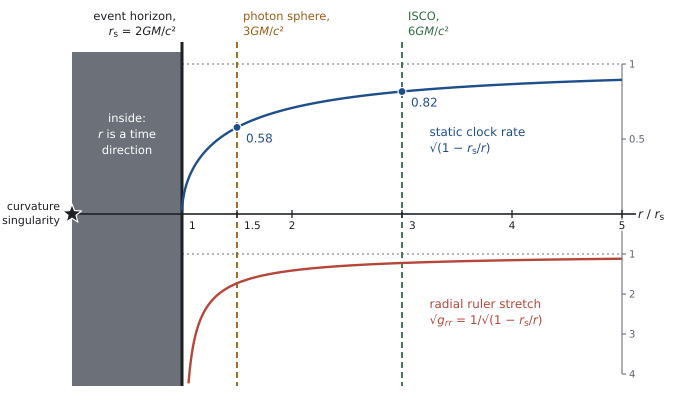
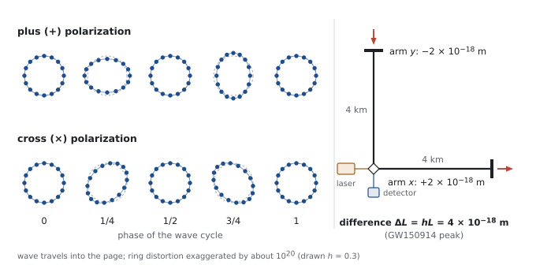

# The Mathematics of General Relativity: From Calculus to Einstein's Field Equations

*A mathematical companion to "General Relativity: A Beginner's Guide"*

In the Beginner's Guide you met general relativity (GR) as a set of ideas: gravity is the curvature of spacetime, free fall is the natural state of motion, and clocks lower down run slow. This companion teaches the mathematics those ideas are written in. It starts where you are, with derivatives, integrals and Taylor series, and climbs one prerequisite at a time through partial derivatives, matrices, index notation, the metric tensor, Christoffel symbols, curvature and, finally, Einstein's field equations. The aim is literacy rather than mastery. When you finish, you should be able to look at $G_{\mu\nu}+\Lambda g_{\mu\nu}=(8\pi G/c^4)T_{\mu\nu}$, at the Schwarzschild metric or at the Riemann tensor and say what every symbol is, what operation each piece asks for, and why the equation has the shape it has. You will not yet be able to solve the field equations for a merging pair of black holes; almost nobody can by hand, and you will see why. But you will know what you are looking at, which mathematics you still need, and which questions to ask a professor of GR. Every new symbol is introduced when it first appears and briefly re-explained when it returns much later, so you can also dip into any section on its own.

## How to read this document

The main body is organised by mathematical prerequisite, not by history. Part I builds the calculus and linear algebra that tensors rest on. Part II builds flat spacetime and the algebra of tensors. Part III builds curved spacetime, from manifolds to the field equations and the action principle. Each section depends only on earlier ones, and every teaching section has the same six parts: what the mathematics is, why GR needs it, how it works step by step, worked examples, where it appears in Einstein's equations, and a short list of what to remember. Worked examples start with plain numbers and end with something from GR.

Part IV, "Anatomy of the Great Equations", is a reference you can return to for years. It dissects twenty equations, from the spacetime interval to the Einstein–Hilbert action, symbol by symbol, in an order where each needs only the ones before it. Part V holds an equation dependency map, a notation reference, a course-by-course study plan and a short bibliography.

Three tags tell you how far to trust a result. **EXACT** means it follows from the definitions or from GR with no approximation. **APPROXIMATE** means it holds only under stated conditions, such as weak gravity or slow motion. **ANALOGY** means a picture that helps intuition but is not the real mathematics. Boxed asides marked "Needs further study" flag topics you will need a future course to use on your own. Equations are numbered by section, so Eq. (16.4) is the fourth numbered equation of Section 16.

## Conventions used throughout

**Metric signature $(-,+,+,+)$.** The flat-spacetime interval is $\Delta s^2=-(c\,\Delta t)^2+\Delta x^2+\Delta y^2+\Delta z^2$, so the Minkowski metric is $\eta_{\mu\nu}=\mathrm{diag}(-1,1,1,1)$, where $\mathrm{diag}(\dots)$ lists the entries of a diagonal matrix (one whose off-diagonal entries are all zero). This is the convention of Misner, Thorne and Wheeler (MTW), Carroll, Wald and Tong, and the one the Beginner's Guide used ([Carroll 1997](https://arxiv.org/abs/gr-qc/9712019), eq. 1.8; [Tong GR notes](https://davidtong.org/pdfs/teaching/general-relativity/gr.pdf)). Timelike separations (ones a clock can travel) have $\Delta s^2<0$.

**Units.** SI units are the default, with $c=299\,792\,458$ m/s and $G=6.674\,30\times10^{-11}$ m³ kg⁻¹ s⁻² ([NIST CODATA](https://physics.nist.gov/cgi-bin/cuu/Value?bg)). The time coordinate is $x^0=ct$, measured in metres, so all four coordinates have the same units. Some books set $c=1$ (time in metres, as Carroll does) or $G=c=1$ ("geometric units", where masses become lengths: one solar mass is 1.477 km or 4.925 μs). Whenever this document uses either shortcut, it says so at that point.

**Indices.** Greek indices $\mu,\nu,\rho,\sigma,\lambda,\alpha,\beta$ run over $0,1,2,3$ (time and three space directions); Latin indices $i,j,k$ run over $1,2,3$ (space only). A superscript on a coordinate is a label, not a power: $x^2$ is the coordinate $y$. The sign $\equiv$ means "is defined as", $\approx$ "is approximately" and $\propto$ "is proportional to". An index repeated once up and once down in a term is summed over (the Einstein summation convention, Section 11).

**Curvature signs (Carroll/MTW).** The Riemann tensor is $R^\rho{}_{\sigma\mu\nu}=\partial_\mu\Gamma^\rho_{\nu\sigma}-\partial_\nu\Gamma^\rho_{\mu\sigma}+\Gamma^\rho_{\mu\lambda}\Gamma^\lambda_{\nu\sigma}-\Gamma^\rho_{\nu\lambda}\Gamma^\lambda_{\mu\sigma}$, the Ricci tensor is the contraction $R_{\mu\nu}=R^\lambda{}_{\mu\lambda\nu}$, and the field equations carry $+8\pi G/c^4$ ([Carroll 1997](https://arxiv.org/abs/gr-qc/9712019), eqs. 3.67, 3.90, 4.52). With these choices a sphere has positive curvature. A dot over a symbol means a derivative with respect to proper time $\tau$ or a path parameter $\lambda$, never coordinate time, unless the text says otherwise.

Textbooks differ in up to three independent signs, which MTW label [S1] (metric signature), [S2] (sign of the Riemann tensor) and [S3] (sign in the field equation). The physics is identical; only the bookkeeping changes ([Wikipedia: Einstein field equations, reporting MTW's classification](https://en.wikipedia.org/wiki/Einstein_field_equations)).

| Text | Signature | [S1] [S2] [S3] | What you will notice |
|---|---|---|---|
| MTW (1973); Carroll (1997 notes, 2004 book); Tong (2019 notes) | $(-,+,+,+)$ | + + + | Same as this document |
| Weinberg, *Gravitation and Cosmology* (1972) | $(-,+,+,+)$ | + − − | A sphere's scalar curvature comes out negative; $-8\pi G$ in the field equation |
| Peebles (1980) | $(+,-,-,-)$ | − + + | Timelike intervals positive |
| Rindler (1977); Peacock (1999) | $(+,-,-,-)$ | − + − | Timelike intervals positive; field-equation sign flipped |
| Landau & Lifshitz; most particle-physics books | $(+,-,-,-)$ | − (others vary) | $u_\mu u^\mu=+c^2$ instead of $-c^2$ |

When you open a new book, check four things: the sign of the time term in flat space, whether a sphere gets positive curvature, the sign in front of $8\pi G$, and whether $c$ and $G$ are visible.

## Prerequisite roadmap

The mathematics of GR is one long chain with two side branches. The main chain runs from the derivative to partial derivatives and the chain rule, then to matrices and coordinate changes, then to index notation and flat spacetime, then to the metric, the Christoffel symbols, curvature and the field equations. One side branch, differential equations, is needed to solve what the chain produces: orbits are ordinary differential equations and the field equations are partial differential equations. The other, the calculus of variations, gives a second route to both the geodesic equation and the field equations.

<!-- FIGURE SPEC: A top-to-bottom flow chart on a white background with rounded boxes and arrows meaning "is needed for". Column of main-chain boxes, each labelled with the topic and, in small grey text, the section numbers: "Calculus I and II: derivatives, integrals, Taylor series (Sec. 1)" -> "Partial derivatives and multivariable chain rule (Sec. 2)" -> "Vectors, dot products, line elements (Sec. 3, 8)" -> "Matrices, inverses, determinants (Sec. 4)" -> "Coordinate changes and Jacobians (Sec. 5)" -> "Dual vectors and bilinear forms (Sec. 6)" -> "Minkowski spacetime and Lorentz transformations (Sec. 9, 10)" -> "Index notation, metric, tensors (Sec. 11 to 14)" -> "Manifolds and tangent spaces (Sec. 15)" -> "Covariant derivative and Christoffel symbols (Sec. 16)" which splits into two arrows: one to "Parallel transport and geodesics (Sec. 17, 18)" and one to "Riemann tensor and geodesic deviation (Sec. 19, 20)"; the Riemann box -> "Ricci tensor, Ricci scalar, Einstein tensor (Sec. 21)" -> "Bianchi identities (Sec. 23)"; a box "Stress-energy tensor (Sec. 22)" joins with the Bianchi box into the final, highlighted box "Einstein's field equations". Left side branch in a different colour (teal): "Gradient, Laplacian, ODEs and PDEs (Sec. 7)" with dashed arrows to "Geodesics" (labelled "ODEs") and to "Einstein's field equations" (labelled "PDEs"). Right side branch in another colour (purple): "Calculus of variations (Sec. 25)" with dashed arrows into "Geodesics" (labelled "extremal proper time") and into "Einstein's field equations" (labelled "Einstein-Hilbert action"). A thin vertical bar on the far right maps the boxes to typical university courses: "Calc II (now)", "Calc III", "Linear algebra", "Modern physics / special relativity", "Mechanics and mathematical methods", "Undergraduate GR". The reader should notice that every arrow points downward: nothing later is needed earlier. -->

## Difficulty ratings at a glance

Ratings are informal judgments relative to your current knowledge: 1 means you could do it today, 5 means about as demanding as the hardest parts of Calculus II, and 10 means graduate-level work you should not expect to master from this document. They lean on instructors' reports that index manipulation, covariant derivatives and curvature are where students struggle most ([Hartle 2006](https://arxiv.org/abs/gr-qc/0506075); [Moore 2006](https://aapt.org/doorway/TGRU/articles/Moore%20GRArticle.pdf)).

| Section | Topic | Rating | What makes it hard |
|---|---|---|---|
| 1 | Derivatives, parameters, Taylor approximations | 2 | Using a clock reading as the variable |
| 2 | Partial derivatives, multivariable chain rule | 4 | Keeping track of what is held fixed |
| 3 | Vectors, coordinates, dot products, line elements | 4 | Basis vectors that turn from point to point |
| 4 | Matrices, inverses, determinants | 4 | Order matters; new algebra rules |
| 5 | Coordinate transformations, Jacobians | 5 | Matrices of derivatives evaluated at a point |
| 6 | Dual vectors, bilinear forms | 6 | Two kinds of components that change oppositely |
| 7 | Gradient, Laplacian, ODEs and PDEs | 5 | Three-dimensional derivatives; boundary conditions |
| 8 | Curved surfaces, line elements | 4 | Measuring from inside a surface |
| 9 | Four-vectors, Minkowski interval | 4 | A minus sign that changes geometry |
| 10 | Lorentz transformations | 5 | Hyperbolic functions; relativity of simultaneity |
| 11 | Index notation, upper and lower indices | 6 | Implied sums; free versus dummy indices |
| 12 | Metric tensor, raising and lowering | 6 | Remembering which object raises and which lowers |
| 13 | Tensor algebra, transformation laws | 6 | One Jacobian per index |
| 14 | Proper time, four-velocity, four-acceleration | 5 | Derivatives with respect to the traveller's clock |
| 15 | Manifolds, tangent spaces | 6 | Abstraction: no surrounding space |
| 16 | Covariant derivative, Christoffel symbols | 8 | Correction terms; long index bookkeeping |
| 17 | Parallel transport | 7 | Solving a vector differential equation |
| 18 | Geodesics | 7 | Coupled nonlinear ODEs |
| 19 | Curvature, Riemann tensor | 9 | Four indices, symmetries, long computations |
| 20 | Geodesic deviation | 8 | Second covariant derivatives along a curve |
| 21 | Ricci tensor, Ricci scalar, Einstein tensor | 8 | Contractions and their meaning |
| 22 | Stress-energy tensor, conservation | 7 | Momentum flux as a tensor |
| 23 | Bianchi identities, field equations as PDEs | 9 | Identities of derivatives of curvature |
| 24 | Killing vectors, conserved quantities | 7 | Symmetry stated as a differential equation |
| 25 | Variational calculus, Einstein–Hilbert action | 9 | Varying a whole function; the metric as the unknown |

# Part I: Foundations

Part I collects the calculus and linear algebra that tensors are built from. Most of it is first- and second-year university mathematics (Calculus III, linear algebra, differential equations), taught here only as far as GR needs. Every topic ends with a glimpse of where it reappears in Einstein's equations.

The running example is the flat plane described in polar coordinates $(r,\theta)$. It is the gentlest place to meet every tool of GR, because each new result can be checked against ordinary Cartesian geometry you already trust.

## 1. Functions, derivatives and Taylor approximations

**Difficulty: 2/10.** This is Calculus I and II; the only new idea is using a moving clock's own reading as the variable.

### 1. What Is This Mathematics?

A function is a rule that turns one input into one output: position as a function of time, $x(t)$. Its derivative is the instantaneous rate of change, the slope of the tangent line. Velocity is the rate of change of position and acceleration the rate of change of velocity.

A path can be described with any convenient counter, called a **parameter**, often written $\lambda$ (lambda). Think of a film reel: each frame shows where the actor is, and you can number the frames by the studio clock or by ticks of the actor's wristwatch. In relativity the most useful counter for a moving object is its own wristwatch reading, the **proper time** $\tau$ (tau).

A **Taylor series** says that near a point, a smooth function looks like its tangent line, and adding curvature terms makes the fit better. Its most-used special case is the **binomial approximation**: for small $x$, $(1+x)^n\approx1+nx$.

### 2. Why Does General Relativity Need It?

In GR every particle's history is a curve through spacetime labelled by proper time, so velocities and accelerations are derivatives with respect to $\tau$. And gravity near Earth is weak: the dimensionless strength of Earth's gravity at its surface, $|\Phi|/c^2$ (the Newtonian potential divided by $c^2$), is about $7\times10^{-10}$. That is why the first term of a Taylor series is almost always enough, and why GR reduces to Newton's theory and supplies the GPS clock corrections.

### 3. How Does the Mathematics Work?

The derivative of $f$ at $t$ is a limit of slopes over a small step $h$:

$$
f'(t)=\lim_{h\to0}\frac{f(t+h)-f(t)}{h}.
\tag{1.1}
$$

Three notations mean the same thing: $\frac{dx}{dt}$ (Leibniz), $x'(t)$ (Lagrange) and $\dot x$ (Newton). In GR books the dot almost always means $d/d\tau$ or $d/d\lambda$, so check before you read ([Hartle 2006](https://arxiv.org/abs/gr-qc/0506075)).

If both $x$ and $t$ are functions of $\tau$, the chain rule converts rates between the two counters:

$$
\frac{dx}{dt}=\frac{dx/d\tau}{dt/d\tau}.
\tag{1.2}
$$

The Taylor series of $f$ about $a$ is ([OpenStax Calculus Vol. 2, §6.3](https://openstax.org/books/calculus-volume-2/pages/6-3-taylor-and-maclaurin-series))

$$
f(x)=f(a)+f'(a)(x-a)+\frac{f''(a)}{2!}(x-a)^2+\cdots
\tag{1.3}
$$

and for any real power $n$ the binomial series converges for $-1<x<1$ ([OpenStax Vol. 2, §6.4](https://openstax.org/books/calculus-volume-2/pages/6-4-working-with-taylor-series)):

$$
(1+x)^n=1+nx+\frac{n(n-1)}{2!}x^2+\cdots
\tag{1.4}
$$

GR uses two cases constantly. For $f(x)=(1-x)^{1/2}$: $f(0)=1$; $f'(x)=-\tfrac12(1-x)^{-1/2}$, so $f'(0)=-\tfrac12$; $f''(x)=-\tfrac14(1-x)^{-3/2}$, so $f''(0)=-\tfrac14$ and the $x^2$ coefficient is $-\tfrac14/2=-\tfrac18$. The same steps for $(1-x)^{-1/2}$ give coefficients $\tfrac12$ and $\tfrac38$:

$$
\sqrt{1-x}\approx1-\frac{x}{2}-\frac{x^2}{8},\qquad
\frac{1}{\sqrt{1-x}}\approx1+\frac{x}{2}+\frac{3x^2}{8}.
\tag{1.5}
$$

### 4. Worked Examples

#### Worked Example 1.1 — How good is "first order"?

Take $x=0.1$. Exactly, $\sqrt{0.9}=0.948683$. The first-order form gives $1-0.05=0.95$, an error of $1.3\times10^{-3}$; adding the second-order term gives $0.95-0.00125=0.94875$, an error of $6.7\times10^{-5}$. At $x=0.01$ the first-order error is $1.3\times10^{-5}$: ten times smaller $x$ gives about a hundred times smaller error, the signature of a remainder that shrinks like $x^2$. The warning case: at $v=0.6c$ the Lorentz factor $\gamma=1/\sqrt{1-v^2/c^2}$ is exactly $1/\sqrt{0.64}=1.25$, while $1+\tfrac12(0.36)=1.18$ is 5.6% low. The binomial shortcut needs $x\ll1$.

#### Worked Example 1.2 — A clock reading as the parameter

A particle moves along $x$ at $v=0.6c$, so $\gamma=1.25$. Labelled by its own clock, its time and position are $t(\tau)=1.25\,\tau$ and $x(\tau)=0.75\,c\,\tau$. Differentiating, $dt/d\tau=1.25$ and $dx/d\tau=0.75c$. By Eq. (1.2), $dx/dt=0.75c/1.25=0.6c$, as it must be. Each tick of the particle's clock corresponds to 1.25 ticks of the laboratory clock: time dilation, read off as a derivative.

#### Worked Example 1.3 — The speed term in a GPS satellite clock

A GPS satellite orbits at radius $a=2.656175\times10^7$ m around Earth, whose $GM=3.986004418\times10^{14}$ m³/s² ([Ashby 2003](https://pmc.ncbi.nlm.nih.gov/articles/PMC5253894/)). For a circular orbit, Physics I gives $v^2/a=GM/a^2$, so

$$
\begin{aligned}
v^2&=\frac{GM}{a}=\frac{3.986004\times10^{14}}{2.656175\times10^{7}}
=1.500656\times10^{7}\ \mathrm{m^2/s^2},\\
\frac{v^2}{c^2}&=\frac{1.500656\times10^{7}}{8.987552\times10^{16}}
=1.66970\times10^{-10}.
\end{aligned}
\tag{1.6}
$$

So $v=3873.8$ m/s, and by Eq. (1.5) a moving clock ticks at the rate $\sqrt{1-v^2/c^2}\approx1-8.3485\times10^{-11}$. Over a day of 86 400 s that is $7.21\times10^{-6}$ s: the satellite clock loses **7.2 μs per day** from its speed. The neglected second-order term is about $10^{-21}$, utterly negligible. The other, larger half of the GPS budget, the gravitational part, needs the metric and is computed in Worked Example 14.4.

### 5. Connection to Einstein's Equations

The law of motion of GR, the geodesic equation (Section 18), begins with a second derivative with respect to proper time, $d^2x^\mu/d\tau^2$. Clocks in weak gravity tick at the rate $d\tau/dt\approx1+\Phi/c^2-v^2/2c^2$, a first-order Taylor expansion **APPROXIMATE** (valid when $|\Phi|/c^2\ll1$ and $v\ll c$). And the whole "Newtonian limit" of the field equations (Equation 11 in Part IV) is a first-order expansion in the small quantity $\Phi/c^2$.

### 6. What I Should Remember

- A derivative is a rate and a slope; a path can be labelled by any parameter, and in GR the natural one is proper time $\tau$.
- The chain rule, $dx/dt=(dx/d\tau)/(dt/d\tau)$, converts between parameters.
- $\sqrt{1-x}\approx1-x/2$ and $1/\sqrt{1-x}\approx1+x/2$ for small $x$, with an error that shrinks like $x^2$.
- In GR books a dot usually means $d/d\tau$, not $d/dt$.

## 2. Partial derivatives and the multivariable chain rule

**Difficulty: 4/10.** Each step is a Calculus I derivative, but you must track which variables are frozen; this is normally Calculus III.

### 1. What Is This Mathematics?

When a quantity depends on several inputs, such as the height $h(x,y)$ of a hillside, a **partial derivative** asks how fast it changes if you nudge one input and freeze the others. $\partial h/\partial x$ is the slope you feel stepping due east (holding $y$ fixed), and $\partial h/\partial y$ the slope stepping due north. The curly $\partial$ ("partial") warns you that other variables are being held constant.

The **multivariable chain rule** answers: if I walk along a path across the hill, how fast does my height change? Answer: east-slope times eastward speed plus north-slope times northward speed, one term per route by which time influences height.

### 2. Why Does General Relativity Need It?

The metric of GR is a set of functions of four coordinates, $g_{\mu\nu}(t,x,y,z)$. Its first partial derivatives build the Christoffel symbols, the "gravitational force" terms of the equation of motion. Its second partial derivatives build curvature. The fact that mixed partial derivatives agree, $\partial_x\partial_y f=\partial_y\partial_x f$, is used to count the 20 independent curvature components of four-dimensional spacetime ([Carroll 1997](https://arxiv.org/abs/gr-qc/9712019), §2). And the chain rule for changing coordinates is the seed of every tensor transformation law.

### 3. How Does the Mathematics Work?

The partial derivative with respect to $x$ is the ordinary limit with $y$ frozen ([OpenStax Calculus Vol. 3, §4.3](https://openstax.org/books/calculus-volume-3/pages/4-3-partial-derivatives)):

$$
\frac{\partial f}{\partial x}=\lim_{h\to0}\frac{f(x+h,y)-f(x,y)}{h}.
\tag{2.1}
$$

To compute it, treat every other variable as a constant and differentiate as in Calculus I. The notations $\partial f/\partial x$, $\partial_x f$, $f_x$ and $f_{,x}$ all mean the same thing; GR writes $\partial_\mu f\equiv\partial f/\partial x^\mu$, where $\mu$ labels one of the four coordinates. **Clairaut's theorem**: if the mixed second partials are continuous, the order does not matter,

$$
\frac{\partial}{\partial y}\frac{\partial f}{\partial x}=\frac{\partial}{\partial x}\frac{\partial f}{\partial y}.
\tag{2.2}
$$

GR assumes smooth (infinitely differentiable) metrics, so Eq. (2.2) always holds there.

If $z=f(x,y)$ and both $x$ and $y$ depend on $t$, then ([OpenStax Vol. 3, §4.5](https://openstax.org/books/calculus-volume-3/pages/4-5-the-chain-rule))

$$
\frac{dz}{dt}=\frac{\partial z}{\partial x}\frac{dx}{dt}+\frac{\partial z}{\partial y}\frac{dy}{dt}.
\tag{2.3}
$$

Draw a tree with a branch for each intermediate variable, multiply along each path, and add the paths. A special case separates the **total** from the **partial** time derivative. A thermometer on a post measures $\partial T/\partial t$; one carried by a cyclist measures $dT/dt=\partial T/\partial t+(\partial T/\partial x)(dx/dt)$. If the air cools at $0.1$ °C/s, warms by $0.5$ °C per metre along the road, and the cyclist rides at 2 m/s, the post reads $-0.1$ °C/s while the cyclist reads $-0.1+0.5\times2=+0.9$ °C/s.

The same rule changes coordinates. With $x=r\cos\theta$, $y=r\sin\theta$,

$$
\frac{\partial f}{\partial r}=\frac{\partial x}{\partial r}\frac{\partial f}{\partial x}+\frac{\partial y}{\partial r}\frac{\partial f}{\partial y}.
\tag{2.4}
$$

> **Common confusion.** Partial derivatives are not fractions. $\partial x/\partial r$ (with $\theta$ fixed) is $\cos\theta$, and $\partial r/\partial x$ (with $y$ fixed) is $x/r=\cos\theta$ too, so their product is $\cos^2\theta$, not 1. Different variables are being held fixed.

### 4. Worked Examples

#### Worked Example 2.1 — Partials and mixed partials

Let $f(x,y)=x^2y+3y^3$ at $(1,2)$. Freezing $y$: $f_x=2xy=4$. Freezing $x$: $f_y=x^2+9y^2=1+36=37$. Mixed: $f_{xy}=\partial_y(2xy)=2x$ and $f_{yx}=\partial_x(x^2+9y^2)=2x$, both equal to 2 at this point, as Clairaut promises. They are not zero: a common error is to assume a mixed partial vanishes because the variable "was held fixed".

#### Worked Example 2.2 — Gravity from a potential

Newton's potential of a point mass is $\Phi=-GM/r$ with $r=\sqrt{x^2+y^2+z^2}$. Freeze $y$ and $z$ and use the one-variable chain rule:

$$
\begin{aligned}
\frac{\partial\Phi}{\partial x}
&=-GM\cdot\left(-\tfrac12\right)(x^2+y^2+z^2)^{-3/2}\cdot2x\\
&=\frac{GMx}{(x^2+y^2+z^2)^{3/2}}.
\end{aligned}
\tag{2.5}
$$

At Earth's surface on the $x$-axis, $(R,0,0)$, this is $GM/R^2$. With $GM=3.9860\times10^{14}$ m³/s² and mean radius $R=6.371\times10^6$ m ([NASA Earth Fact Sheet](https://nssdc.gsfc.nasa.gov/planetary/factsheet/earthfact.html)), $GM/R^2=9.820$ m/s², NASA's mean surface gravity. The gravitational field is $g_x=-\partial\Phi/\partial x$, pointing toward the centre.

#### Worked Example 2.3 — Changing derivatives from Cartesian to polar

Let $f=xy$. Then $\partial f/\partial x=y$, $\partial f/\partial y=x$, $\partial x/\partial r=\cos\theta$, $\partial y/\partial r=\sin\theta$, $\partial x/\partial\theta=-r\sin\theta$ and $\partial y/\partial\theta=r\cos\theta$. Eq. (2.4) and its $\theta$ partner give

$$
\begin{aligned}
\partial_r f&=y\cos\theta+x\sin\theta=2r\sin\theta\cos\theta=r\sin2\theta,\\
\partial_\theta f&=-yr\sin\theta+xr\cos\theta=r^2\cos2\theta.
\end{aligned}
\tag{2.6}
$$

Check by substituting first: $f=r^2\cos\theta\sin\theta=\tfrac12r^2\sin2\theta$, whose partials are the same. At $r=2$, $\theta=\pi/6$: $\partial_rf=2\sin(\pi/3)=1.7321$ and $\partial_\theta f=4\cos(\pi/3)=2$.

### 5. Connection to Einstein's Equations

The Christoffel symbols, met properly in Section 16, are built entirely from first partial derivatives of the metric:

$$
\Gamma^\sigma_{\mu\nu}=\tfrac12 g^{\sigma\rho}\left(\partial_\mu g_{\nu\rho}+\partial_\nu g_{\rho\mu}-\partial_\rho g_{\mu\nu}\right).
\tag{2.7}
$$

Curvature takes one more derivative, so the field equations are second-order in derivatives of $g_{\mu\nu}$. Eq. (2.4), written with indices, becomes $\partial f/\partial x'^\mu=(\partial x^\nu/\partial x'^\mu)\,\partial f/\partial x^\nu$: the transformation law of a gradient ([Carroll 1997](https://arxiv.org/abs/gr-qc/9712019), eq. 1.41), which Section 13 generalises to every tensor.

### 6. What I Should Remember

- A partial derivative is an ordinary derivative with every other variable frozen; always know which ones are frozen.
- $\partial f/\partial x$, $\partial_x f$, $f_x$ and $f_{,x}$ are the same; $\partial_\mu f$ is the four-coordinate version.
- For smooth functions, mixed partials commute; curvature will turn out to measure what does *not* commute.
- The multivariable chain rule adds one term per route of influence, and it is how derivatives change between coordinate systems.

## 3. Vectors, coordinates, dot products and the first line element

**Difficulty: 4/10.** Vectors are familiar from Physics I; what is new is that the reference arrows of polar coordinates change direction from place to place.

### 1. What Is This Mathematics?

A **vector** is an arrow: a size and a direction. Its **components** are instructions relative to a set of reference arrows, the **basis vectors**: "go 3 along the first and 4 along the second". A **coordinate system** is a labelling scheme for points. The arrow does not change when you switch coordinate systems; only its description does, like the same sentence in English and in French ([Tong, Vector Calculus](https://www.damtp.cam.ac.uk/user/tong/vc.html), §6).

Cartesian basis vectors $\hat{\mathbf x}$, $\hat{\mathbf y}$ point the same way everywhere. Polar ones do not: "outward" ($\hat{\mathbf e}_r$) and "around" ($\hat{\mathbf e}_\theta$) rotate as you walk around the origin (Figure 3.1).

The **dot product** measures how much two arrows point the same way, scaled by their lengths. Dotting an arrow with itself gives its squared length. For a tiny step, that squared length is the **line element** $ds^2$: Pythagoras for infinitesimal displacements, and the first appearance of the metric.

<!-- FIGURE SPEC: The flat plane with a light grey Cartesian grid and the origin O marked. Draw thin grey concentric circles (r = 1, 2, 3) and radial rays every 30 degrees. At four points, (r, θ) = (2, 0°), (2, 60°), (2, 150°) and (3, 240°), draw a pair of short arrows: a blue arrow labelled "e_r (hat)" pointing radially outward and a red arrow labelled "e_θ (hat)" pointing counterclockwise along the circle, both of unit length. At the point (2, 60°) also draw, dashed, the longer coordinate-basis arrow "e_θ = ∂x/∂θ" of length r = 2 in the same direction as e_θ (hat). In one corner, a single fixed black arrow labelled "x (hat), the same arrow everywhere" copied at two of the points to show that its polar components differ. Caption text inside the figure is not needed. The reader should notice that the blue and red pairs rotate as one moves around the origin while the black arrow does not. -->

### 2. Why Does General Relativity Need It?

GR's metric is a generalised dot product: it turns pairs of displacements into numbers. In curved spacetime there are no basis vectors that stay the same from place to place, so every calculation in GR has the polar-coordinate problem built in. The rate at which basis vectors turn is exactly what the Christoffel symbols record ([Tong GR notes](https://davidtong.org/pdfs/teaching/general-relativity/gr.pdf), ch. 1).

### 3. How Does the Mathematics Work?

In Cartesian components, $\mathbf V=V^x\hat{\mathbf x}+V^y\hat{\mathbf y}$. The superscripts $x$, $y$ are labels saying which component, not powers. The dot product and length are

$$
\mathbf A\cdot\mathbf B=A^xB^x+A^yB^y=|\mathbf A|\,|\mathbf B|\cos\alpha,\qquad|\mathbf A|=\sqrt{\mathbf A\cdot\mathbf A},
\tag{3.1}
$$

where $\alpha$ is the angle between the arrows. Polar coordinates are $x=r\cos\theta$, $y=r\sin\theta$. Their unit basis vectors, written in Cartesian form, depend on $\theta$:

$$
\hat{\mathbf e}_r=(\cos\theta,\ \sin\theta),\qquad\hat{\mathbf e}_\theta=(-\sin\theta,\ \cos\theta).
\tag{3.2}
$$

Differentiating shows how they turn: $\partial\hat{\mathbf e}_r/\partial\theta=\hat{\mathbf e}_\theta$ and $\partial\hat{\mathbf e}_\theta/\partial\theta=-\hat{\mathbf e}_r$. GR prefers the **coordinate basis**, the arrows obtained by nudging one coordinate: $\mathbf e_r=\partial\mathbf x/\partial r=(\cos\theta,\sin\theta)$ and $\mathbf e_\theta=\partial\mathbf x/\partial\theta=(-r\sin\theta,\ r\cos\theta)$, whose length is $r$.

For the line element, start from Pythagoras and use the chain rule, Eq. (2.3), for the differentials:

$$
\begin{aligned}
dx&=\cos\theta\,dr-r\sin\theta\,d\theta,\\
dy&=\sin\theta\,dr+r\cos\theta\,d\theta.
\end{aligned}
\tag{3.3}
$$

Square and add. The cross terms $\mp2r\sin\theta\cos\theta\,dr\,d\theta$ cancel, and $\sin^2\theta+\cos^2\theta=1$ twice:

$$
ds^2=dx^2+dy^2=dr^2+r^2\,d\theta^2.
\tag{3.4}
$$

The coefficients are the **metric components**, $g_{rr}=1$, $g_{\theta\theta}=r^2$, $g_{r\theta}=0$: the coordinate system's built-in ruler. A step $d\theta$ is not a distance; it is worth $r\,d\theta$ of distance. ($ds^2$ means $(ds)^2$, the square of a tiny length, not "$d$ of $s^2$".)

### 4. Worked Examples

#### Worked Example 3.1 — One arrow, two sets of polar components

Take the fixed arrow $\mathbf V=\hat{\mathbf x}=(1,0)$. At the point $(1,1)$, $r=\sqrt2$ and $\theta=45^\circ$, so $\hat{\mathbf e}_r=(0.7071,0.7071)$, $\hat{\mathbf e}_\theta=(-0.7071,0.7071)$, and the components are $\mathbf V\cdot\hat{\mathbf e}_r=0.7071$ and $\mathbf V\cdot\hat{\mathbf e}_\theta=-0.7071$. At $(0,2)$, $\theta=90^\circ$, $\hat{\mathbf e}_r=(0,1)$, $\hat{\mathbf e}_\theta=(-1,0)$, and the components are $0$ and $-1$. The arrow never changed; the basis turned.

#### Worked Example 3.2 — Turning basis vectors make "centripetal acceleration"

Write position as $\mathbf x=r\,\hat{\mathbf e}_r$ and differentiate with the product rule, using $d\hat{\mathbf e}_r/dt=\dot\theta\,\hat{\mathbf e}_\theta$ and $d\hat{\mathbf e}_\theta/dt=-\dot\theta\,\hat{\mathbf e}_r$ (here the dot is $d/dt$):

$$
\begin{aligned}
\dot{\mathbf x}&=\dot r\,\hat{\mathbf e}_r+r\dot\theta\,\hat{\mathbf e}_\theta,\\
\ddot{\mathbf x}&=(\ddot r-r\dot\theta^2)\,\hat{\mathbf e}_r+(r\ddot\theta+2\dot r\dot\theta)\,\hat{\mathbf e}_\theta.
\end{aligned}
\tag{3.5}
$$

For uniform circular motion with $r=2$ m and $\dot\theta=3$ rad/s, $a_r=-2\times9=-18$ m/s². The $-r\dot\theta^2$ term exists only because $\hat{\mathbf e}_r$ rotates. Setting $\ddot{\mathbf x}=0$ (no force) gives $\ddot r-r\dot\theta^2=0$ and $\ddot\theta+2\dot r\dot\theta/r=0$: the equations of a straight line in polar coordinates, which you will meet again as the geodesic equation.

#### Worked Example 3.3 — The line element is exact for tiny steps

At $r=2$ take $dr=0.01$ and $d\theta=0.005$. Eq. (3.4) gives $ds^2=0.0001+4\times0.000025=0.0002$, so $ds=0.014142$. The straight chord between $(2,0)$ and $(2.01\cos0.005,\ 2.01\sin0.005)$ is $0.014160$. The 0.12% difference comes from products of small steps that the line element ignores; it vanishes as the steps shrink.

### 5. Connection to Einstein's Equations

Every metric in GR is written as a line element $ds^2=g_{\mu\nu}dx^\mu dx^\nu$ (Section 12), and Eq. (3.4) is its simplest curvilinear case. The derivatives of the coordinate basis, $\partial\mathbf e_r/\partial\theta=\tfrac1r\mathbf e_\theta$ and $\partial\mathbf e_\theta/\partial\theta=-r\,\mathbf e_r$, are exactly the Christoffel symbols $\Gamma^\theta_{r\theta}=1/r$ and $\Gamma^r_{\theta\theta}=-r$ of Section 16. Even in flat space they are not zero, a warning that nonzero Christoffel symbols do not by themselves mean curvature.

### 6. What I Should Remember

- A vector is not its list of components; components depend on the basis.
- Cartesian basis vectors are the same everywhere; polar (and all curved-space) basis vectors change from point to point.
- The dot product turns two vectors into one number; the line element $ds^2$ is Pythagoras for tiny steps.
- In polar coordinates $ds^2=dr^2+r^2d\theta^2$: the coefficients are a position-dependent ruler, the first metric.

## 4. Matrices: multiplication, inverses and determinants

**Difficulty: 4/10.** Matrix arithmetic is new but mechanical; the surprise is that the order of multiplication matters.

### 1. What Is This Mathematics?

A **matrix** is a rectangular table of numbers that acts as a machine: it turns one list of numbers (a vector) into another by fixed linear rules. Each output entry is one row of the matrix dotted with the input. Multiplying matrices chains machines, and order matters, as with putting on socks and then shoes. The **determinant** of a square matrix is the factor by which it scales areas (in 2D) or volumes (in 3D); a negative sign means it also flips orientation, and zero means it squashes space flat and cannot be undone. The **inverse** is the machine that undoes the original.

### 2. Why Does General Relativity Need It?

The metric $g_{\mu\nu}$ is a symmetric 4×4 matrix at every point. Its inverse $g^{\mu\nu}$ is used in nearly every formula. Lorentz transformations are 4×4 matrices, and two boosts in different directions do not commute ([Carroll 1997](https://arxiv.org/abs/gr-qc/9712019), §1). The determinant of the metric appears as $\sqrt{-g}$ in every invariant volume and in the Einstein–Hilbert action.

### 3. How Does the Mathematics Work?

With $A_{ij}$ the entry in row $i$, column $j$, matrix–vector and matrix–matrix products are

$$
(A\mathbf v)_i=\sum_jA_{ij}v_j,\qquad(AB)_{ij}=\sum_kA_{ik}B_{kj}.
\tag{4.1}
$$

The **identity** $I$ has 1s on the diagonal and 0s elsewhere, so $AI=IA=A$. The **transpose** $A^T$ swaps rows and columns, $(A^T)_{ij}=A_{ji}$, and $(AB)^T=B^TA^T$. A matrix is **symmetric** if $A^T=A$ and **diagonal** if every off-diagonal entry is zero. "Usually $AB$ is different from $BA$" ([Strang, *Introduction to Linear Algebra*, §1.4](https://math.mit.edu/~gs/linearalgebra/ila6/ila6_1_4.pdf)). For a 2×2 matrix,

$$
\det\begin{pmatrix}a&b\\c&d\end{pmatrix}=ad-bc,\qquad
\begin{pmatrix}a&b\\c&d\end{pmatrix}^{-1}=\frac{1}{ad-bc}\begin{pmatrix}d&-b\\-c&a\end{pmatrix},
\tag{4.2}
$$

and the inverse exists only when $ad-bc\neq0$. A 3×3 determinant expands along the first row: $\det=a(ei-fh)-b(di-fg)+c(dh-eg)$ for rows $(a,b,c)$, $(d,e,f)$, $(g,h,i)$. The inverse of a diagonal matrix is the reciprocal of each diagonal entry; the inverse of a non-diagonal matrix is not.

### 4. Worked Examples

#### Worked Example 4.1 — Order matters

Let $A=\begin{pmatrix}1&2\\3&4\end{pmatrix}$ and $B=\begin{pmatrix}0&1\\1&0\end{pmatrix}$. Row by column, $AB$ has entries $(1)(0)+(2)(1)=2$, $(1)(1)+(2)(0)=1$, $(3)(0)+(4)(1)=4$, $(3)(1)+(4)(0)=3$, so $AB=\begin{pmatrix}2&1\\4&3\end{pmatrix}$: the columns of $A$ swapped. The same steps give $BA=\begin{pmatrix}3&4\\1&2\end{pmatrix}$: the rows swapped. $AB\neq BA$.

#### Worked Example 4.2 — Determinant and inverse, with a check

$\det A=1\cdot4-2\cdot3=-2$: $A$ doubles areas and flips orientation. By Eq. (4.2), $A^{-1}=\tfrac{1}{-2}\begin{pmatrix}4&-2\\-3&1\end{pmatrix}=\begin{pmatrix}-2&1\\1.5&-0.5\end{pmatrix}$. Check $AA^{-1}$: $1(-2)+2(1.5)=1$, $1(1)+2(-0.5)=0$, $3(-2)+4(1.5)=0$, $3(1)+4(-0.5)=1$. That is $I$.

#### Worked Example 4.3 — Metric matrices from GR

The polar metric is $g=\mathrm{diag}(1,r^2)$, with inverse $\mathrm{diag}(1,1/r^2)$ and determinant $r^2$. The Minkowski metric $\eta=\mathrm{diag}(-1,1,1,1)$ is its own inverse, with determinant $-1$. The Schwarzschild metric (Equation 12 of Part IV) in coordinates $(ct,r,\theta,\phi)$, writing $f=1-r_s/r$, is diagonal:

$$
\begin{aligned}
g&=\mathrm{diag}\!\left(-f,\ f^{-1},\ r^2,\ r^2\sin^2\theta\right),\\
\det g&=-f\cdot f^{-1}\cdot r^2\cdot r^2\sin^2\theta=-r^4\sin^2\theta.
\end{aligned}
\tag{4.3}
$$

So $\sqrt{-g}=r^2\sin\theta$, exactly as for flat space in spherical coordinates: the $f$ and $1/f$ cancel.

#### Worked Example 4.4 — A non-diagonal metric is not inverted entry by entry

A grid whose axes meet at 60° has metric $g=\begin{pmatrix}1&1/2\\1/2&1\end{pmatrix}$ (Section 11). Then $\det g=1-\tfrac14=0.75$ and $g^{-1}=\tfrac{1}{0.75}\begin{pmatrix}1&-1/2\\-1/2&1\end{pmatrix}=\begin{pmatrix}4/3&-2/3\\-2/3&4/3\end{pmatrix}$. Check the first row against the first column: $\tfrac43-\tfrac23\cdot\tfrac12=1$; against the second: $\tfrac43\cdot\tfrac12-\tfrac23=0$. The reciprocals of the entries, 1 and 2, would be wrong.

### 5. Connection to Einstein's Equations

The statement "$g^{\mu\nu}$ is the inverse of $g_{\mu\nu}$" is written $g^{\mu\nu}g_{\nu\sigma}=\delta^\mu_\sigma$, where $\delta^\mu_\sigma$ (the Kronecker delta) is 1 when $\mu=\sigma$ and 0 otherwise: the identity matrix in index form ([Carroll 1997](https://arxiv.org/abs/gr-qc/9712019), eq. 2.28). Lorentz transformations are the matrices satisfying $\Lambda^T\eta\Lambda=\eta$ (Section 10). And $\sqrt{-g}$ makes the volume element $\sqrt{-g}\,d^4x$ of the Einstein–Hilbert action independent of coordinates (Section 25).

### 6. What I Should Remember

- Row times column is the only multiplication rule, and $AB\neq BA$ in general.
- The determinant is an area or volume scale factor; an inverse exists only when it is nonzero.
- A diagonal matrix inverts entry by entry; a non-diagonal one does not.
- The metric is a symmetric matrix, its inverse raises indices, and $\det g$ supplies $\sqrt{-g}$.

## 5. Coordinate transformations and Jacobians

**Difficulty: 5/10.** It combines partial derivatives with matrices; this is the "change of variables" chapter of Calculus III.

### 1. What Is This Mathematics?

A change of coordinates, such as Cartesian to polar, is a set of functions. Zoomed in close enough, any smooth change of coordinates looks like a matrix: the table of first partial derivatives of one set of coordinates with respect to the other, called the **Jacobian matrix**. Its determinant, the **Jacobian**, says how much a tiny coordinate rectangle is stretched in area. **ANALOGY** A currency exchange table that differs from city to city: the Jacobian at a point is the local exchange rate between "coordinate units".

### 2. Why Does General Relativity Need It?

GR lets you use any coordinates, so it constantly translates between them. Tensor components change by one Jacobian factor per index (Section 13). A Lorentz boost is the special case of a constant Jacobian (Section 10). And because coordinate volumes are not physical volumes, every integral over spacetime carries a Jacobian-like factor, $\sqrt{-g}$ ([Carroll 1997](https://arxiv.org/abs/gr-qc/9712019), eq. 2.48).

### 3. How Does the Mathematics Work?

For polar coordinates the Jacobian matrix and its determinant are ([OpenStax Vol. 3, §5.7](https://openstax.org/books/calculus-volume-3/pages/5-7-change-of-variables-in-multiple-integrals))

$$
J=\begin{pmatrix}\dfrac{\partial x}{\partial r}&\dfrac{\partial x}{\partial\theta}\\[6pt]\dfrac{\partial y}{\partial r}&\dfrac{\partial y}{\partial\theta}\end{pmatrix}
=\begin{pmatrix}\cos\theta&-r\sin\theta\\\sin\theta&r\cos\theta\end{pmatrix},\qquad\det J=r.
\tag{5.1}
$$

Eq. (3.3) is just $J$ acting on $(dr,d\theta)$. A polar "rectangle" with sides $dr$ and $d\theta$ has real sides $dr$ and $r\,d\theta$, so its area is $dA=r\,dr\,d\theta$ (Figure 5.1). The reverse change uses the inverse matrix:

$$
\frac{\partial(r,\theta)}{\partial(x,y)}=\begin{pmatrix}\cos\theta&\sin\theta\\-\sin\theta/r&\cos\theta/r\end{pmatrix}=J^{-1}.
\tag{5.2}
$$

The metric changes by a Jacobian on each side. Starting from the Cartesian metric $I$:

$$
g_{\text{polar}}=J^TIJ=J^TJ,\qquad\det g_{\text{polar}}=(\det J)^2,
\tag{5.3}
$$

so $\sqrt{\det g}=|\det J|$: the metric "knows" the Jacobian. That is why GR writes invariant volumes as $\sqrt{|g|}\,d^nx$.

<!-- FIGURE SPEC: Left panel: the (r, θ) coordinate plane drawn as an ordinary rectangular grid with a small shaded rectangle of width dr and height dθ, sides labelled "dr" and "dθ". Right panel: the x-y plane with circles r = 1, 1.5, 2, 2.5 and rays every 15 degrees; the image of the shaded rectangle is a curved wedge-shaped patch near r = 2, θ = 30°, shaded the same colour, with its radial side labelled "dr" and its arc side labelled "r dθ". An arrow from left to right labelled "x = r cos θ, y = r sin θ". Beneath the right patch the text "area ≈ r dr dθ, Jacobian = r". Below both panels a second, smaller copy of the wedge at r = 1 to show that the same dr, dθ gives a smaller patch nearer the origin. The reader should notice that equal coordinate rectangles map to unequal real areas, in proportion to r. -->

### 4. Worked Examples

#### Worked Example 5.1 — A Jacobian and its inverse at one point

At $r=2$, $\theta=\pi/6$ ($\cos\theta=0.86603$, $\sin\theta=0.5$), Eq. (5.1) gives $J=\begin{pmatrix}0.86603&-1\\0.5&1.73205\end{pmatrix}$ and $\det J=1.5+0.5=2=r$. Eq. (5.2) gives $J^{-1}=\begin{pmatrix}0.86603&0.5\\-0.25&0.43301\end{pmatrix}$. Check the four entries of $JJ^{-1}$: $0.75+0.25=1$, $0.43301-0.43301=0$, $0.43301-0.43301=0$, $0.25+0.75=1$.

#### Worked Example 5.2 — Areas and volumes with the Jacobian

The quarter-annulus $1\le r\le2$, $0\le\theta\le\pi/2$ has area $\int_0^{\pi/2}\int_1^2r\,dr\,d\theta=\tfrac32\cdot\tfrac\pi2=3\pi/4$, a quarter of $\pi(2^2-1^2)$, as it should be. In 3D spherical coordinates the Jacobian is $r^2\sin\theta$, and a ball of radius $R$ has volume $\int_0^{2\pi}\int_0^\pi\int_0^R r^2\sin\theta\,dr\,d\theta\,d\phi=\tfrac{R^3}{3}\cdot2\cdot2\pi=\tfrac43\pi R^3$.

#### Worked Example 5.3 — The metric from the Jacobian

Multiply out Eq. (5.3) with the matrix of Eq. (5.1):

$$
J^TJ=\begin{pmatrix}\cos^2\theta+\sin^2\theta&-r\sin\theta\cos\theta+r\sin\theta\cos\theta\\ \cdot&r^2\sin^2\theta+r^2\cos^2\theta\end{pmatrix}=\begin{pmatrix}1&0\\0&r^2\end{pmatrix}.
\tag{5.4}
$$

(The dot marks the entry equal to its mirror image.) This is $ds^2=dr^2+r^2d\theta^2$ again, found by matrix multiplication instead of squaring differentials, and $\sqrt{\det g}=r=\det J$.

### 5. Connection to Einstein's Equations

The Einstein–Hilbert action integrates the curvature over spacetime with the invariant volume element $\sqrt{-g}\,d^4x$, the four-dimensional, curved-space version of $r\,dr\,d\theta$ (Section 25). The general tensor transformation law puts one factor $\partial x'^\mu/\partial x^\nu$ or $\partial x^\nu/\partial x'^\mu$ on each index; these are entries of a Jacobian matrix or its inverse ([Carroll 1997](https://arxiv.org/abs/gr-qc/9712019), eq. 2.19).

### 6. What I Should Remember

- The Jacobian matrix is the table of partial derivatives of one set of coordinates with respect to the other; the reverse change uses the inverse matrix.
- Its determinant is the local area or volume stretch: $dA=r\,dr\,d\theta$ in polar coordinates.
- The metric transforms as $g'=J^TgJ$, so $\sqrt{|\det g|}$ supplies the Jacobian automatically.
- A Lorentz boost is a Jacobian that is the same everywhere.

## 6. Linear algebra for tensors: dual vectors and bilinear forms

**Difficulty: 6/10.** The ideas are short but abstract; this material normally comes from a linear algebra course.

### 1. What Is This Mathematics?

A **vector space** is any collection you can add and scale: arrows, lists of numbers, functions. A **basis** is a minimal set of reference vectors, and components are the recipe for building any vector from them. A **linear map** respects adding and scaling.

A **dual vector** (also called a covector or one-form) is a linear machine that eats one vector and returns a number. If vectors are columns of numbers, dual vectors are rows, and "eating" is row-times-column ([Carroll 1997](https://arxiv.org/abs/gr-qc/9712019), §1). **ANALOGY** A shopping basket (a column of quantities) and a price list (a row of prices): the price list eats the basket and returns the bill. Count eggs in dozens instead of singles and the quantities shrink by 12 while the price per unit grows by 12; the bill is unchanged.

A **bilinear form** eats two vectors and returns a number, linear in each slot. The dot product is one. A **tensor** is the same idea with any number of slots ([Tong, Vector Calculus](https://www.damtp.cam.ac.uk/user/tong/vc.html), §6).

### 2. Why Does General Relativity Need It?

The gradient of a function is the prime example of a dual vector: feed it a direction and it returns the rate of change, with no ruler needed ([Carroll 1997](https://arxiv.org/abs/gr-qc/9712019), eq. 1.40). The metric is a symmetric bilinear form, and so is the stress-energy tensor $T_{\mu\nu}$. In ordinary Cartesian space, vector and dual-vector components happen to be equal, which is why school physics never separated them; in spacetime they differ by a sign, and in curved coordinates by more ([Carroll 1997](https://arxiv.org/abs/gr-qc/9712019), after eq. 1.62).

### 3. How Does the Mathematics Work?

Label vector components with upper indices, $V^1,V^2$, and dual-vector components with lower ones, $\omega_1,\omega_2$. The dual vector acting on the vector is the sum

$$
\omega(\mathbf V)=\omega_1V^1+\omega_2V^2,
\tag{6.1}
$$

and linearity means $\omega(a\mathbf V+b\mathbf W)=a\,\omega(\mathbf V)+b\,\omega(\mathbf W)$. When the basis vectors are rescaled, vector components scale the opposite way and dual components the same way, so the number $\omega(\mathbf V)$ never changes: that opposite behaviour is why the two kinds get different index positions. A bilinear form with matrix $G$ acts as

$$
g(\mathbf U,\mathbf W)=\sum_{i,j}G_{ij}U^iW^j=\mathbf U^TG\,\mathbf W,
\tag{6.2}
$$

and it is symmetric when $G^T=G$. The gradient of $f$ is the dual vector $df=(\partial_1f,\ \partial_2f)$; acting on a velocity it gives the rate of change along the path, by the chain rule (2.3).

### 4. Worked Examples

#### Worked Example 6.1 — Opposite scaling keeps the answer fixed

Let $\omega=(2,-1,3)$ and $\mathbf V=(1,4,2)$. Then $\omega(\mathbf V)=2-4+6=4$. Now double every basis vector. The vector's components halve to $(0.5,2,1)$; the dual vector's components double to $(4,-2,6)$; and $4(0.5)-2(2)+6(1)=4$ again.

#### Worked Example 6.2 — The gradient eats a velocity

Let $f=x^2+3y$ at $(1,2)$. Its gradient components are $(\partial_xf,\partial_yf)=(2x,3)=(2,3)$. Acting on the velocity $\mathbf V=(0.5,1)$: $2(0.5)+3(1)=4$. Check directly: along the path $(1+s/2,\ 2+s)$, $\frac{d}{ds}[(1+s/2)^2+3(2+s)]$ at $s=0$ is $2(1)(\tfrac12)+3=4$.

#### Worked Example 6.3 — The polar metric as a two-slot machine

At $r=2$ the polar metric has matrix $G=\mathrm{diag}(1,4)$, acting on components $(dr,d\theta)$. For $\mathbf U=(1,\ 0.5)$ and $\mathbf W=(2,\ -0.25)$, Eq. (6.2) gives $1\cdot1\cdot2+4\cdot0.5\cdot(-0.25)=2-0.5=1.5$. Feeding the same vector twice gives its squared length: $g(\mathbf U,\mathbf U)=1+4(0.25)=2$.

### 5. Connection to Einstein's Equations

Both sides of Einstein's equations are symmetric bilinear machines. Feed $T_{\mu\nu}$ an observer's four-velocity $u^\mu$ twice and divide by $c^2$, and out comes the energy density that observer measures; feed $G_{\mu\nu}$ the same vector and out comes a measure of curvature. "There are ten independent equations (since both sides are symmetric two-index tensors)" ([Carroll 1997](https://arxiv.org/abs/gr-qc/9712019), after eq. 4.52).

> **Needs further study.** A linear algebra course (vector spaces, bases and change of basis, dual spaces, determinants, eigenvalues) is the single most useful mathematics course for GR after Calculus III. Graduate courses treat "finite-dimensional vector spaces" as essential background ([Cambridge Part III GR guide](https://www.maths.cam.ac.uk/postgrad/part-iii/files/misc/2020-21%20Guide/Relativity%20and%20Gravitation/General%20Relativity.pdf)).

### 6. What I Should Remember

- A dual vector is a row that eats a column and returns a number; the gradient is the standard example.
- Vector components (upper index) and dual components (lower index) change in opposite ways, so the number they produce is basis-independent.
- A bilinear form eats two vectors; the metric is a symmetric one, and $g(\mathbf U,\mathbf U)$ is a squared length.
- A tensor is a multilinear machine, defined by how it acts, not by being a table of numbers.

## 7. Gradients, the Laplacian, and ODEs versus PDEs

**Difficulty: 5/10.** Three-dimensional derivatives and the language of differential equations, usually met in Calculus III and a differential-equations course.

### 1. What Is This Mathematics?

The **gradient** $\nabla f$ (read "del $f$") points uphill along the steepest direction of a field $f$, with length equal to the steepness. The **divergence** $\nabla\cdot\mathbf F$ measures the net outflow of a vector field per unit volume: a faucet is a source, a drain a sink. The **Laplacian** $\nabla^2f$ measures how much $f$ at a point differs from its average on a tiny surrounding sphere: the average equals $f+\tfrac{h^2}{6}\nabla^2f$ plus smaller terms, for a sphere of radius $h$.

A **differential equation** relates an unknown function to its derivatives. If the unknown depends on one variable, it is an **ordinary differential equation** (ODE); if on several, a **partial differential equation** (PDE). **ANALOGY** An ODE is the flight plan of one aeroplane through time; a PDE is the weather over a whole country evolving at once.

### 2. Why Does General Relativity Need It?

Newton's gravity, written as a field equation, is a PDE: Poisson's equation, $\nabla^2\Phi=4\pi G\rho$. Einstein's equations were built to reduce to it for weak, slow gravity ([Carroll 1997](https://arxiv.org/abs/gr-qc/9712019), eq. 4.35). GR's law of motion is a system of ODEs, its field equations a system of PDEs, and symmetry is what turns those PDEs back into ODEs that can be solved by hand.

### 3. How Does the Mathematics Work?

In Cartesian coordinates,

$$
\nabla f=\left(\frac{\partial f}{\partial x},\frac{\partial f}{\partial y},\frac{\partial f}{\partial z}\right),\qquad
\nabla\cdot\mathbf F=\frac{\partial F_x}{\partial x}+\frac{\partial F_y}{\partial y}+\frac{\partial F_z}{\partial z},
\tag{7.1}
$$

and $\nabla^2f=\nabla\cdot\nabla f=\partial_x^2f+\partial_y^2f+\partial_z^2f$. Newton's field is $\mathbf g=-\nabla\Phi$. A point mass $M$ sends a flux $-(GM/r^2)(4\pi r^2)=-4\pi GM$ through every sphere around it; the divergence theorem turns that into Gauss's law, $\nabla\cdot\mathbf g=-4\pi G\rho$, and so ([Tong, Vector Calculus](https://www.damtp.cam.ac.uk/user/tong/vc.html), §5)

$$
\nabla^2\Phi=4\pi G\rho .
\tag{7.2}
$$

The $4\pi$ is the area of a unit sphere. For a function of $r$ alone the Laplacian is not $d^2f/dr^2$ but

$$
\nabla^2f=\frac{1}{r^2}\frac{d}{dr}\!\left(r^2\frac{df}{dr}\right).
\tag{7.3}
$$

The **order** of a differential equation is its highest derivative. It is **linear** if the unknown and its derivatives appear only to the first power, not multiplied together; then solutions can be added (superposed). An $n$th-order ODE needs $n$ initial conditions; a PDE on a region needs boundary conditions ([Paul's Online Notes](https://tutorial.math.lamar.edu/Classes/DE/Definitions.aspx)).

### 4. Worked Examples

#### Worked Example 7.1 — Two Laplacians

For $f=x^2+y^2+z^2$: $\nabla^2f=2+2+2=6$. For $f=1/r$ with $r\neq0$, use Eq. (7.3): $df/dr=-1/r^2$, so $r^2\,df/dr=-1$, whose derivative is $0$. Hence $\nabla^2(1/r)=0$ away from the origin, which is why $\Phi=-GM/r$ solves Poisson's equation outside a mass, where $\rho=0$.

#### Worked Example 7.2 — The gravity of a uniform ball

A ball of radius $R$ has uniform density $\rho_0$ and mass $M=\tfrac43\pi R^3\rho_0$. Inside, try $\Phi_{\text{in}}=A+Br^2$. Using Eq. (7.3), $\nabla^2(r^2)=\tfrac{1}{r^2}\tfrac{d}{dr}(2r^3)=6$, so $6B=4\pi G\rho_0$ and $B=GM/(2R^3)$. Outside, $\nabla^2\Phi=0$ gives $\Phi_{\text{out}}=C/r$ (a constant term is dropped so that $\Phi\to0$ far away). Matching slopes at $R$: $2BR=-C/R^2$, so $C=-GM$. Matching values: $A+BR^2=-GM/R$, so $A=-3GM/(2R)$. The result, an **EXACT** solution of Eq. (7.2) for this density, is

$$
\Phi_{\text{in}}=-\frac{GM\,(3R^2-r^2)}{2R^3},\qquad\Phi_{\text{out}}=-\frac{GM}{r}.
\tag{7.4}
$$

For an idealised uniform Earth ($GM=3.9860\times10^{14}$ m³/s², $R=6.371\times10^6$ m), surface gravity is 9.820 m/s², halfway down it is 4.910 m/s², and the implied density is 5513 kg/m³, NASA's mean density ([NASA Earth Fact Sheet](https://nssdc.gsfc.nasa.gov/planetary/factsheet/earthfact.html)). The real Earth has a dense core, so only the outside solution is right for it.

#### Worked Example 7.3 — Nonlinearity kills superposition

The ODE $y'=y^2$ is solved by $y_1=1/(1-t)$, since $y_1'=1/(1-t)^2=y_1^2$. Try $2y_1$: the left side is $2/(1-t)^2$ but the right side is $4/(1-t)^2$. Doubling a solution does not give a solution. Carroll states the GR version: "two known solutions cannot be superposed to find a third" ([Carroll 1997](https://arxiv.org/abs/gr-qc/9712019), §4).

| Equation | Type | Order | Linear? | Needs |
|---|---|---|---|---|
| $m\ddot x=-kx$ (spring) | ODE | 2 | yes | 2 initial conditions |
| $\nabla^2\Phi=4\pi G\rho$ (Poisson) | PDE | 2 | yes | boundary conditions |
| Geodesic equation (Section 18) | 4 coupled ODEs | 2 | no | initial position and velocity |
| Einstein's equations (Section 23) | 10 coupled PDEs | 2 | no | initial data, boundary and coordinate choices |

### 5. Connection to Einstein's Equations

In the weak-field limit, the time-time component of Einstein's equations becomes exactly Eq. (7.2) **APPROXIMATE** (weak, static field; slow motion; pressure much less than $\rho c^2$). The full equations are "ten, coupled partial differential equations", and their known exact solutions exploit symmetry ([Tong GR notes](https://davidtong.org/pdfs/teaching/general-relativity/gr.pdf), ch. 5): spherical symmetry turns them into ODEs in $r$, as in Worked Example 7.2.

### 6. What I Should Remember

- Gradient: scalar to vector (strictly, a dual vector); divergence: vector to scalar; Laplacian: second derivatives, "average minus centre".
- Newtonian gravity in one line is $\nabla^2\Phi=4\pi G\rho$, and the $4\pi$ is the area of a unit sphere.
- ODEs have one independent variable, PDEs several; nonlinear equations cannot be superposed.
- The geodesic equation is a nonlinear ODE system; Einstein's equations are a nonlinear PDE system, which symmetry can reduce to ODEs.

# Part II: Spacetime and Tensor Algebra

Part II moves from the plane to curved surfaces and to the flat spacetime of special relativity, and introduces the index notation in which all of GR is written. By its end you will be able to read $ds^2=g_{\mu\nu}dx^\mu dx^\nu$, raise and lower indices, and say how any tensor changes when coordinates change.

Spacetime here is still flat. Curvature enters in Part III; what Part II supplies is the language.

## 8. Curved surfaces and line elements

**Difficulty: 4/10.** The calculation is a careful use of the chain rule and $\sin^2+\cos^2=1$; the new idea is measuring a surface from inside it.

### 1. What Is This Mathematics?

Two numbers, such as latitude and longitude, label every point on a curved surface. A line element turns small changes of those labels into true distances along the surface. **ANALOGY** A map whose scale bar changes from place to place: on a Mercator map a centimetre near the pole is fewer kilometres than near the equator. The metric is that changing scale bar written as a formula.

### 2. Why Does General Relativity Need It?

Spacetime has no "outside" from which to measure it. Everything GR says comes from coordinates plus a metric in those coordinates, so the sphere, described by its own two angles, is the training case ([Moore 2006](https://aapt.org/doorway/TGRU/articles/Moore%20GRArticle.pdf)). The sphere's line element reappears, multiplied by $r^2$, in the Schwarzschild metric of every star and black hole.

### 3. How Does the Mathematics Work?

Let $\theta$ be the **colatitude**, the angle down from the north pole ($0\le\theta\le\pi$; latitude is $90^\circ-\theta$), and $\phi$ the longitude. A sphere of radius $a$ sits in space as $x=a\sin\theta\cos\phi$, $y=a\sin\theta\sin\phi$, $z=a\cos\theta$. By the chain rule (2.3),

$$
\begin{aligned}
dx&=a\cos\theta\cos\phi\,d\theta-a\sin\theta\sin\phi\,d\phi,\\
dy&=a\cos\theta\sin\phi\,d\theta+a\sin\theta\cos\phi\,d\phi,\\
dz&=-a\sin\theta\,d\theta.
\end{aligned}
\tag{8.1}
$$

Square each line and add. The $d\theta\,d\phi$ cross terms, $\mp2a^2\sin\theta\cos\theta\sin\phi\cos\phi$, cancel. The $d\theta^2$ terms give $a^2\cos^2\theta+a^2\sin^2\theta=a^2$ and the $d\phi^2$ terms give $a^2\sin^2\theta$:

$$
ds^2=a^2\left(d\theta^2+\sin^2\theta\,d\phi^2\right).
\tag{8.2}
$$

Read off $g_{\theta\theta}=a^2$, $g_{\phi\phi}=a^2\sin^2\theta$, $g_{\theta\phi}=0$ ([Carroll 1997](https://arxiv.org/abs/gr-qc/9712019), eqs. 2.31–2.33). Along a meridian, $ds=a\,d\theta$; along a circle of latitude, $ds=a\sin\theta\,d\phi$, which shrinks to zero at the poles. Angles must be in radians. The symbol $d\Omega^2\equiv d\theta^2+\sin^2\theta\,d\phi^2$ is shorthand for the unit sphere.

<!-- FIGURE SPEC: A sphere of radius a drawn in 3D perspective with a latitude-longitude grid (colatitude θ measured from the north pole N). Highlight one small grid cell near colatitude 60°: its north-south side labelled "a dθ" and its east-west side labelled "a sin θ dφ". Draw a dashed horizontal radius from the polar axis to that cell, labelled "a sin θ" (the radius of the circle of latitude). Separately draw two routes between the same two points on the 60°N latitude circle (longitudes 0° and 90°E): the latitude circle itself in orange, labelled "parallel, 5004 km", and the great circle in blue, bulging toward the pole, labelled "great circle, 4605 km". Mark the north pole N and the angle θ. The reader should notice that east-west steps shrink near the pole and that the great circle is shorter than the parallel. -->

### 4. Worked Examples

#### Worked Example 8.1 — Degrees on the Earth

With Earth's mean radius $a=6371.0$ km ([NASA Earth Fact Sheet](https://nssdc.gsfc.nasa.gov/planetary/factsheet/earthfact.html)) and $1^\circ=0.0174533$ rad, one degree of latitude is $a\,d\theta=111.19$ km everywhere. One degree of longitude is $a\sin\theta\,d\phi$: 111.19 km at the equator ($\sin\theta=1$), 78.63 km at 45°N ($\sin\theta=0.70711$) and 55.60 km at 60°N ($\sin\theta=0.5$).

#### Worked Example 8.2 — Following a coordinate line is not going straight

From longitude 0° to 90°E along the 60°N parallel, $L=a\sin\theta\,\Delta\phi=6371\times0.5\times1.5708=5003.8$ km. The great circle between the same points has angular length $\Delta\sigma$ with $\cos\Delta\sigma=\sin^260^\circ+\cos^260^\circ\cos90^\circ=0.75$, so $\Delta\sigma=0.72273$ rad and $L=4604.5$ km, 399 km shorter. Section 18 shows why the great circle is the "straight" path.

#### Worked Example 8.3 — Measuring curvature without leaving the surface

Points at surface distance $r$ from the north pole have $\theta=r/a$, so the circle through them has circumference $C=2\pi a\sin(r/a)$. Taylor-expanding $\sin x\approx x-x^3/6$:

$$
C\approx2\pi r-\frac{\pi r^3}{3a^2},\qquad
K\equiv\lim_{r\to0}\frac{3\,(2\pi r-C)}{\pi r^3}=\frac{1}{a^2}.
\tag{8.3}
$$

$K$ is the **Gaussian curvature**, found from measurements made entirely within the surface. On Earth a circle of radius 10 km falls short of $2\pi r$ by 2.6 cm, one of 100 km by 25.8 m (the Beginner's Guide's example), and one of 1000 km by 25.8 km. Curvature is an $r^3$ effect, which is why small regions look flat.

### 5. Connection to Einstein's Equations

The Schwarzschild metric ends with $r^2(d\theta^2+\sin^2\theta\,d\phi^2)$, Eq. (8.2) with $a$ replaced by $r$; the cosmological metric (named FLRW, after Friedmann, Lemaître, Robertson and Walker) contains a curved three-dimensional version. Carroll's summary is the key point: "the metric tensor contains all the information we need to describe the curvature of the manifold" ([Carroll 1997](https://arxiv.org/abs/gr-qc/9712019), §2). Section 19 turns Eq. (8.3) into the Riemann tensor.

### 6. What I Should Remember

- Two coordinates label a surface; the line element converts coordinate steps into true distances.
- On a sphere $ds^2=a^2(d\theta^2+\sin^2\theta\,d\phi^2)$, with $\theta$ measured from the pole.
- Curvature can be measured from inside, for example from the circumference shortfall $\pi r^3/3a^2$.
- Coordinate lines need not be the shortest paths.

## 9. Four-vectors, Minkowski spacetime and the interval

**Difficulty: 4/10.** The algebra is Pythagoras with one sign changed; the concepts are those of the Beginner's Guide, now written as mathematics.

### 1. What Is This Mathematics?

An **event** is a point in spacetime, a place at an instant. We label it with four numbers $x^\mu=(x^0,x^1,x^2,x^3)=(ct,x,y,z)$, where the index $\mu$ runs over 0, 1, 2, 3 and $\mu=0$ is time measured in metres. A particle's history is a curve, its **worldline**. A **four-vector** is any set of four components that changes between observers the way the displacement $\Delta x^\mu$ between two events does.

Observers in relative motion disagree about time separations and space separations but agree on one combination, the **interval**. Its minus sign is what makes time different from a fourth direction of space.

### 2. Why Does General Relativity Need It?

In GR every small freely falling laboratory obeys special relativity, so the Minkowski metric is the local standard against which curvature is measured. GR replaces the constant table $\eta_{\mu\nu}$ by a position-dependent $g_{\mu\nu}(x)$, and "the metric determines causality, by defining the speed of light faster than which no signal can travel" ([Carroll 1997](https://arxiv.org/abs/gr-qc/9712019), §2).

### 3. How Does the Mathematics Work?

The interval between two events is

$$
\Delta s^2=-(c\,\Delta t)^2+(\Delta x)^2+(\Delta y)^2+(\Delta z)^2.
\tag{9.1}
$$

Here the superscript 2 is a genuine square of a bracketed quantity. Packaging the coefficients $(-1,1,1,1)$ in the Minkowski metric,

$$
\eta_{\mu\nu}=\begin{pmatrix}-1&0&0&0\\0&1&0&0\\0&0&1&0\\0&0&0&1\end{pmatrix},\qquad
\Delta s^2=\sum_{\mu=0}^{3}\sum_{\nu=0}^{3}\eta_{\mu\nu}\,\Delta x^\mu\Delta x^\nu .
\tag{9.2}
$$

Of the sixteen terms in the double sum only the four diagonal ones survive. The sign classifies how two events are related ([Carroll 1997](https://arxiv.org/abs/gr-qc/9712019), §1):

| Sign of $\Delta s^2$ | Name | Meaning | What you can compute |
|---|---|---|---|
| negative | timelike | a clock can be present at both events; one can cause the other | proper time $\Delta\tau=\sqrt{-\Delta s^2}/c$ |
| zero | null (lightlike) | only light connects them | nothing ticks along light |
| positive | spacelike | no signal can connect them | proper distance $\sqrt{\Delta s^2}$ |

One metre of time is $1/c=3.33564$ ns.

> **Common confusion.** $\Delta s^2$ can be negative. It is the name of a quantity, not the square of a real number, and it is never square-rooted directly.

### 4. Worked Examples

#### Worked Example 9.1 — Three kinds of separation

With components in metres: $(c\Delta t,\Delta x)=(5,3)$ gives $\Delta s^2=-25+9=-16$ m², timelike, with $c\Delta\tau=4$ m, so $\Delta\tau=4/c=13.34$ ns. $(3,5)$ gives $+16$ m², spacelike, with proper distance 4 m. $(5,5)$ gives 0: null.

#### Worked Example 9.2 — Two lightning strikes

Two strikes are 1.000 km apart and 2.000 μs apart in the ground frame. Then $c\Delta t=599.585$ m and

$$
\Delta s^2=-(599.585)^2+(1000)^2=-359\,502+1\,000\,000=+640\,498\ \mathrm{m^2}.
\tag{9.3}
$$

The separation is spacelike: neither strike could have caused the other. An observer moving at $v=c^2\Delta t/\Delta x=0.59958c$ sees them as simultaneous, $\sqrt{640\,498}=800.31$ m apart (checked with the boost of Section 10).

#### Worked Example 9.3 — A four-dimensional displacement

$\Delta x^\mu=(10,2,3,4)$ m gives $\Delta s^2=-100+4+9+16=-71$ m². It is timelike, and a clock carried between the events at constant velocity reads $c\Delta\tau=\sqrt{71}=8.43$ m, or 28.1 ns.

### 5. Connection to Einstein's Equations

Equation 1 of Part IV is Eq. (9.1). The general line element $ds^2=g_{\mu\nu}dx^\mu dx^\nu$ (Section 12) is Eq. (9.2) with $\eta_{\mu\nu}$ replaced by a position-dependent table and finite steps by infinitesimal ones. The sign rule survives: in any spacetime of GR, timelike, null and spacelike are decided by the sign of $ds^2$.

### 6. What I Should Remember

- An event has coordinates $x^\mu=(ct,x,y,z)$, with $\mu=0$ for time measured in metres.
- The interval $\Delta s^2=-(c\Delta t)^2+\Delta x^2+\Delta y^2+\Delta z^2=\eta_{\mu\nu}\Delta x^\mu\Delta x^\nu$ is the same for all inertial observers.
- Negative means timelike, zero means null, positive means spacelike.
- GR replaces $\eta_{\mu\nu}$ by a position-dependent metric $g_{\mu\nu}(x)$.

## 10. Lorentz transformations

**Difficulty: 5/10.** The derivation needs only matching coefficients and the identity $\cosh^2\phi-\sinh^2\phi=1$; the conceptual hurdle is relativity of simultaneity.

### 1. What Is This Mathematics?

**Lorentz transformations** are the linear changes of coordinates between inertial observers that keep the interval unchanged. Ordinary rotations keep $x^2+y^2$ fixed and mix $x$ with $y$ through $\cos$ and $\sin$. **Boosts** keep $-(ct)^2+x^2$ fixed and mix $ct$ with $x$ through the hyperbolic functions $\cosh$ and $\sinh$: they are "rotations between space and time directions" ([Carroll 1997](https://arxiv.org/abs/gr-qc/9712019), §1).

### 2. Why Does General Relativity Need It?

Locally inertial frames in GR are related by Lorentz transformations, and the components of four-vectors and tensors change by them. In GR the constant matrix $\Lambda^\mu{}_\nu$ is generalised to the position-dependent Jacobian $\partial x'^\mu/\partial x^\nu$ of an arbitrary coordinate change ([Carroll 1997](https://arxiv.org/abs/gr-qc/9712019), before eq. 2.19).

### 3. How Does the Mathematics Work?

Look for linear formulas $ct'=A\,ct+B\,x$ and $x'=C\,ct+D\,x$ and demand $-(ct')^2+x'^2=-(ct)^2+x^2$ for all $ct$ and $x$. Expanding the left side and matching the coefficients of $(ct)^2$, $ct\,x$ and $x^2$:

$$
-A^2+C^2=-1,\qquad-AB+CD=0,\qquad-B^2+D^2=1.
\tag{10.1}
$$

All three are satisfied by $A=D=\cosh\phi$ and $B=C=-\sinh\phi$, where the hyperbolic functions are $\cosh\phi=\tfrac12(e^\phi+e^{-\phi})$, $\sinh\phi=\tfrac12(e^\phi-e^{-\phi})$ and $\tanh\phi=\sinh\phi/\cosh\phi$; squaring and subtracting shows $\cosh^2\phi-\sinh^2\phi=1$. The new observer's origin $x'=0$ moves along $x/ct=\tanh\phi$, so $\tanh\phi=\beta\equiv v/c$; dividing $\cosh^2\phi-\sinh^2\phi=1$ by $\cosh^2\phi$ then gives $\cosh\phi=\gamma$ and $\sinh\phi=\gamma\beta$. The number $\phi$ is the **rapidity**. As a matrix acting on $(ct,x,y,z)$:

$$
\Lambda^\mu{}_\nu=\begin{pmatrix}\gamma&-\gamma\beta&0&0\\-\gamma\beta&\gamma&0&0\\0&0&1&0\\0&0&0&1\end{pmatrix},\qquad\gamma=\frac{1}{\sqrt{1-\beta^2}},
\tag{10.2}
$$

so $ct'=\gamma(ct-\beta x)$ and $x'=\gamma(x-\beta ct)$. The row label is the upper index $\mu$ and the column label the lower index $\nu$, so $x'^\mu=\Lambda^\mu{}_\nu x^\nu$ is matrix times column. Interval invariance, written as a matrix statement, is the defining property (compare rotations, $R^TR=I$):

$$
\Lambda^T\eta\,\Lambda=\eta .
\tag{10.3}
$$

The matrix (10.2) does not depend on the metric signature; only $\eta$ does. Two boosts in a row multiply as matrices, and their rapidities add, which is the relativistic velocity-addition law: two successive $0.6c$ boosts make one boost of $\tanh(2\ln2)=15/17=0.882c$, not $1.2c$.

<!-- FIGURE SPEC: A Minkowski (spacetime) diagram with horizontal axis x (metres) and vertical axis ct (metres), equal scales, origin O. Draw the two light-cone lines x = ±ct as yellow 45-degree lines and lightly shade the future cone (upper) and past cone (lower), labelling regions "future", "past" and "elsewhere (spacelike)". Draw the boosted observer's axes for v = 0.6c in red: the ct' axis along x = 0.6 ct (slope 5/3 relative to the x axis) and the x' axis along ct = 0.6 x, both passing through O, visibly "scissoring" toward the light line. Mark the event E = (ct, x) = (5, 3) as a black dot lying on the ct' axis, labelled "E: (ct, x) = (5, 3) m; (ct', x') = (4, 0) m". Draw a dashed red hyperbola -(ct)^2 + x^2 = -16 through E and through (ct, x) = (4, 0), labelled "interval = -16 m^2, invariant". Add tick marks on the ct' axis at intervals of the invariant hyperbolae (ct' = 1, 2, 3, 4), showing they are spaced further apart along the line than ticks on ct. The reader should notice the light lines are shared by both observers, the primed axes tilt symmetrically toward them, and the hyperbola connects points with equal interval. -->

### 4. Worked Examples

#### Worked Example 10.1 — The numbers at $v=0.6c$

$\beta=0.6$, $1-\beta^2=0.64$, $\sqrt{0.64}=0.8$, so $\gamma=1.25$ and $\gamma\beta=0.75$. The rapidity is $\phi=\operatorname{artanh}0.6$, the inverse of $\tanh$, which equals $\tfrac12\ln\frac{1+\beta}{1-\beta}$: $\phi=\tfrac12\ln\tfrac{1.6}{0.4}=\ln2=0.693147$. Check: $\cosh(\ln2)=(2+\tfrac12)/2=1.25$ and $\sinh(\ln2)=(2-\tfrac12)/2=0.75$.

#### Worked Example 10.2 — Time dilation read off the matrix

Transform the event $(ct,x,y,z)=(5,3,0,0)$ m: $ct'=1.25(5)-0.75(3)=4$ and $x'=-0.75(5)+1.25(3)=0$. The interval is $-25+9=-16$ before and $-16+0=-16$ after. Since $x'=0$, the event sits on the moving clock's worldline: that clock reads 4 m of time (13.34 ns) while the ground frame says 5 m. The ratio $5/4$ is $\gamma$.

#### Worked Example 10.3 — Checking $\Lambda^T\eta\Lambda=\eta$ by hand

On the $t$–$x$ block, first $\eta\Lambda$, then $\Lambda^T$ times that:

$$
\begin{aligned}
\eta\Lambda&=\begin{pmatrix}-1&0\\0&1\end{pmatrix}\begin{pmatrix}1.25&-0.75\\-0.75&1.25\end{pmatrix}=\begin{pmatrix}-1.25&0.75\\-0.75&1.25\end{pmatrix},\\
\Lambda^T(\eta\Lambda)&=\begin{pmatrix}-1.5625+0.5625&0.9375-0.9375\\0.9375-0.9375&-0.5625+1.5625\end{pmatrix}=\begin{pmatrix}-1&0\\0&1\end{pmatrix}.
\end{aligned}
\tag{10.4}
$$

Also $\det\Lambda=\gamma^2-\gamma^2\beta^2=1$: boosts preserve spacetime "area".

### 5. Connection to Einstein's Equations

Because Einstein's equations are tensor equations, they hold in every locally inertial frame related by Eq. (10.2), and indeed in every coordinate system. In the counting argument of Section 15, the six free parameters of Lorentz transformations (three rotations, three boosts) are exactly what is left over after a freely falling frame is chosen.

### 6. What I Should Remember

- Lorentz transformations are defined by preserving the interval: $\Lambda^T\eta\Lambda=\eta$.
- Boosts are hyperbolic rotations: $\gamma=\cosh\phi$, $\gamma\beta=\sinh\phi$, $\beta=\tanh\phi$.
- Rapidities add; velocities combine by the relativistic addition law.
- In GR the constant $\Lambda^\mu{}_\nu$ generalises to the Jacobian $\partial x'^\mu/\partial x^\nu$.

## 11. Index notation: summation, upper and lower indices

**Difficulty: 6/10.** Nothing here is deep, but implied sums and index positions are where most beginners' errors happen ([Moore 2006](https://aapt.org/doorway/TGRU/articles/Moore%20GRArticle.pdf)).

### 1. What Is This Mathematics?

Index notation is shorthand for sums over components. Its central rule, the **Einstein summation convention**, says that an index appearing once up and once down in the same term is summed over all its values, so the $\sum$ sign is left out ([Carroll 1997](https://arxiv.org/abs/gr-qc/9712019), after eq. 1.9). Indices come in two heights because vectors have two natural kinds of components. **Contravariant** components $V^i$ (upper index) say how many of each basis vector to add, like walking directions along streets. **Covariant** components $V_i$ (lower index) are the dot products of the vector with each basis vector, like the shadows the trip casts on each street. In a perpendicular, unit-length basis they are equal; on a skewed grid they are not (Figure 11.1).

### 2. Why Does General Relativity Need It?

Every equation of GR is written this way. One line such as $G_{\mu\nu}=(8\pi G/c^4)T_{\mu\nu}$ stands for sixteen equations, and the index positions tell you at a glance which objects can be added, contracted or set equal.

### 3. How Does the Mathematics Work?

The rules ([Carroll 1997](https://arxiv.org/abs/gr-qc/9712019), after eqs. 1.9 and 1.61; [Moore 2006](https://aapt.org/doorway/TGRU/articles/Moore%20GRArticle.pdf)):

| Rule | Example |
|---|---|
| Repeated index, once up and once down: sum it (a **dummy** index) | $a^\mu b_\mu=a^0b_0+a^1b_1+a^2b_2+a^3b_3$ |
| An index appearing once is **free**; it must appear at the same height in every term on both sides | $W^\mu=T^\mu{}_\nu V^\nu$ is four equations |
| No index may appear more than twice in a term | $a^\mu b_\mu c_\mu$ is meaningless |
| Dummy names can be changed freely | $a^\mu b_\mu=a^\nu b_\nu$ |
| $f$ free indices in $n$ dimensions mean $n^f$ equations | $G_{\mu\nu}=\dots$ is $4^2=16$ equations |

The line element with an implied double sum reads, in two dimensions,

$$
\begin{aligned}
g_{\mu\nu}dx^\mu dx^\nu
&=g_{00}dx^0dx^0+g_{01}dx^0dx^1+g_{10}dx^1dx^0+g_{11}dx^1dx^1\\
&=g_{00}(dx^0)^2+2g_{01}dx^0dx^1+g_{11}(dx^1)^2,
\end{aligned}
\tag{11.1}
$$

using the symmetry $g_{01}=g_{10}$. For a skewed basis $\mathbf e_1$, $\mathbf e_2$, the two kinds of components and the metric are

$$
\mathbf V=V^1\mathbf e_1+V^2\mathbf e_2,\qquad V_i\equiv\mathbf V\cdot\mathbf e_i,\qquad g_{ij}\equiv\mathbf e_i\cdot\mathbf e_j,
\tag{11.2}
$$

and substituting the first into the second gives $V_i=g_{ij}V^j$: the metric converts one kind into the other.

> **Index ≠ exponent.** In $x^\mu=(ct,x,y,z)$, the symbol $x^2$ means the coordinate $y$. The square of $y$ is written $(x^2)^2$. Carroll's advice: "Don't start thinking of the superscripts as exponents" ([Carroll 1997](https://arxiv.org/abs/gr-qc/9712019), §1). Some books use coordinate names as indices ($u^t$, $u^r$) to avoid exactly this confusion ([Moore 2006](https://aapt.org/doorway/TGRU/articles/Moore%20GRArticle.pdf)).

<!-- FIGURE SPEC: A 2D plane with an oblique basis: e_1 = (1, 0) drawn along the horizontal and e_2 = (0.5, 0.866) drawn at 60 degrees to e_1, both from the origin O, in dark grey with labels. Draw the vector V = 2 e_1 + 1 e_2 = (2.5, 0.866) as a thick black arrow. Left half of the figure (or green construction): the contravariant construction, a parallelogram with sides 2 e_1 and 1 e_2 drawn with dashed green lines parallel to the basis vectors, labelled "V^1 = 2" and "V^2 = 1" (lengths along the axes). Right half (or orange construction): the covariant construction, dashed orange perpendicular drops from the tip of V onto the e_1 line and onto the e_2 line, with the foot points marked and labelled "V_1 = V · e_1 = 2.5" and "V_2 = V · e_2 = 2.0". A small box in the corner reads "g_11 = 1, g_12 = g_21 = 0.5, g_22 = 1; V_i = g_ij V^j; length squared = V^i V_i = 7". The reader should notice that parallel projections (contravariant) and perpendicular projections (covariant) give different numbers when the axes are not perpendicular. -->

### 4. Worked Examples

#### Worked Example 11.1 — A four-dimensional contraction

With $a^\mu=(3,1,2,-1)$ and $b_\mu=(-2,4,0,5)$, the terms are $3(-2)=-6$, $1(4)=4$, $2(0)=0$ and $(-1)(5)=-5$, so $a^\mu b_\mu=-7$. Renaming the dummy, $a^\nu b_\nu=-7$ still.

#### Worked Example 11.2 — Two kinds of components on a 60° grid

Let $\mathbf e_1=(1,0)$ and $\mathbf e_2=(0.5,0.8660)$, and $\mathbf V=2\mathbf e_1+1\mathbf e_2=(2.5,0.8660)$, so $(V^1,V^2)=(2,1)$. The covariant components are $V_1=2.5(1)+0.866(0)=2.5$ and $V_2=2.5(0.5)+0.866(0.866)=1.25+0.75=2.0$. The metric is $g_{11}=g_{22}=1$, $g_{12}=g_{21}=0.5$, and lowering checks: $V_1=1(2)+0.5(1)=2.5$ and $V_2=0.5(2)+1(1)=2$. The squared length is $V^iV_i=2(2.5)+1(2)=7$, matching $2.5^2+0.866^2=7$, and Eq. (11.1) with $dx=(2,1)$ gives $4+2(0.5)(2)(1)+1=7$ too. Double the basis vectors and the contravariant components halve to $(1,0.5)$ while the covariant ones double to $(5,4)$: they vary *contra* (against) and *co* (with) the basis, which is where the names come from.

#### Worked Example 11.3 — Spot the error

Each line is malformed ([Moore 2006](https://aapt.org/doorway/TGRU/articles/Moore%20GRArticle.pdf)). $a^\mu b^\mu$: both indices up, so no sum is defined. $a^\mu=b_\nu$: free indices do not match. $\eta_{\mu\nu}A^\mu B^\nu=\eta_{\mu\mu}A^\mu B^\mu$: the right side uses $\mu$ four times and silently drops the off-diagonal terms. $\delta^\mu_\mu=1$: written out, $\delta^0_0+\delta^1_1+\delta^2_2+\delta^3_3=4$.

### 5. Connection to Einstein's Equations

In $G_{\mu\nu}+\Lambda g_{\mu\nu}=(8\pi G/c^4)T_{\mu\nu}$, $\mu$ and $\nu$ are free: sixteen equations, ten of them distinct because every term is symmetric. In $R=g^{\mu\nu}R_{\mu\nu}$ both indices are dummies, so the result is a single number. In the geodesic equation, $\Gamma^\mu_{\rho\sigma}\frac{dx^\rho}{d\tau}\frac{dx^\sigma}{d\tau}$ is a sixteen-term double sum for each value of $\mu$.

### 6. What I Should Remember

- One index up and one down in a term means "sum over it"; free indices must match on both sides.
- Never use an index three times in a term; dummy names are arbitrary.
- Upper (contravariant) components build the vector from basis arrows; lower (covariant) components are its dot products with them.
- A superscript is a label, not a power.

## 12. The metric tensor, raising and lowering indices

**Difficulty: 6/10.** It combines matrices, index notation and line elements; the risk is confusing $g_{\mu\nu}$ with its inverse $g^{\mu\nu}$.

### 1. What Is This Mathematics?

The **metric tensor** $g_{\mu\nu}$ is a symmetric table of functions that turns small coordinate steps into physical intervals of time or length. It generalises the dot product, and its inverse $g^{\mu\nu}$ converts lower indices back to upper ones. Lowering an index with $g_{\mu\nu}$ and raising it with $g^{\mu\nu}$ are how the two kinds of components of Section 11 are exchanged.

### 2. Why Does General Relativity Need It?

In GR the metric *is* the gravitational field. Carroll's list of its jobs includes: it "allows the computation of path length and proper time", "determines the 'shortest distance' between two points (and therefore the motion of test particles)", "replaces the Newtonian gravitational field", and "replaces the traditional Euclidean three-dimensional dot product of Newtonian mechanics" ([Carroll 1997](https://arxiv.org/abs/gr-qc/9712019), §2). Its ten independent components are the unknowns of Einstein's equations.

### 3. How Does the Mathematics Work?

$$
ds^2=g_{\mu\nu}(x)\,dx^\mu dx^\nu,\qquad g_{\mu\nu}=g_{\nu\mu},\qquad g^{\mu\lambda}g_{\lambda\nu}=\delta^\mu_\nu .
\tag{12.1}
$$

A symmetric $4\times4$ table has $4\cdot5/2=10$ independent entries. To lower an index, contract with the metric; to raise one, contract with the inverse:

$$
V_\mu=g_{\mu\nu}V^\nu,\qquad\omega^\mu=g^{\mu\nu}\omega_\nu .
\tag{12.2}
$$

Raising then lowering returns the original, because $g^{\mu\lambda}g_{\lambda\nu}=\delta^\mu_\nu$. The squared length of a vector is $V^\mu V_\mu=g_{\mu\nu}V^\mu V^\nu$. Some metrics you will meet:

| Space and coordinates | Metric components | Note |
|---|---|---|
| Plane, $(x,y)$ | $\mathrm{diag}(1,1)$ | Pythagoras |
| Plane, $(r,\theta)$ | $\mathrm{diag}(1,r^2)$ | flat, yet position-dependent |
| Sphere, $(\theta,\phi)$ | $\mathrm{diag}(a^2,a^2\sin^2\theta)$ | curved |
| Minkowski, $(ct,x,y,z)$ | $\mathrm{diag}(-1,1,1,1)$ | special relativity |
| Schwarzschild, $(ct,r,\theta,\phi)$ | $\mathrm{diag}(-f,1/f,r^2,r^2\sin^2\theta)$, $f=1-r_s/r$ | outside a spherical mass |

In Minkowski spacetime, lowering flips only the sign of the time component. In polar coordinates it multiplies the $\theta$ component by $r^2$.

> **Common confusion.** A metric that changes from place to place does not mean curved space: polar coordinates on a flat plane are the counterexample. Only the curvature of Part III, built from second derivatives of the metric, decides.

### 4. Worked Examples

#### Worked Example 12.1 — Lowering in Minkowski spacetime

For $V^\mu=(5,3,0,0)$: $V_0=\eta_{00}V^0=-5$, $V_1=3$, so $V_\mu=(-5,3,0,0)$, and $V^\mu V_\mu=5(-5)+3(3)=-16$, the interval of Worked Example 9.1. In a $(+,-,-,-)$ book you would get $V_\mu=(5,-3,0,0)$ and $+16$: same physics, opposite bookkeeping.

#### Worked Example 12.2 — Lowering in polar coordinates

At $r=2$ take $V^\mu=(V^r,V^\theta)=(3,0.5)$. Then $V_r=g_{rr}V^r=3$ and $V_\theta=g_{\theta\theta}V^\theta=4(0.5)=2$. The squared length is $V^\mu V_\mu=3(3)+0.5(2)=10$. Check with unit-vector components: the $\hat\theta$ component is $rV^\theta=1$, and $3^2+1^2=10$. Raising back: $g^{\theta\theta}V_\theta=\tfrac14(2)=0.5$.

#### Worked Example 12.3 — Earth's metric at its surface

Earth's Schwarzschild radius is $r_s=2GM/c^2=8.870$ mm (Equation 13 of Part IV). At the mean radius $r=6.371\times10^6$ m, $r_s/r=1.392\times10^{-9}$. A clock at rest has $dr=d\theta=d\phi=0$, so $ds^2=g_{00}(c\,dt)^2$, and with $ds^2=-c^2d\tau^2$ its rate is

$$
\frac{d\tau}{dt}=\sqrt{1-\frac{r_s}{r}}\approx1-\frac{r_s}{2r}=1-6.96\times10^{-10}.
\tag{12.3}
$$

Over a day it loses $6.96\times10^{-10}\times86\,400\ \mathrm s=60.1$ μs relative to a clock far away. The radial component stretches distances by $\sqrt{g_{rr}}-1\approx r_s/2r=6.96\times10^{-10}$: a radial step of 1 km in $r$ is about 0.7 μm longer as a measured length.

### 5. Connection to Einstein's Equations

The metric appears in every term: $g_{\mu\nu}$ inside $G_{\mu\nu}=R_{\mu\nu}-\tfrac12Rg_{\mu\nu}$, $g^{\mu\nu}$ inside $R=g^{\mu\nu}R_{\mu\nu}$, and $g_{\mu\nu}$ again beside the cosmological constant. The Christoffel symbols raise an index with $g^{\sigma\rho}$, and in weak gravity $g_{00}\approx-(1+2\Phi/c^2)$ carries Newton's potential.

### 6. What I Should Remember

- $ds^2=g_{\mu\nu}dx^\mu dx^\nu$; $g_{\mu\nu}$ is symmetric with 10 independent components in 4D.
- Lower with $g_{\mu\nu}$, raise with $g^{\mu\nu}$, and $g^{\mu\lambda}g_{\lambda\nu}=\delta^\mu_\nu$.
- In Minkowski spacetime with $(-,+,+,+)$, lowering flips the sign of the time component only.
- The metric's appearance depends on coordinates; curvature, not variation, signals gravity.

## 13. Tensor products, contractions and transformation laws

**Difficulty: 6/10.** Each rule is short; applying "one Jacobian per index" correctly takes practice.

### 1. What Is This Mathematics?

A tensor of **type** $(k,l)$ has $k$ upper and $l$ lower indices, and $n^{k+l}$ components in $n$ dimensions ([Carroll 1997](https://arxiv.org/abs/gr-qc/9712019), §1). Three operations build new tensors. The **tensor (outer) product** multiplies components with no sum, raising the rank: $T^{ij}=A^iB^j$. **Contraction** sums one upper index against one lower index, removing both; the **trace** $M^i{}_i$ is the simplest case. Any two-index tensor splits into a **symmetric** part and an **antisymmetric** part. Finally, the **transformation law** says how components change between coordinate systems: one Jacobian factor per index.

### 2. Why Does General Relativity Need It?

The Ricci tensor is a contraction of the Riemann tensor, the Ricci scalar is a contraction of the Ricci tensor, and $T=T^\mu{}_\mu$ is the trace of the stress-energy tensor; the field equations are built from these. The transformation law guarantees that an equation between tensors, true in one coordinate system, is true in all of them. That is the mathematical core of "general covariance".

### 3. How Does the Mathematics Work?

Contracting an outer product gives back the pairing of Section 6: if $M^i{}_j=A^i\omega_j$, then $M^i{}_i=A^i\omega_i$; with $A^i=(1,2)$ and $\omega_j=(4,1)$ both equal $4+2=6$. Symmetric and antisymmetric parts are written with round and square brackets:

$$
T^{(ij)}=\tfrac12\left(T^{ij}+T^{ji}\right),\qquad T^{[ij]}=\tfrac12\left(T^{ij}-T^{ji}\right).
\tag{13.1}
$$

Under a change of coordinates $x\to x'$, upper indices pick up $\partial x'/\partial x$ and lower indices the inverse, $\partial x/\partial x'$ ([Carroll 1997](https://arxiv.org/abs/gr-qc/9712019), eqs. 2.16–2.19):

$$
\begin{aligned}
V'^\mu&=\frac{\partial x'^\mu}{\partial x^\nu}V^\nu,\qquad
\omega'_\mu=\frac{\partial x^\nu}{\partial x'^\mu}\omega_\nu,\\
g'_{\mu\nu}&=\frac{\partial x^\alpha}{\partial x'^\mu}\frac{\partial x^\beta}{\partial x'^\nu}\,g_{\alpha\beta}.
\end{aligned}
\tag{13.2}
$$

Mnemonic: the primed coordinate sits wherever the index on the left sits. Why "true in one system, true in all": if $A_{\mu\nu}=B_{\mu\nu}$ in some coordinates, then $C_{\mu\nu}=A_{\mu\nu}-B_{\mu\nu}$ has every component zero there, and Eq. (13.2) multiplies zeros by Jacobian factors, so $C'_{\mu\nu}=0$ in every other system. This fails for objects that are not tensors, such as the partial derivative of a vector's components, whose transformation picks up an extra second-derivative term ([Carroll 1997](https://arxiv.org/abs/gr-qc/9712019), eq. 2.26). Repairing that is the job of Section 16.

### 4. Worked Examples

#### Worked Example 13.1 — Outer product and its parts

With $A^i=(1,2)$ and $B^j=(3,-1)$, $T^{ij}=A^iB^j$ has $T^{11}=3$, $T^{12}=-1$, $T^{21}=6$, $T^{22}=-2$. It is not symmetric. By Eq. (13.1) its symmetric part has entries $3$, $2.5$, $2.5$, $-2$ and its antisymmetric part $0$, $-3.5$, $3.5$, $0$; adding them returns $T$. A symmetric and an antisymmetric tensor always contract to zero: $3(0)+2.5(-3.5)+2.5(3.5)+(-2)(0)=0$.

#### Worked Example 13.2 — Cartesian to polar, and an invariant

At $(x,y)=(1,1)$, so $r=\sqrt2$, $\theta=\pi/4$, take $V=\hat{\mathbf x}$, $(V^x,V^y)=(1,0)$, and the dual vector $\omega=\nabla x$, $(\omega_x,\omega_y)=(1,0)$. With $\partial r/\partial x=x/r=0.7071$ and $\partial\theta/\partial x=-y/r^2=-0.5$, Eq. (13.2) gives $V^r=0.7071$, $V^\theta=-0.5$. With $\partial x/\partial r=\cos\theta=0.7071$ and $\partial x/\partial\theta=-r\sin\theta=-1$, it gives $\omega_r=0.7071$, $\omega_\theta=-1$. The contraction is $1(1)+0(0)=1$ in Cartesian and $0.7071^2+(-1)(-0.5)=0.5+0.5=1$ in polar: upper-with-lower contractions do not depend on coordinates.

#### Worked Example 13.3 — The trace of a perfect fluid

A perfect fluid (Section 22) has $T^{\mu\nu}=(\rho+p/c^2)u^\mu u^\nu+p\,g^{\mu\nu}$, with $u_\mu u^\mu=-c^2$ (Section 14) and $\delta^\mu_\mu=4$. Its trace is

$$
T=g_{\mu\nu}T^{\mu\nu}=(\rho+p/c^2)(-c^2)+4p=-\rho c^2+3p .
\tag{13.3}
$$

For dust ($p=0$), $T=-\rho c^2$; for radiation ($p=\rho c^2/3$), $T=0$. (Carroll's notes say "$T>0$ in matter" in this passage; in the $(-,+,+,+)$ signature dust actually has $T<0$, a sign slip that does not affect his argument.)

### 5. Connection to Einstein's Equations

$R_{\mu\nu}=R^\lambda{}_{\mu\lambda\nu}$ and $R=g^{\mu\nu}R_{\mu\nu}$ are contractions; Riemann has $4^4=256$ components but, thanks to its symmetries, only 20 independent ones. Einstein's equation is a tensor equation of exactly the kind shown above to hold in all coordinates, and its trace (Section 23) uses Eq. (13.3).

### 6. What I Should Remember

- Type $(k,l)$ counts upper and lower indices; outer products raise the rank and contractions lower it.
- Contract only an upper index with a lower one; the trace is the full contraction of a $(1,1)$ tensor.
- Each index transforms with one Jacobian factor: $\partial x'/\partial x$ for upper, $\partial x/\partial x'$ for lower.
- A tensor that is zero in one coordinate system is zero in all, so tensor equations hold everywhere; partial derivatives of tensors break this.

## 14. Proper time, four-velocity and four-acceleration

**Difficulty: 5/10.** Single-variable calculus applied to a worldline; the subtle step is a product-rule identity with indices.

### 1. What Is This Mathematics?

**Proper time** $\tau$ is the time a clock carried along a worldline actually ticks: "τ actually measures the time elapsed on a physical clock carried along the path" ([Carroll 1997](https://arxiv.org/abs/gr-qc/9712019), §1). Differentiating the worldline $x^\mu(\tau)$ with respect to $\tau$ gives the **four-velocity** $u^\mu=dx^\mu/d\tau$; multiplying by mass gives the **four-momentum** $p^\mu=mu^\mu$; differentiating again gives the **four-acceleration** $a^\mu=du^\mu/d\tau$, whose length is what an accelerometer on board reads.

### 2. Why Does General Relativity Need It?

GR's law of motion says a freely falling body has zero four-acceleration in the generalised sense of Section 18. The dust stress-energy tensor is built from $u^\mu$. And gravitational time dilation, including the GPS clock budget, is nothing but proper time computed with $g_{\mu\nu}$ instead of $\eta_{\mu\nu}$.

### 3. How Does the Mathematics Work?

For a clock's worldline $ds^2<0$, and $d\tau^2=-ds^2/c^2$. In flat spacetime this gives

$$
d\tau=\sqrt{1-\frac{v^2}{c^2}}\;dt,\qquad\tau=\int\sqrt{1-\frac{v(t)^2}{c^2}}\;dt .
\tag{14.1}
$$

By the chain rule (1.2), $u^\mu=\frac{dt}{d\tau}\frac{dx^\mu}{dt}=\gamma(c,v_x,v_y,v_z)$, and its squared length is fixed:

$$
u_\mu u^\mu=-\gamma^2c^2+\gamma^2v^2=-c^2,\qquad p_\mu p^\mu=-m^2c^2 .
\tag{14.2}
$$

With $p^\mu=(E/c,\ \mathbf p)$, the second identity is $E^2=(pc)^2+(mc^2)^2$. Differentiate the constant $\eta_{\mu\nu}u^\mu u^\nu=-c^2$ with the product rule; the two terms are equal after renaming dummies and using $\eta_{\mu\nu}=\eta_{\nu\mu}$:

$$
0=\eta_{\mu\nu}a^\mu u^\nu+\eta_{\mu\nu}u^\mu a^\nu=2\,u_\mu a^\mu .
\tag{14.3}
$$

So the four-acceleration is always perpendicular to the four-velocity. In the momentary rest frame $u^\mu=(c,0,0,0)$, this forces $a^0=0$, and $a_\mu a^\mu$ is the squared acceleration the passenger feels. Moore lists this product-rule step among the most common points of confusion ([Moore 2006](https://aapt.org/doorway/TGRU/articles/Moore%20GRArticle.pdf)). In weak gravity, the metric $g_{00}\approx-(1+2\Phi/c^2)$, $g_{ij}\approx(1-2\Phi/c^2)\delta_{ij}$ gives the clock-rate formula used for GPS **APPROXIMATE** (valid for $|\Phi|/c^2\ll1$ and $v\ll c$; derived in Equation 3 of Part IV):

$$
\frac{d\tau}{dt}\approx1+\frac{\Phi}{c^2}-\frac{v^2}{2c^2}.
\tag{14.4}
$$

### 4. Worked Examples

#### Worked Example 14.1 — Proper time for a varying speed

A ship's speed rises steadily as $v(t)=0.16c\,t$ (with $t$ in years) from 0 to $0.8c$ over five years. By Eq. (14.1), $\tau=\int_0^5\sqrt{1-0.0256t^2}\,dt$. Substitute $u=0.16t$, $dt=6.25\,du$, $u$ from 0 to 0.8, and use the Calculus II result $\int\sqrt{1-u^2}\,du=\tfrac12(u\sqrt{1-u^2}+\arcsin u)$:

$$
\tau=6.25\cdot\tfrac12\left(0.8\times0.6+\arcsin0.8\right)=3.125\times1.407295=4.398\ \text{yr}.
\tag{14.5}
$$

The crew ages 4.40 years while 5 years pass on Earth.

#### Worked Example 14.2 — Energy and momentum at $0.6c$

For a 1000 kg ship at $0.6c$, $\gamma=1.25$, so $u^\mu=(1.25c,\ 0.75c,\ 0,\ 0)$ and $u_\mu u^\mu=(-1.5625+0.5625)c^2=-c^2$. The energy is $E=\gamma mc^2=1.1234\times10^{20}$ J and the kinetic energy $E-mc^2=2.2469\times10^{19}$ J; Newton's $\tfrac12mv^2=1.6178\times10^{19}$ J is 28% low. Check: $-(E/c)^2+p^2=-1.40430\times10^{23}+5.0555\times10^{22}=-8.9876\times10^{22}=-m^2c^2$ in kg² m² s⁻².

#### Worked Example 14.3 — A rocket at 1 g for one year of ship time

With constant proper acceleration $\alpha$, the rapidity grows linearly with proper time, $\phi=\alpha\tau/c$, so $v=c\tanh\phi$, $ct=(c^2/\alpha)\sinh\phi$ and $x=(c^2/\alpha)(\cosh\phi-1)$; one can check $u_\mu a^\mu=0$ and $a_\mu a^\mu=\alpha^2$. With $\alpha=9.80665$ m/s² ([NIST](https://physics.nist.gov/cgi-bin/cuu/Value?gn)) and $\tau=1$ yr, $\phi=1.0323$, giving $v=0.7748c$, $\gamma=1.582$, Earth time 1.187 yr and distance 0.564 light-years. The crew feels 1 g throughout, but Earth sees the ship's acceleration fall to $\alpha/\gamma^3=2.48$ m/s².

#### Worked Example 14.4 — The GPS clock budget

Use Eq. (14.4) for a satellite and a ground clock and subtract. The satellite's speed term is $-8.3485\times10^{-11}$ (Worked Example 1.3). The gravitational term compares the satellite's potential, $-GM/a$, with the ground clock's, fixed by the rotating geoid at $\Phi_0/c^2=-6.969290\times10^{-10}$ ([Ashby 2003](https://pmc.ncbi.nlm.nih.gov/articles/PMC5253894/)):

$$
\begin{aligned}
\frac{-GM/a-\Phi_0}{c^2}&=-1.66970\times10^{-10}+6.96929\times10^{-10}\\
&=+5.29959\times10^{-10}\quad(+45.8\ \mu\text{s/day}),\\
\text{net}&=5.29959\times10^{-10}-0.83485\times10^{-10}\\
&=4.4647\times10^{-10}\quad(+38.6\ \mu\text{s/day}).
\end{aligned}
\tag{14.6}
$$

The satellite clock gains 45.8 μs/day from weaker gravity, loses 7.2 μs/day from its speed, and nets **+38.6 μs/day**, the figure in the Beginner's Guide. Engineers therefore set the clocks to $10.23\ \text{MHz}\times(1-4.4647\times10^{-10})=10.22999999543$ MHz before launch ([Ashby 2003](https://pmc.ncbi.nlm.nih.gov/articles/PMC5253894/)). Some sources quote about 45.7 and 7.1 μs/day instead, because they book the ground clock's own rotational speed in the velocity term rather than in the geoid potential; the net is the same ([Pascual-Sánchez, arXiv:gr-qc/0507121](https://arxiv.org/abs/gr-qc/0507121)).

### 5. Connection to Einstein's Equations

The geodesic equation sets the four-acceleration to zero in a way that accounts for curved coordinates: $d^2x^\mu/d\tau^2+\Gamma^\mu_{\alpha\beta}u^\alpha u^\beta=0$. Its normalisation becomes $g_{\mu\nu}u^\mu u^\nu=-c^2$. And the simplest source in the field equations, dust, is $T^{\mu\nu}=\rho u^\mu u^\nu$.

### 6. What I Should Remember

- Proper time is wristwatch time, $d\tau^2=-ds^2/c^2$, and the unaccelerated worldline has the most of it.
- $u^\mu=dx^\mu/d\tau=\gamma(c,\mathbf v)$ always has $u_\mu u^\mu=-c^2$; $p^\mu=(E/c,\mathbf p)$ has $p_\mu p^\mu=-m^2c^2$.
- Four-acceleration is perpendicular to four-velocity, and its size is what an accelerometer reads.
- In weak gravity $d\tau/dt\approx1+\Phi/c^2-v^2/2c^2$: for GPS, +45.8 − 7.2 = +38.6 μs/day.

# Part III: Curved Spacetime

Part III is the heart of the subject. It asks how to do calculus when the basis vectors turn and the space itself is curved, and it ends with the field equations and the action they come from. The ladder used by every good textbook is followed throughout: flat polar coordinates first (to see what curvature is *not*), then the curved two-sphere (small enough to compute by hand), then Schwarzschild spacetime ([Carroll 1997](https://arxiv.org/abs/gr-qc/9712019); [Tong GR notes](https://davidtong.org/pdfs/teaching/general-relativity/gr.pdf)).

This is where the difficulty ratings climb to 8 and 9. Expect to read some sections twice, and remember that the goal is to recognise and interpret, not yet to compute everything yourself.

## 15. Manifolds and tangent spaces

**Difficulty: 6/10.** Little calculation, but abstract: there is no surrounding space to lean on.

### 1. What Is This Mathematics?

A **manifold** is a space that looks like ordinary flat $\mathbb R^n$ (the set of lists of $n$ real numbers) when you zoom in far enough: a sphere, a doughnut, curved spacetime. It is described the way an atlas describes the Earth, with flat maps called **charts**, each covering part of it, and rules for translating between maps where they overlap. Coordinates are labels on a map, not rulers; distances come only from the metric. **ANALOGY** A city map looks flat because a small enough piece of any smooth curved surface is almost a plane ([Einstein Online](https://www.einstein-online.info/en/spotlight/geometry_force/)).

At each point there is a **tangent space**: picture a flat sheet of paper touching a globe at one point. Velocities, momenta and forces at that point live in that sheet (Figure 15.1).

### 2. Why Does General Relativity Need It?

Spacetime in GR is a four-dimensional curved manifold, and no single coordinate system need cover it: Schwarzschild coordinates misbehave at the horizon, so other charts are used there. The local-flatness theorem below is the equivalence principle in mathematical form: a small freely falling laboratory sees special relativity. And because each point has its own tangent space, a vector at the Sun cannot be subtracted directly from a vector at the Earth; a rule for comparing them, the connection of Section 16, must be added.

### 3. How Does the Mathematics Work?

A **chart** assigns each point $p$ in a patch of the manifold its coordinates $x^\mu(p)$; the **dimension** is the number of coordinates needed. Where two charts overlap, the change of coordinates must be smooth, and its derivative is the Jacobian of Section 5. A curve $x^\mu(\lambda)$ through $p$ has **tangent vector** components $V^\mu=dx^\mu/d\lambda$. For any function $f$, the chain rule gives

$$
\frac{df}{d\lambda}=\frac{dx^\mu}{d\lambda}\,\partial_\mu f=V^\mu\partial_\mu f .
\tag{15.1}
$$

Since $f$ is arbitrary, a vector can be identified with this directional derivative, $V=V^\mu\partial_\mu$: the partial derivatives $\partial_\mu$ act as the **coordinate basis** vectors ([Carroll 1997](https://arxiv.org/abs/gr-qc/9712019), eqs. 2.9–2.10), and the metric gives their dot products, $g_{\mu\nu}=\mathbf e_\mu\cdot\mathbf e_\nu$.

**Local flatness.** At any point $p$ you can choose coordinates in which $g_{\mu\nu}(p)=\eta_{\mu\nu}$ and every first derivative $\partial_\sigma g_{\mu\nu}(p)$ vanishes, but in general not every second derivative ([Carroll 1997](https://arxiv.org/abs/gr-qc/9712019), §2). Counting shows why. The metric at $p$ has 10 components and the Jacobian offers 16 free numbers: enough, with 6 left over (the 3 rotations and 3 boosts of Section 10). The 40 first derivatives of the metric are matched by 40 free second derivatives of the coordinate change. But the 100 second derivatives of the metric face only 80 free third derivatives, leaving **20** that no choice of coordinates can remove. Those 20 numbers are curvature.

<!-- FIGURE SPEC: A shaded sphere in 3D perspective. At two points, the north pole N and a point P on the equator, draw a small translucent flat square (tangent plane) touching the sphere at that point: horizontal at N, vertical at P. In the tangent plane at P draw two short arrows, "e_θ" pointing due south (down the meridian) and "e_φ" pointing due east. At P also draw an arrow pointing due north, labelled "due north at P". Then draw a copy of that same arrow, dashed and greyed, placed at N, sticking straight up out of N's tangent plane, with a small red "X" and the label "not in N's tangent plane". Add the caption-like note "each point has its own flat sheet of vectors". The reader should notice that a vector from one tangent plane does not lie in another, so vectors at different points cannot be compared directly. -->

### 4. Worked Examples

#### Worked Example 15.1 — Why a sphere needs two charts

Latitude and longitude fail at the poles, where longitude is undefined and the metric determinant $a^4\sin^2\theta$ vanishes, and along the seam where $\phi=0$ meets $\phi=2\pi$. Carroll covers the sphere with two charts, stereographic projections from each pole, whose overlap is everything except the poles ([Carroll 1997](https://arxiv.org/abs/gr-qc/9712019), eqs. 2.4–2.6). The poles are ordinary points of the sphere; only the coordinates are bad there, a lesson that returns at the Schwarzschild horizon.

#### Worked Example 15.2 — Local flatness on a sphere, explicitly

Let $\rho=a\theta$ be the distance from the north pole along the surface. Eq. (8.2) becomes $ds^2=d\rho^2+a^2\sin^2(\rho/a)\,d\phi^2$, and the Taylor series of $\sin$ gives

$$
ds^2=d\rho^2+\rho^2\left(1-\frac{\rho^2}{3a^2}+\cdots\right)d\phi^2 .
\tag{15.2}
$$

The leading term is the flat polar metric; the first correction is second order in $\rho$ and controlled by the curvature $1/a^2$, exactly as the local-flatness theorem says.

### 5. Connection to Einstein's Equations

Einstein's equations are written in some chart, so they must be tensor equations to mean the same thing in every chart. The 20 curvature numbers left by the counting argument are the 20 independent components of the Riemann tensor (Section 19), and half of them are what the field equations constrain.

> **Needs further study.** Smooth manifolds, charts and tangent spaces are made rigorous in a differential geometry course (or the first chapters of a graduate GR text such as Carroll's or Tong's notes). Cambridge advises students to work through the differential geometry in advance of graduate GR ([Cambridge Part III preparation](https://www.maths.cam.ac.uk/postgrad/part-iii/node/63)).

### 6. What I Should Remember

- A manifold looks like flat $\mathbb R^n$ up close; coordinates are labels, and some manifolds need several charts.
- A vector lives in the tangent space at one point; vectors at different points cannot be compared without a connection.
- At any point you can make the metric Minkowski with vanishing first derivatives, but 20 second-derivative numbers remain: curvature.
- Local flatness is the equivalence principle in mathematical form.

## 16. The covariant derivative and Christoffel symbols

**Difficulty: 8/10.** The idea is one correction term, but the index bookkeeping is long and new.

### 1. What Is This Mathematics?

To ask whether a vector field is changing, you must compare arrows at neighbouring points. In curved coordinates, or on a curved surface, the basis arrows themselves turn from point to point, so the ordinary derivative of the components mixes "the arrow really changed" with "my reference arrows turned". The **covariant derivative** $\nabla$ removes the second effect. **ANALOGY** On a merry-go-round, a fixed lamp post seems to swing around you; correcting for your own rotation reveals that it never moved. The correction coefficients are the **Christoffel symbols** $\Gamma^\lambda_{\mu\nu}$ (capital gamma): the turning rates of the coordinate basis.

### 2. Why Does General Relativity Need It?

Physical laws must be tensor equations, and the partial derivative of a vector's components is not a tensor in curved coordinates; $\nabla$ is. Every law of special relativity carries over by replacing $\partial$ with $\nabla$, Carroll's "comma-goes-to-semicolon rule" (in the notation $V^\nu{}_{,\mu}\equiv\partial_\mu V^\nu$, $V^\nu{}_{;\mu}\equiv\nabla_\mu V^\nu$): energy conservation $\partial_\mu T^{\mu\nu}=0$ becomes $\nabla_\mu T^{\mu\nu}=0$ ([Carroll 1997](https://arxiv.org/abs/gr-qc/9712019), eq. 4.23). And the Christoffel symbols play the role of the gravitational force in the equation of motion.

### 3. How Does the Mathematics Work?

In flat space, define the Christoffel symbols by how the coordinate basis vectors change:

$$
\partial_\mu\mathbf e_\nu=\Gamma^\lambda_{\mu\nu}\,\mathbf e_\lambda .
\tag{16.1}
$$

Differentiate a whole vector $\mathbf V=V^\nu\mathbf e_\nu$ with the product rule, then rename dummy indices ($\lambda\leftrightarrow\nu$) in the second term:

$$
\partial_\mu\mathbf V=(\partial_\mu V^\nu)\mathbf e_\nu+V^\nu\Gamma^\lambda_{\mu\nu}\mathbf e_\lambda
=\left(\partial_\mu V^\nu+\Gamma^\nu_{\mu\lambda}V^\lambda\right)\mathbf e_\nu .
\tag{16.2}
$$

The bracket is the covariant derivative. For a dual vector the correction has a minus sign, and a general tensor gets $+\Gamma$ for each upper index and $-\Gamma$ for each lower one ([Carroll 1997](https://arxiv.org/abs/gr-qc/9712019), eqs. 3.1, 3.12, 3.13):

$$
\nabla_\mu V^\nu=\partial_\mu V^\nu+\Gamma^\nu_{\mu\lambda}V^\lambda,\qquad
\nabla_\mu\omega_\nu=\partial_\mu\omega_\nu-\Gamma^\lambda_{\mu\nu}\omega_\lambda .
\tag{16.3}
$$

On a curved manifold Eq. (16.1) has no meaning, because there is no surrounding space; instead GR fixes $\Gamma$ by two demands. The connection is **torsion-free**, $\Gamma^\lambda_{\mu\nu}=\Gamma^\lambda_{\nu\mu}$, and **metric-compatible**, $\nabla_\rho g_{\mu\nu}=0$, so lengths and angles are not changed by the derivative. Write $\nabla g=0$ three times with the indices cycled, $\rho\mu\nu$, $\mu\nu\rho$ and $\nu\rho\mu$; add the second and third and subtract the first. Using the symmetry of $\Gamma$, four of the six $\Gamma$ terms cancel in pairs and the other two are equal, leaving

$$
\partial_\mu g_{\nu\rho}+\partial_\nu g_{\rho\mu}-\partial_\rho g_{\mu\nu}=2\,\Gamma^\lambda_{\mu\nu}\,g_{\lambda\rho}.
\tag{16.4}
$$

Multiply by $\tfrac12g^{\sigma\rho}$ and use $g^{\sigma\rho}g_{\lambda\rho}=\delta^\sigma_\lambda$:

$$
\Gamma^\sigma_{\mu\nu}=\tfrac12\,g^{\sigma\rho}\left(\partial_\mu g_{\nu\rho}+\partial_\nu g_{\rho\mu}-\partial_\rho g_{\mu\nu}\right).
\tag{16.5}
$$

Carroll calls this "one of the most important formulas in this subject; commit it to memory" ([Carroll 1997](https://arxiv.org/abs/gr-qc/9712019), eq. 3.21). Being symmetric in its lower pair, $\Gamma$ has $4\times10=40$ independent components in four dimensions.

> **Common confusion.** The Christoffel symbols are not a tensor. They vanish in Cartesian coordinates on a flat plane but not in polar coordinates, and a tensor that vanishes in one coordinate system vanishes in all. So $\Gamma\neq0$ does not mean curvature, and $\Gamma=0$ at a point does not mean flatness ([Tong GR notes](https://davidtong.org/pdfs/teaching/general-relativity/gr.pdf), ch. 1).

### 4. Worked Examples

#### Worked Example 16.1 — Polar coordinates from the formula

With $g_{rr}=1$, $g_{\theta\theta}=r^2$ and inverse $g^{rr}=1$, $g^{\theta\theta}=1/r^2$, the only nonzero derivative is $\partial_rg_{\theta\theta}=2r$. Eq. (16.5) gives

$$
\begin{aligned}
\Gamma^r_{\theta\theta}&=\tfrac12g^{rr}\left(0+0-\partial_rg_{\theta\theta}\right)=\tfrac12(1)(-2r)=-r,\\
\Gamma^\theta_{r\theta}&=\Gamma^\theta_{\theta r}=\tfrac12g^{\theta\theta}\,\partial_rg_{\theta\theta}=\tfrac12\cdot\tfrac{1}{r^2}\cdot2r=\tfrac1r,
\end{aligned}
\tag{16.6}
$$

and all others vanish. These are the turning rates of the basis vectors found in Section 3, $\partial_\theta\mathbf e_\theta=-r\,\mathbf e_r$ and $\partial_\theta\mathbf e_r=\tfrac1r\mathbf e_\theta$, in that order.

#### Worked Example 16.2 — A constant field has zero covariant derivative

The uniform field $\hat{\mathbf x}$ has polar components $V^r=\cos\theta$, $V^\theta=-\sin\theta/r$, whose partial derivatives are not zero. Add the corrections of Eq. (16.3):

$$
\begin{aligned}
\nabla_\theta V^r&=-\sin\theta+\Gamma^r_{\theta\theta}V^\theta=-\sin\theta+(-r)\left(-\tfrac{\sin\theta}{r}\right)=0,\\
\nabla_rV^\theta&=\tfrac{\sin\theta}{r^2}+\Gamma^\theta_{r\theta}V^\theta=\tfrac{\sin\theta}{r^2}-\tfrac{\sin\theta}{r^2}=0,
\end{aligned}
\tag{16.7}
$$

and likewise $\nabla_rV^r=0$ and $\nabla_\theta V^\theta=-\cos\theta/r+\cos\theta/r=0$. A field that does not change has zero covariant derivative, even though its components change.

#### Worked Example 16.3 — The sphere

For $ds^2=a^2(d\theta^2+\sin^2\theta\,d\phi^2)$, the only nonzero derivative is $\partial_\theta g_{\phi\phi}=2a^2\sin\theta\cos\theta$, so $\Gamma^\theta_{\phi\phi}=\tfrac12\cdot\tfrac1{a^2}\cdot(-2a^2\sin\theta\cos\theta)=-\sin\theta\cos\theta$ and $\Gamma^\phi_{\theta\phi}=\tfrac12\cdot\tfrac{1}{a^2\sin^2\theta}\cdot2a^2\sin\theta\cos\theta=\cot\theta$. The radius $a$ cancels: Christoffel symbols cannot tell a big sphere from a small one, but curvature can (Section 19).

#### Worked Example 16.4 — Where the textbook divergence formulas come from

Contracting Eq. (16.5) gives $\Gamma^\mu_{\mu\lambda}=\partial_\lambda\ln\sqrt{|g|}$, so $\nabla_\mu V^\mu=\frac{1}{\sqrt{|g|}}\partial_\mu(\sqrt{|g|}\,V^\mu)$ ([Carroll 1997](https://arxiv.org/abs/gr-qc/9712019), eqs. 3.26–3.28). The field $x\hat{\mathbf x}+y\hat{\mathbf y}$ has Cartesian divergence 2; in polar form it is $V^r=r$, $V^\theta=0$. The naive $\partial_rV^r=1$ is wrong; with $\sqrt{g}=r$, $\frac1r\partial_r(r\cdot r)=2$ is right. This is the polar divergence formula of electromagnetism books.

### 5. Connection to Einstein's Equations

The Christoffel symbols enter the geodesic equation (Section 18), every covariant derivative including $\nabla_\mu T^{\mu\nu}=0$, and the Riemann tensor (Section 19), which is built from $\partial\Gamma$ and $\Gamma\Gamma$. In weak, static gravity, $\Gamma^i_{00}\approx\partial_i\Phi/c^2$ **APPROXIMATE** (weak static field, $x^0=ct$): the Christoffel symbol *is* Newton's gravitational field, and because $\Gamma$ can be made zero at any point by choosing freely falling coordinates, gravity's "force" can always be transformed away locally.

### 6. What I Should Remember

- $\nabla=\partial+\Gamma$-correction: $+\Gamma$ for each upper index, $-\Gamma$ for each lower index.
- $\Gamma^\sigma_{\mu\nu}=\tfrac12g^{\sigma\rho}(\partial_\mu g_{\nu\rho}+\partial_\nu g_{\rho\mu}-\partial_\rho g_{\mu\nu})$ follows from symmetry and $\nabla g=0$.
- Christoffel symbols are not tensors: nonzero in flat polar coordinates, zero at any chosen point in curved space.
- "Comma goes to semicolon": $\partial\to\nabla$ carries special-relativistic laws into GR.

## 17. Parallel transport

**Difficulty: 7/10.** It means solving a small system of first-order ODEs with Christoffel symbols as coefficients.

### 1. What Is This Mathematics?

**Parallel transport** carries an arrow along a path while keeping it "as constant as possible", where constant is judged by the surface itself, not by an outside space. On a flat sheet an arrow carried around any loop comes back unchanged. On a sphere it comes back rotated, and that leftover rotation, the **holonomy**, is a fingerprint of curvature (Figure 17.1).

### 2. Why Does General Relativity Need It?

A freely falling gyroscope's spin axis is parallel-transported along its worldline, so in curved spacetime it ends up pointing in a slightly different direction: geodetic precession, measured by Gravity Probe B. Parallel transport also defines geodesics (curves that transport their own velocity), and its failure around small loops defines the Riemann tensor.

### 3. How Does the Mathematics Work?

Along a path $x^\mu(\lambda)$, the covariant derivative in the direction of travel is $D/d\lambda=(dx^\sigma/d\lambda)\nabla_\sigma$. Parallel transport sets it to zero; by the chain rule $(dx^\sigma/d\lambda)\partial_\sigma V^\mu=dV^\mu/d\lambda$, so

$$
\frac{DV^\mu}{d\lambda}=\frac{dV^\mu}{d\lambda}+\Gamma^\mu_{\nu\sigma}\frac{dx^\nu}{d\lambda}V^\sigma=0
\tag{17.1}
$$

([Carroll 1997](https://arxiv.org/abs/gr-qc/9712019), eq. 3.32). These are first-order ODEs, so the starting vector fixes the result along the whole path. Metric compatibility guarantees that lengths and angles are preserved.

<!-- FIGURE SPEC: A sphere in 3D perspective with the north pole N, the equator, and two meridians at longitudes 0° and 90°E forming an "octant" triangle with vertices N, A (equator, 0°) and B (equator, 90°E); shade the triangle lightly. Draw a tangent arrow (green) at several stations along the closed path N -> A -> B -> N: starting at N pointing down the 0° meridian toward A; along leg N to A the arrow stays tangent to the meridian pointing south; at A it points due south; along leg A to B (equator) it keeps pointing due south, perpendicular to the path; along leg B to N it points backward (south, opposite to the direction of travel); arriving at N it points down the 90°E meridian. At N show the initial arrow (dashed) and final arrow (solid) with a 90° arc between them, labelled "rotated 90° = enclosed area / a^2". Inset at the side: a small latitude circle at colatitude θ0 with an arrow carried around it and a label "rotation 2π(1 − cos θ0)". The reader should notice that each leg is straight (a geodesic), yet the arrow returns rotated. -->

### 4. Worked Examples

#### Worked Example 17.1 — No holonomy in a flat plane

Carry $\hat{\mathbf x}$ around the circle $r=R$, $\theta=\lambda$, so $dr/d\lambda=0$ and $d\theta/d\lambda=1$, with components $V^r=\cos\theta$, $V^\theta=-\sin\theta/R$. The $r$ equation: $-\sin\theta+\Gamma^r_{\theta\theta}(1)V^\theta=-\sin\theta+(-R)(-\sin\theta/R)=0$. The $\theta$ equation: $-\cos\theta/R+\Gamma^\theta_{\theta r}(1)V^r=-\cos\theta/R+\cos\theta/R=0$. The components change, yet the arrow stays $\hat{\mathbf x}$ and returns unchanged.

#### Worked Example 17.2 — Around a circle of latitude

On the sphere take $\theta=\theta_0$ fixed and $\phi=\lambda$ from 0 to $2\pi$. With $\Gamma^\theta_{\phi\phi}=-\sin\theta_0\cos\theta_0$ and $\Gamma^\phi_{\phi\theta}=\cot\theta_0$, Eq. (17.1) reads

$$
\frac{dV^\theta}{d\lambda}-\sin\theta_0\cos\theta_0\,V^\phi=0,\qquad
\frac{dV^\phi}{d\lambda}+\cot\theta_0\,V^\theta=0 .
\tag{17.2}
$$

Differentiate the first and substitute the second: $d^2V^\theta/d\lambda^2=-\cos^2\theta_0\,V^\theta$, simple harmonic motion with angular frequency $\cos\theta_0$. Starting due south ($V^\theta=1$, $V^\phi=0$), the solution is $V^\theta=\cos(\lambda\cos\theta_0)$, and relative to the local south and east directions the arrow turns steadily. After one loop it has rotated by

$$
\Delta\alpha=2\pi\left(1-\cos\theta_0\right),
\tag{17.3}
$$

which equals the enclosed polar-cap area $2\pi a^2(1-\cos\theta_0)$ divided by $a^2$. At colatitude 30° (latitude 60°N) that is 48.2°; at colatitude 60° it is exactly 180°; on the equator, a geodesic, it is a full turn, the same as none. For the triangle of Figure 17.1, whose three straight sides meet at right angles, the arrow returns rotated by 90°: the angle excess $270^\circ-180^\circ$, and also the area $\tfrac18(4\pi a^2)$ divided by $a^2$, namely $\pi/2$. Holonomy, angle excess and enclosed curvature are one number.

#### Worked Example 17.3 — A gyroscope in orbit

Gravity Probe B carried four gyroscopes in a 642 km polar orbit from 2004 to 2005 and measured a geodetic drift of $-6601.8\pm18.3$ milliarcseconds per year, against GR's prediction of $-6606.1$ ([Everitt et al. 2011](https://arxiv.org/abs/1105.3456)): agreement to 0.07%, within the 0.28% uncertainty. This is parallel transport around a loop in curved spacetime. A Foucault pendulum's turning is the same geometry on Earth's curved surface, but it is an **ANALOGY**, caused by Earth's rotation, not by spacetime curvature.

### 5. Connection to Einstein's Equations

Around a tiny loop with sides $\delta a\,A^\nu$ and $\delta b\,B^\mu$, the change in a transported vector is $\delta V^\rho=(\delta a)(\delta b)\,A^\nu B^\mu R^\rho{}_{\sigma\mu\nu}V^\sigma$ ([Carroll 1997](https://arxiv.org/abs/gr-qc/9712019), eq. 3.63). That is the Riemann tensor of Section 19, whose contraction stands on the left of Einstein's equations.

### 6. What I Should Remember

- Parallel transport solves $dV^\mu/d\lambda+\Gamma^\mu_{\nu\sigma}(dx^\nu/d\lambda)V^\sigma=0$ and preserves lengths and angles.
- In flat space a transported vector returns unchanged; in curved space it returns rotated by the enclosed curvature.
- On a sphere the rotation equals area$/a^2$: $2\pi(1-\cos\theta_0)$ for a circle of latitude, 90° for the octant triangle.
- Gyroscopes in free fall are parallel-transported; Gravity Probe B measured the result.

## 18. Geodesics and the geodesic equation

**Difficulty: 7/10.** The equation is one line, but it is a coupled nonlinear system of second-order ODEs.

### 1. What Is This Mathematics?

A **geodesic** is the straightest possible path in a curved space: on a sphere, a great circle. Carroll gives two equivalent definitions ([Carroll 1997](https://arxiv.org/abs/gr-qc/9712019), §3): a curve that parallel-transports its own tangent vector ("never turns"), and a curve that makes its length, or for a clock its proper time, stationary.

### 2. Why Does General Relativity Need It?

It is GR's law of motion. A freely falling body, whether planet, photon or astronaut, follows a geodesic of spacetime; there is no gravitational force term, because gravity is built into the Christoffel symbols. Orbits, light bending, the photon sphere and the inner edge of accretion discs all come from it.

### 3. How Does the Mathematics Work?

Put $V^\mu=dx^\mu/d\lambda$ into the parallel-transport equation (17.1):

$$
\frac{d^2x^\mu}{d\lambda^2}+\Gamma^\mu_{\nu\sigma}\frac{dx^\nu}{d\lambda}\frac{dx^\sigma}{d\lambda}=0 .
\tag{18.1}
$$

Carroll calls it "another one which you should memorize" ([Carroll 1997](https://arxiv.org/abs/gr-qc/9712019), eq. 3.47). In Cartesian coordinates of flat space $\Gamma=0$ and $d^2x^\mu/d\lambda^2=0$: straight lines. The form (18.1) holds only for an **affine** parameter, $\lambda=a\tau+b$. Massive particles use $\lambda=\tau$, with $g_{\mu\nu}u^\mu u^\nu=-c^2$; light has $d\tau=0$, so it uses another affine parameter, with $g_{\mu\nu}\dot x^\mu\dot x^\nu=0$. Timelike geodesics locally *maximise* proper time, which is the twin paradox in geometric form. Section 25 derives Eq. (18.1) a second way, by making proper time stationary.

### 4. Worked Examples

#### Worked Example 18.1 — A straight line in polar coordinates

With $\Gamma^r_{\theta\theta}=-r$ and $\Gamma^\theta_{r\theta}=1/r$, Eq. (18.1) gives $\ddot r-r\dot\theta^2=0$ and $\ddot\theta+\tfrac2r\dot r\dot\theta=0$, the same equations as "zero acceleration" in Worked Example 3.2 (the factor 2 because $\Gamma^\theta_{r\theta}$ and $\Gamma^\theta_{\theta r}$ both appear). Test the line $x=b$, $y=s$, so $r=\sqrt{b^2+s^2}$ and $\theta=\arctan(s/b)$:

$$
\dot r=\frac sr,\quad\ddot r=\frac{b^2}{r^3},\quad\dot\theta=\frac{b}{r^2},\quad\ddot\theta=-\frac{2bs}{r^4}.
\tag{18.2}
$$

Then $\ddot r-r\dot\theta^2=b^2/r^3-b^2/r^3=0$ and $\ddot\theta+\tfrac2r\dot r\dot\theta=-2bs/r^4+2bs/r^4=0$. The line looks curved in polar language; the $\Gamma$ terms make it come out straight, and $r^2\dot\theta=b$ is a conserved angular momentum.

#### Worked Example 18.2 — Great circles, not parallels

On the sphere the geodesic equations are $\ddot\theta-\sin\theta\cos\theta\,\dot\phi^2=0$ and $\ddot\phi+2\cot\theta\,\dot\theta\dot\phi=0$ ([Tong GR notes](https://davidtong.org/pdfs/teaching/general-relativity/gr.pdf), ch. 3). A meridian ($\phi$ constant, $\theta=s/a$) satisfies both. So does the equator ($\theta=\pi/2$, where $\sin\theta\cos\theta=0$). A circle of latitude with $\theta_0\neq\pi/2$ has $\ddot\theta=0$ but $\sin\theta_0\cos\theta_0\,\dot\phi^2\neq0$, so it fails: an aircraft flying due west along a parallel is not on the shortest route (Worked Example 8.2).

#### Worked Example 18.3 — Falling straight into a mass

In Schwarzschild spacetime, with $f=1-r_s/r$, the time component of the geodesic equation says $e\equiv f\,dt/d\tau$ is constant; $e=1$ for a body dropped from rest far away. Put $dt/d\tau=e/f$ into the normalisation $-fc^2(dt/d\tau)^2+f^{-1}(dr/d\tau)^2=-c^2$ for radial motion and multiply by $f$:

$$
\left(\frac{dr}{d\tau}\right)^2=c^2(e^2-f)=\frac{c^2r_s}{r}=\frac{2GM}{r}.
\tag{18.3}
$$

Differentiating with respect to $\tau$ gives $d^2r/d\tau^2=-GM/r^2$, Newton's law, **EXACT** in these variables. Caution: $r$ is Schwarzschild's areal radius, not a ruler distance, and $\tau$ is the faller's own clock; the Newtonian look is special to this choice.

### 5. Connection to Einstein's Equations

Einstein's equations determine the metric; the geodesic equation then tells matter and light how to move in it. In the weak-field, slow-motion limit Eq. (18.1) becomes $\ddot{\mathbf x}=-\nabla\Phi$ (Equation 11 of Part IV), and with the full Schwarzschild Christoffels it gives circular orbits, the photon sphere at $3GM/c^2$ and the innermost stable orbit at $6GM/c^2$ (Equations 5 and 16).

### 6. What I Should Remember

- A geodesic parallel-transports its own tangent: $\ddot x^\mu+\Gamma^\mu_{\nu\sigma}\dot x^\nu\dot x^\sigma=0$, with an affine parameter.
- Free particles follow timelike geodesics and light follows null geodesics; there is no gravitational force term.
- Timelike geodesics locally maximise proper time.
- In polar coordinates the $\Gamma$ terms are "fictitious forces"; in curved spacetime they cannot be removed everywhere at once.

## 19. Curvature: from two dimensions to the Riemann tensor

**Difficulty: 9/10.** The definition is one commutator; the formula has four indices and the computations are long.

### 1. What Is This Mathematics?

Picture an ant that can never leave a surface. **Intrinsic** curvature is whatever it can detect by measuring within the surface: triangle angle sums, circle circumferences, the rotation of an arrow carried around a loop. **Extrinsic** curvature is how the surface bends in the space around it, which the ant cannot see. A cylinder unrolls flat without stretching, so it is intrinsically flat; a sphere cannot be flattened, which is why every world map distorts something ([Carroll 1997](https://arxiv.org/abs/gr-qc/9712019), ch. 3). For a surface, one number per point suffices, the **Gaussian curvature** $K$, and Gauss's *Theorema Egregium* (1827) says it can be computed from the metric alone.

In more than two dimensions every plane through a point can have a different curvature, and the full information is the **Riemann tensor** $R^\rho{}_{\sigma\mu\nu}$. Recall Clairaut: partial derivatives commute. Covariant derivatives in curved space do not, and the amount by which they fail is the curvature.

### 2. Why Does General Relativity Need It?

The Christoffel symbols can be transformed away at a point; curvature cannot. Gravity's coordinate-independent content is tidal: neighbouring free-fall paths accelerate relative to one another (Section 20), and that relative acceleration is the Riemann tensor.

### 3. How Does the Mathematics Work?

The Riemann tensor is defined by the commutator of covariant derivatives acting on any vector field ([Carroll 1997](https://arxiv.org/abs/gr-qc/9712019), eq. 3.66):

$$
[\nabla_\mu,\nabla_\nu]V^\rho\equiv\nabla_\mu\nabla_\nu V^\rho-\nabla_\nu\nabla_\mu V^\rho=R^\rho{}_{\sigma\mu\nu}V^\sigma .
\tag{19.1}
$$

To compute it, expand $\nabla_\mu(\nabla_\nu V^\rho)$ with Eq. (16.3); $\nabla_\nu V^\rho$ has one upper and one lower index, so it gets a $+\Gamma$ and a $-\Gamma$ term. Subtract the same expression with $\mu\leftrightarrow\nu$. The $\partial_\mu\partial_\nu V^\rho$ terms cancel by Clairaut; the terms with one derivative of $V$ are symmetric in $\mu\nu$ and cancel; the $\Gamma^\lambda_{\mu\nu}\nabla_\lambda V^\rho$ term cancels because $\Gamma$ is symmetric. What survives multiplies $V^\sigma$ with no derivative on it:

$$
\begin{aligned}
R^\rho{}_{\sigma\mu\nu}={}&\partial_\mu\Gamma^\rho_{\nu\sigma}-\partial_\nu\Gamma^\rho_{\mu\sigma}\\
&+\Gamma^\rho_{\mu\lambda}\Gamma^\lambda_{\nu\sigma}-\Gamma^\rho_{\nu\lambda}\Gamma^\lambda_{\mu\sigma}.
\end{aligned}
\tag{19.2}
$$

Index roles: $\rho$ is the component of the output, $\sigma$ the slot for the input vector, and $\mu\nu$ the plane of the loop; reversing the loop reverses the change, so $R^\rho{}_{\sigma\mu\nu}=-R^\rho{}_{\sigma\nu\mu}$. With the first index lowered, $R_{\rho\sigma\mu\nu}=g_{\rho\lambda}R^\lambda{}_{\sigma\mu\nu}$ obeys

$$
R_{\rho\sigma\mu\nu}=-R_{\sigma\rho\mu\nu}=-R_{\rho\sigma\nu\mu}=R_{\mu\nu\rho\sigma},
\tag{19.3}
$$

plus the cyclic identity of Section 23. These leave $n^2(n^2-1)/12$ independent components: 1 in two dimensions, 6 in three, 20 in four ([Carroll 1997](https://arxiv.org/abs/gr-qc/9712019), eq. 3.85), the same 20 as the counting argument of Section 15. In two dimensions $K=R_{1212}/\det g$.

### 4. Worked Examples

#### Worked Example 19.1 — The sphere, term by term

Set $\rho=\theta$, $\sigma=\phi$, $\mu=\theta$, $\nu=\phi$ in Eq. (19.2), with the sphere's $\Gamma^\theta_{\phi\phi}=-\sin\theta\cos\theta$ and $\Gamma^\phi_{\theta\phi}=\cot\theta$:

$$
\begin{aligned}
\partial_\theta\Gamma^\theta_{\phi\phi}&=\sin^2\theta-\cos^2\theta,\qquad\partial_\phi\Gamma^\theta_{\theta\phi}=0,\\
\Gamma^\theta_{\theta\lambda}\Gamma^\lambda_{\phi\phi}&=0,\qquad
\Gamma^\theta_{\phi\lambda}\Gamma^\lambda_{\theta\phi}=(-\sin\theta\cos\theta)(\cot\theta)=-\cos^2\theta,\\
R^\theta{}_{\phi\theta\phi}&=(\sin^2\theta-\cos^2\theta)-0+0-(-\cos^2\theta)=\sin^2\theta .
\end{aligned}
\tag{19.4}
$$

Lowering, $R_{\theta\phi\theta\phi}=a^2\sin^2\theta$, and $K=R_{\theta\phi\theta\phi}/\det g=a^2\sin^2\theta/(a^4\sin^2\theta)=1/a^2$, matching Worked Example 8.3 ([Carroll 1997](https://arxiv.org/abs/gr-qc/9712019), eqs. 3.102–3.103).

#### Worked Example 19.2 — Flat after all

For the polar plane, $R^r{}_{\theta r\theta}=\partial_r\Gamma^r_{\theta\theta}-\partial_\theta\Gamma^r_{r\theta}+\Gamma^r_{r\lambda}\Gamma^\lambda_{\theta\theta}-\Gamma^r_{\theta\lambda}\Gamma^\lambda_{r\theta}=(-1)-0+0-(-r)(1/r)=0$. The Christoffel symbols are nonzero, yet the curvature vanishes: Riemann is blind to the choice of coordinates. A cylinder, $ds^2=dz^2+a^2d\phi^2$, has constant metric components, so every $\Gamma$ and every curvature component is zero.

### 5. Connection to Einstein's Equations

The Riemann tensor itself does not appear in Einstein's equations; only its contractions do (Section 21). Of its 20 components, 10 are fixed locally by matter through the Ricci tensor; the other 10, the Weyl tensor, are not, and they carry tides and gravitational waves through empty space. Equation 6 of Part IV evaluates Riemann for Schwarzschild spacetime and uses it to show that the horizon is not a place of infinite curvature.

> **Needs further study.** Computing all components of Eq. (19.2) for a realistic metric takes hours by hand; working relativists use computer algebra (Mathematica, Maple, SymPy) after doing a few by hand ([Moore 2006](https://aapt.org/doorway/TGRU/articles/Moore%20GRArticle.pdf)). The full theory of curvature belongs to a differential geometry course.

### 6. What I Should Remember

- Intrinsic curvature is measurable from inside; a cylinder is flat, a sphere is not.
- $R^\rho{}_{\sigma\mu\nu}$ measures the failure of covariant derivatives to commute, equivalently the rotation of a vector carried around a small loop.
- It is built from $\partial\Gamma$ and $\Gamma\Gamma$, i.e. from second derivatives of the metric, and has 20 independent components in 4D.
- The sphere has $R^\theta{}_{\phi\theta\phi}=\sin^2\theta$ and $K=1/a^2$; flat polar coordinates have zero curvature despite nonzero $\Gamma$.

## 20. Geodesic deviation

**Difficulty: 8/10.** It needs second covariant derivatives along a curve, but its Newtonian version is a Taylor expansion you can do now.

### 1. What Is This Mathematics?

Two travellers start on the equator a short distance apart, both heading due north, perfectly parallel. Neither ever turns, yet they meet at the North Pole (Figure 20.1). No force pushed them together; the curvature of the surface did. In spacetime the same happens to freely falling objects: in a falling elevator, two balls side by side drift together, and two balls one above the other drift apart. That relative acceleration is the **tidal** effect, and the **geodesic deviation equation** computes it from the Riemann tensor.

### 2. Why Does General Relativity Need It?

The equivalence principle removes gravity at a point, but not its variation across a region. Geodesic deviation is the part of gravity that cannot be transformed away, and it is how curvature is physically measured: ocean tides, the stretching of bodies near black holes, and every gravitational-wave detector ([Carroll 1997](https://arxiv.org/abs/gr-qc/9712019), eq. 3.113; [Tong GR notes](https://davidtong.org/pdfs/teaching/general-relativity/gr.pdf), §5.2).

### 3. How Does the Mathematics Work?

Take a family of geodesics with four-velocity $u^\mu$ and let $\xi^\mu$ (xi) be the small separation vector from one to its neighbour. Using the geodesic equation, zero torsion and the commutator (19.1), Carroll derives ([Carroll 1997](https://arxiv.org/abs/gr-qc/9712019), eq. 3.113; [Tong GR notes](https://davidtong.org/pdfs/teaching/general-relativity/gr.pdf), eq. 3.36)

$$
\frac{D^2\xi^\mu}{d\tau^2}=R^\mu{}_{\nu\rho\sigma}\,u^\nu u^\rho\xi^\sigma ,
\tag{20.1}
$$

where $D/d\tau=u^\alpha\nabla_\alpha$ is the covariant derivative along the reference geodesic. Because $R^\mu{}_{\nu\rho\sigma}=-R^\mu{}_{\nu\sigma\rho}$, the same equation can be written with the last two indices swapped and a minus sign, as some books do.

Now the Newtonian version, by Taylor expansion. Two particles at $\mathbf x$ and $\mathbf x+\boldsymbol\xi$ obey $\ddot x^i=-\partial_i\Phi(\mathbf x)$ and $\ddot x^i+\ddot\xi^i=-\partial_i\Phi(\mathbf x+\boldsymbol\xi)$. Expanding $\partial_i\Phi(\mathbf x+\boldsymbol\xi)\approx\partial_i\Phi(\mathbf x)+\xi^j\partial_j\partial_i\Phi$ and subtracting:

$$
\frac{d^2\xi^i}{dt^2}=-\left(\partial_i\partial_j\Phi\right)\xi^j .
\tag{20.2}
$$

The matrix $\partial_i\partial_j\Phi$ is the **Newtonian tidal tensor**. Matching (20.1) with $u^\mu\approx(c,0,0,0)$ to (20.2) gives, in this document's convention,

$$
R^i{}_{0j0}\approx\frac{\partial_i\partial_j\Phi}{c^2}
\tag{20.3}
$$

**APPROXIMATE** (weak field, slow motion). Its trace, $\nabla^2\Phi/c^2$, is the part that Poisson's equation ties to matter.

> **Common confusion.** Sign and index-order conventions for Eq. (20.1) differ between books. Wikipedia's article on geodesic deviation, for instance, writes an intermediate line with a clashing index order; do not copy it into a calculation that uses Carroll's ordering. A reliable check in any convention: meridians on a sphere must *converge*.

<!-- FIGURE SPEC: Two panels side by side. Left panel: a sphere with the equator and two meridians starting at equator points A and B separated by a short arc ξ0; both meridians drawn as solid blue lines heading north and converging at the north pole N; small double-headed arrows between them at three latitudes labelled "ξ0", "ξ0 cos(s/a)", "0", showing the separation shrinking. Right panel: Earth (a large circle at the bottom) with a freely falling elevator (dashed box) above it; inside, four small balls arranged in a cross: the top and bottom balls have arrows pointing apart vertically labelled "+2GM ξ / r^3 (stretch)", the left and right balls have arrows pointing toward each other horizontally labelled "−GM ξ / r^3 (squeeze)"; faint dashed lines from each ball to Earth's centre show they all fall toward the centre. The reader should notice that parallel starts do not stay parallel, and that tides stretch along the radial direction and squeeze across it. -->

### 4. Worked Examples

#### Worked Example 20.1 — Meridians on a sphere

Meridians at longitudes 0 and $\Delta\phi$ are separated at colatitude $\theta$ by $\xi=a\,\Delta\phi\sin\theta$. Measuring arc length $s$ northward from the equator, $\theta=\pi/2-s/a$, so $\xi(s)=\xi_0\cos(s/a)$ and $\xi''=-\xi/a^2$. The deviation equation gives the same, with the orthonormal curvature component equal to $K=1/a^2$ and the minus sign meaning convergence ([Tong GR notes](https://davidtong.org/pdfs/teaching/general-relativity/gr.pdf), eqs. 3.37–3.38). Initially parallel meridians meet after $s=\pi a/2$, about 10 008 km on Earth.

#### Worked Example 20.2 — The tidal tensor of a point mass

With $\Phi=-GM/r$, Worked Example 2.2 gave $\partial_i\Phi=GMx_i/r^3$; one more derivative gives

$$
\partial_i\partial_j\Phi=\frac{GM}{r^3}\left(\delta_{ij}-\frac{3x_ix_j}{r^2}\right).
\tag{20.4}
$$

At $\mathbf x=(r,0,0)$ the radial entry is $\tfrac{GM}{r^3}(1-3)=-\tfrac{2GM}{r^3}$, so by Eq. (20.2) $\ddot\xi_{\text{radial}}=+\tfrac{2GM}{r^3}\xi$: stretching. Each transverse entry is $+\tfrac{GM}{r^3}$, so $\ddot\xi_\perp=-\tfrac{GM}{r^3}\xi$: squeezing. The trace, $-2+1+1=0$, is $\nabla^2\Phi=0$ in empty space. At Earth's surface $2GM/R^3=3.08\times10^{-6}$ s⁻², so the head and feet of a 2 m person are pulled apart at $6.2\times10^{-6}$ m/s², far too little to feel.

#### Worked Example 20.3 — GR gives exactly the same tides

For Schwarzschild spacetime, in the orthonormal frame of a static observer, the curvature components are $R^{\hat r}{}_{\hat t\hat r\hat t}=-r_s/r^3$ and $R^{\hat\theta}{}_{\hat t\hat\theta\hat t}=R^{\hat\phi}{}_{\hat t\hat\phi\hat t}=+r_s/2r^3$ (hats mark components along unit vectors). With $u\approx(c,0,0,0)$, Eq. (20.1) gives radial acceleration $+c^2r_s\xi/r^3=+2GM\xi/r^3$ and transverse $-GM\xi/r^3$, **EXACT** for static or radially falling observers, with $r$ the areal radius ([Dray, *Geometry of General Relativity*](https://sites.science.oregonstate.edu/physics/coursewikis/GGR/book/ggr/tidal.html)). Newton's tidal formula survives unchanged into GR here.

### 5. Connection to Einstein's Equations

Einstein's equations constrain the trace of the tidal operator, $R^\mu{}_{\nu\mu\sigma}$, which is the Ricci tensor (Section 21). That is why Carroll introduces the field equations as the replacement for Poisson's equation, whose left side $\nabla^2\Phi$ is the trace of the Newtonian tidal tensor. A gravitational-wave detector is a geodesic-deviation meter (Equation 18 of Part IV).

### 6. What I Should Remember

- $D^2\xi^\mu/d\tau^2=R^\mu{}_{\nu\rho\sigma}u^\nu u^\rho\xi^\sigma$: relative acceleration of neighbours is curvature.
- On a sphere $\xi''=-\xi/a^2$: initially parallel meridians converge.
- Near a mass, free-fall neighbours are stretched radially ($+2GM\xi/r^3$) and squeezed sideways ($-GM\xi/r^3$), exactly as in Newton's tidal tensor.
- Tides are the part of gravity that free fall cannot remove; always check a book's sign convention with the sphere.

## 21. The Ricci tensor, the Ricci scalar and the Einstein tensor

**Difficulty: 8/10.** The operations are contractions you already know; what is hard is their meaning.

### 1. What Is This Mathematics?

The **Ricci tensor** $R_{\mu\nu}$ is a trace of the Riemann tensor, a kind of average over directions. Baez and Bunn give it a picture. Take a small ball of test particles, initially at rest relative to one another, in free fall. In local inertial coordinates, with $c=1$, its volume $V$ starts to change as $\ddot V/V=-R_{tt}$: "the Ricci tensor says how our ball of freely falling test particles starts changing in volume" ([Baez & Bunn 2005](https://arxiv.org/abs/gr-qc/0103044)). The rest of the Riemann tensor, the **Weyl tensor**, says how the ball changes shape: tides and gravitational waves (Figure 21.1). The **Ricci scalar** $R$ is one more trace, a single number per point. The **Einstein tensor** $G_{\mu\nu}$ is Ricci with its trace adjusted so that its divergence is automatically zero.

### 2. Why Does General Relativity Need It?

Ricci is the part of curvature that matter controls locally, and Einstein's equations say exactly that. In empty space Ricci vanishes but Weyl need not, which is how the Moon raises tides across a vacuum. The Einstein tensor is what stands on the left side of the field equations.

### 3. How Does the Mathematics Work?

Contract the first and third indices of Riemann, then contract again with the inverse metric ([Carroll 1997](https://arxiv.org/abs/gr-qc/9712019), eqs. 3.90–3.92):

$$
R_{\mu\nu}=R^\lambda{}_{\mu\lambda\nu},\qquad R=g^{\mu\nu}R_{\mu\nu},\qquad G_{\mu\nu}=R_{\mu\nu}-\tfrac12R\,g_{\mu\nu}.
\tag{21.1}
$$

Other contractions give nothing new: contracting the first pair or the last pair gives zero by antisymmetry. $R_{\mu\nu}$ is symmetric, so in four dimensions Riemann's 20 components split into 10 (Ricci) plus 10 (Weyl). Taking the trace of $G_{\mu\nu}$ with $g^{\mu\nu}g_{\mu\nu}=4$ gives $G\equiv g^{\mu\nu}G_{\mu\nu}=R-2R=-R$. So $G_{\mu\nu}$ is the **trace-reverse** of $R_{\mu\nu}$, and reversing again gets you back: $R_{\mu\nu}=G_{\mu\nu}-\tfrac12G\,g_{\mu\nu}$. Why exactly $\tfrac12$ is explained in Section 23.

In Baez and Bunn's units ($c=8\pi G=1$), Einstein's equation applied to the small ball reads $\ddot V/V=-\tfrac12(\rho+P_x+P_y+P_z)$, where $\rho$ is the energy density and $P_x,P_y,P_z$ the pressures at the ball's centre ([Baez & Bunn 2005](https://arxiv.org/abs/gr-qc/0103044)). Restoring units, for isotropic pressure $p$ and mass density $\rho$, it becomes $\ddot V/V=-4\pi G(\rho+3p/c^2)$ **EXACT** (for an infinitesimal ball initially at rest, in local inertial coordinates). Pressure gravitates.

<!-- FIGURE SPEC: Three side-by-side panels showing a small sphere of test particles (drawn as a ring of 12 dots around a central dot) at time zero (dashed outline) and a short time later (solid outline). Panel 1, "Ricci (inside matter)": the ball shrinks uniformly to a smaller sphere, arrows pointing inward from every dot, label "volume decreases: V''/V = −4πG(ρ + 3p/c^2)". Panel 2, "Weyl (empty space near a mass)": the ball deforms into a prolate ellipsoid, stretched vertically and squeezed horizontally, with the same volume, arrows outward at top and bottom and inward at the sides, label "shape changes, volume does not (tides)". Panel 3, "Weyl (gravitational wave)": the ball deforms into an ellipse stretched horizontally and squeezed vertically, then (thin dotted outline) the opposite, label "plus-polarized wave". Under the panels a single line: "Riemann (20) = Ricci (10, volume) + Weyl (10, shape)". The reader should notice that matter changes volume while empty-space curvature only changes shape. -->

### 4. Worked Examples

#### Worked Example 21.1 — The sphere, and why two dimensions are dull

From Worked Example 19.1 and the symmetries, $R^\phi{}_{\theta\phi\theta}=1$, so $R_{\theta\theta}=R^\theta{}_{\theta\theta\theta}+R^\phi{}_{\theta\phi\theta}=0+1=1$, and similarly $R_{\phi\phi}=\sin^2\theta$, $R_{\theta\phi}=0$. Then

$$
R=g^{\theta\theta}R_{\theta\theta}+g^{\phi\phi}R_{\phi\phi}=\frac{1}{a^2}+\frac{\sin^2\theta}{a^2\sin^2\theta}=\frac{2}{a^2},
\tag{21.2}
$$

positive, so in this convention "spaces which everyone agrees to call positively curved actually have a positive Ricci scalar" ([Carroll 1997](https://arxiv.org/abs/gr-qc/9712019), eq. 3.105). But $G_{\theta\theta}=1-\tfrac12\cdot\tfrac{2}{a^2}\cdot a^2=0$ and likewise $G_{\phi\phi}=0$. In two dimensions $G_{\mu\nu}=0$ for every surface, so a two-dimensional "Einstein equation" would force $T_{\mu\nu}=0$: no gravity at all.

#### Worked Example 21.2 — Empty but curved

For Schwarzschild spacetime, the orthonormal static-frame components (Worked Example 20.3) give

$$
R_{\hat t\hat t}=R^{\hat r}{}_{\hat t\hat r\hat t}+R^{\hat\theta}{}_{\hat t\hat\theta\hat t}+R^{\hat\phi}{}_{\hat t\hat\phi\hat t}=-\frac{r_s}{r^3}+\frac{r_s}{2r^3}+\frac{r_s}{2r^3}=0 .
\tag{21.3}
$$

All ten components of $R_{\mu\nu}$ vanish outside the mass, yet Riemann does not: a ball of particles near Earth changes shape (stretched radially, squeezed sideways) without changing volume.

### 5. Connection to Einstein's Equations

The left side of the field equations is $G_{\mu\nu}+\Lambda g_{\mu\nu}$. In vacuum with $\Lambda=0$ they reduce to $R_{\mu\nu}=0$, which Schwarzschild spacetime satisfies, and their trace ties the Ricci scalar to the trace of matter, $R=-(8\pi G/c^4)T$ when $\Lambda=0$.

### 6. What I Should Remember

- $R_{\mu\nu}=R^\lambda{}_{\mu\lambda\nu}$ is a trace of Riemann; $R=g^{\mu\nu}R_{\mu\nu}$ is its trace; $G_{\mu\nu}=R_{\mu\nu}-\tfrac12Rg_{\mu\nu}$.
- Ricci measures how a falling ball changes volume; Weyl measures how it changes shape.
- Ricci $=0$ does not mean flat: Schwarzschild spacetime is Ricci-flat but curved.
- In two dimensions $G_{\mu\nu}\equiv0$; in four, $G$ and $R_{\mu\nu}$ are trace-reverses of each other.

## 22. The stress-energy tensor and covariant conservation

**Difficulty: 7/10.** The table itself reads quickly; "pressure is a flow of momentum" takes a while to absorb.

### 1. What Is This Mathematics?

The **stress-energy tensor** $T^{\mu\nu}$ is a symmetric 4×4 table saying how much $\mu$-momentum flows across a surface of constant $x^\nu$, where "0-momentum" means energy divided by $c$ ([Carroll 1997](https://arxiv.org/abs/gr-qc/9712019), §1). Its top-left entry is energy density; the rest of the top row is energy flow; the diagonal of the space block holds pressures; the off-diagonal space entries are shear stresses (Figure 22.1). Baez and Bunn: "It takes a while to figure out why pressure is really the flow of momentum, but it is eminently worth doing" ([Baez & Bunn 2005](https://arxiv.org/abs/gr-qc/0103044)).

### 2. Why Does General Relativity Need It?

It is the source of curvature, the right side of Einstein's equations. In GR not only mass but energy, momentum flow and pressure gravitate. And its conservation law, $\nabla_\mu T^{\mu\nu}=0$, contains the equations of motion of matter.

### 3. How Does the Mathematics Work?

With $x^0=ct$, every component has units of J/m³ (equivalently pascals). The pieces are $T^{00}$ (energy density), $T^{0i}=T^{i0}$ (energy flux divided by $c$, equal to $c$ times momentum density) and $T^{ij}$ (flux of $i$-momentum across a surface of constant $x^j$). For dust, pressureless matter of rest-frame mass density $\rho$, $T^{\mu\nu}=\rho u^\mu u^\nu$. A **perfect fluid** adds an isotropic pressure $p$:

$$
T^{\mu\nu}=\left(\rho+\frac{p}{c^2}\right)u^\mu u^\nu+p\,g^{\mu\nu}.
\tag{22.1}
$$

In special relativity, energy and momentum conservation is $\partial_\mu T^{\mu\nu}=0$: whatever leaves a small box flows through its walls. In curved spacetime, by comma-goes-to-semicolon ([Carroll 1997](https://arxiv.org/abs/gr-qc/9712019), eq. 4.23),

$$
\nabla_\mu T^{\mu\nu}=0 .
\tag{22.2}
$$

This is local conservation. A conserved *total* energy for a whole spacetime needs a time symmetry (Section 24); an expanding universe has none, so photons lose energy to redshift with no global bookkeeping to restore it ([Carroll 2010](https://www.preposterousuniverse.com/blog/2010/02/22/energy-is-not-conserved/)).

<!-- FIGURE SPEC: A 4 x 4 grid of square cells representing T^{μν}, rows labelled μ = 0 (ct), 1 (x), 2 (y), 3 (z) down the left and columns labelled ν = 0, 1, 2, 3 across the top. Colour the cells by meaning: cell (0,0) gold, labelled "energy density"; cells (0,1), (0,2), (0,3) light orange, labelled "energy flux / c"; cells (1,0), (2,0), (3,0) light orange, labelled "momentum density × c"; diagonal cells (1,1), (2,2), (3,3) blue, labelled "pressure"; the six off-diagonal space cells grey, labelled "shear stress". A double-headed arrow across the main diagonal labelled "symmetric: T^{μν} = T^{νμ}". Below the grid, a second small grid showing the perfect fluid at rest: diag(ρc^2, p, p, p) with all off-diagonal cells blank. The reader should notice the block structure: energy in the corner, momentum along the edges, stresses in the 3 x 3 block. -->

### 4. Worked Examples

#### Worked Example 22.1 — A perfect fluid at rest

In Minkowski spacetime the fluid's rest frame has $u^\mu=(c,0,0,0)$, $g^{00}=-1$ and $g^{ii}=+1$. Eq. (22.1) gives

$$
\begin{aligned}
T^{00}&=\left(\rho+\frac{p}{c^2}\right)c^2+p(-1)=\rho c^2,\\
T^{0i}&=0,\qquad T^{ii}=0+p(+1)=p,\qquad T^{ij}=0\ (i\neq j).
\end{aligned}
\tag{22.3}
$$

So $T^{\mu\nu}=\mathrm{diag}(\rho c^2,p,p,p)$. How big is pressure? For water at 1 atmosphere, $p/\rho c^2\approx1.1\times10^{-15}$; even at the Sun's centre, with density $1.622\times10^5$ kg/m³ and pressure $2.477\times10^{16}$ Pa ([NASA Sun Fact Sheet](https://nssdc.gsfc.nasa.gov/planetary/factsheet/sunfact.html)), it is only $1.7\times10^{-6}$. In neutron stars, pressure and energy density "contribute comparably" ([Baez & Bunn 2005](https://arxiv.org/abs/gr-qc/0103044)), one reason GR is essential there.

#### Worked Example 22.2 — Conservation contains the continuity equation

For slowly moving dust in flat spacetime, $T^{00}\approx\rho c^2$ and $T^{i0}\approx\rho c\,v^i$. The $\nu=0$ component of $\partial_\mu T^{\mu\nu}=0$ is $\partial_0T^{00}+\partial_iT^{i0}=0$; with $\partial_0=\partial/\partial(ct)$ and a division by $c$,

$$
\frac{\partial\rho}{\partial t}+\nabla\cdot(\rho\mathbf v)=0,
\tag{22.4}
$$

the continuity equation: mass is neither created nor destroyed. In a weak gravitational field the $\nu=i$ components of Eq. (22.2) give Euler's fluid equation with the gravitational force $-\rho\nabla\Phi$, supplied by the term $\Gamma^i_{00}T^{00}$.

#### Worked Example 22.3 — How densities dilute as the universe expands

For the expanding universe (Equation 19 of Part IV), with scale factor $a(t)$ and a fluid at rest in comoving coordinates, the $\nu=0$ component of Eq. (22.2) works out to $\dot\rho+3(\dot a/a)(\rho+p/c^2)=0$ ([Carroll 1997](https://arxiv.org/abs/gr-qc/9712019), §8). With $p=w\rho c^2$, separate variables:

$$
\frac{d\rho}{\rho}=-3(1+w)\frac{da}{a}\quad\Longrightarrow\quad\rho\propto a^{-3(1+w)}.
\tag{22.5}
$$

Matter ($w=0$) dilutes as $a^{-3}$, with volume. Radiation ($w=1/3$) dilutes as $a^{-4}$: volume times the redshift of each photon. A cosmological constant ($w=-1$) does not dilute at all.

### 5. Connection to Einstein's Equations

$T_{\mu\nu}$ is the entire right-hand side, multiplied by $8\pi G/c^4$. Because the left side's divergence vanishes identically (Section 23), the field equations *require* $\nabla_\mu T^{\mu\nu}=0$: geometry will not accept a source that is not conserved.

### 6. What I Should Remember

- $T^{\mu\nu}$ is the flux of $\mu$-momentum through surfaces of constant $x^\nu$: energy density in the corner, stresses in the space block.
- A perfect fluid at rest is $\mathrm{diag}(\rho c^2,p,p,p)$, with trace $-\rho c^2+3p$.
- $\nabla_\mu T^{\mu\nu}=0$ is local energy-momentum conservation and contains continuity and Euler's equation.
- Pressure gravitates, but it matters only in extreme objects and in cosmology.

## 23. The Bianchi identities and the field equations as differential equations

**Difficulty: 9/10.** Identities between derivatives of curvature, and the structure of a system of nonlinear PDEs.

### 1. What Is This Mathematics?

The **Bianchi identities** are statements about curvature that hold for every metric whatsoever, like $\nabla\cdot(\nabla\times\mathbf F)=0$ in vector calculus. MTW's slogan for them is "the boundary of a boundary is zero" ([UW Physics 544 notes on MTW ch. 15](https://faculty.washington.edu/seattle/physics544/2011-lectures/lecture-20.pdf)). Their twice-contracted form says the Einstein tensor has zero divergence.

### 2. Why Does General Relativity Need It?

The contracted identity explains three things at once: why the field equations use $G_{\mu\nu}$ with exactly $\tfrac12$, why they force energy-momentum conservation, and why their ten equations contain only six independent ones. It also rules out the first guess, $R_{\mu\nu}\propto T_{\mu\nu}$.

### 3. How Does the Mathematics Work?

The first Bianchi identity is algebraic and the second differential ([Carroll 1997](https://arxiv.org/abs/gr-qc/9712019), eqs. 3.81 and 3.87):

$$
\begin{aligned}
&R^\rho{}_{\sigma\mu\nu}+R^\rho{}_{\mu\nu\sigma}+R^\rho{}_{\nu\sigma\mu}=0,\\
&\nabla_\lambda R_{\rho\sigma\mu\nu}+\nabla_\rho R_{\sigma\lambda\mu\nu}+\nabla_\sigma R_{\lambda\rho\mu\nu}=0 .
\end{aligned}
\tag{23.1}
$$

On the sphere the first identity reads $\sin^2\theta+0-\sin^2\theta=0$ for $\rho=\theta$, $(\sigma\mu\nu)=(\phi\theta\phi)$. Now contract the second identity with $g^{\nu\sigma}$. Because $\nabla g=0$, the metric slides through the derivatives, and the symmetries (19.3) turn each Riemann term into a Ricci tensor; contracting again with $g^{\mu\lambda}$ turns them into Ricci tensors and the scalar:

$$
\begin{aligned}
&\nabla_\lambda R_{\rho\mu}-\nabla_\rho R_{\lambda\mu}+\nabla^\nu R_{\lambda\rho\mu\nu}=0,\\
&\nabla^\mu R_{\rho\mu}-\nabla_\rho R+\nabla^\nu R_{\rho\nu}=0 .
\end{aligned}
\tag{23.2}
$$

The first and third terms of the second line are equal, so $2\nabla^\mu R_{\rho\mu}=\nabla_\rho R$, and since $\nabla^\mu(Rg_{\mu\nu})=\nabla_\nu R$,

$$
\nabla^\mu R_{\rho\mu}=\tfrac12\nabla_\rho R\quad\Longrightarrow\quad\nabla^\mu G_{\mu\nu}=0 .
\tag{23.3}
$$

**Why $\tfrac12$.** Try $X_{\mu\nu}=R_{\mu\nu}-\alpha Rg_{\mu\nu}$. By Eq. (23.3), $\nabla^\mu X_{\mu\nu}=(\tfrac12-\alpha)\nabla_\nu R$, which vanishes for every geometry only if $\alpha=\tfrac12$. The coefficient is forced, not fitted.

**Why not $R_{\mu\nu}=\kappa T_{\mu\nu}$, with $\kappa$ a constant.** Conservation would then force $\nabla^\mu R_{\mu\nu}=0$, so $\nabla_\nu R=0$ by Eq. (23.3); the trace $R=\kappa T$ would make $T$ constant throughout spacetime, impossible when $T=0$ in vacuum and $T=-\rho c^2$ in dust ([Carroll 1997](https://arxiv.org/abs/gr-qc/9712019), eqs. 4.37–4.41).

> **History aside.** Einstein presented four papers to the Prussian Academy in November 1915. On 4 November he proposed, in effect, Ricci proportional to $T$; on 11 November he made it consistent by assuming $T=0$ for all matter; on 25 November he added the trace term, giving the final field equations ([Janssen & Renn 2015](https://physicstoday.aip.org/features/arch-and-scaffold-how-einstein-found-his-field-equations)). David Hilbert presented an action-based paper on 20 November 1915, published on 31 March 1916; the surviving proofs show a version that was not generally covariant and lacked the explicit field equations, and most historians conclude that Hilbert did not derive them first, though a minority dispute that reading of the proofs ([Corry, Renn & Stachel 1997](https://doi.org/10.1126/science.278.5341.1270); [Janssen & Renn 2015](https://physicstoday.aip.org/features/arch-and-scaffold-how-einstein-found-his-field-equations)).

**The field equations as PDEs.** $G_{\mu\nu}$ contains second derivatives of $g$ (through $\partial\Gamma$) and products of first derivatives with inverse metrics (through $\Gamma\Gamma$). So Einstein's equations are second-order, nonlinear and coupled. There are ten (both sides symmetric), but the four identities (23.3) mean "there are only six truly independent equations", matching the four free functions in a choice of coordinates ([Carroll 1997](https://arxiv.org/abs/gr-qc/9712019), after eq. 4.52). Four of the ten, $G^{0\nu}=\kappa T^{0\nu}$, contain no second time derivatives: they are **constraints** on the initial data, while the six $G^{ij}=\kappa T^{ij}$ are the **evolution** equations. Numerical relativity slices spacetime into spatial sheets, with a lapse function (proper time between sheets) and a shift vector (how coordinates slide), and must keep the constraints satisfied as errors accumulate ([Gourgoulhon 2007](https://arxiv.org/abs/gr-qc/0703035)).

### 4. Worked Examples

#### Worked Example 23.1 — Symmetry turns the PDEs into ODEs

For a static, spherically symmetric vacuum, try $ds^2=-e^{2\alpha(r)}c^2dt^2+e^{2\beta(r)}dr^2+r^2d\Omega^2$, with $\alpha$ and $\beta$ unknown functions of $r$ only. The Ricci components are now ODEs ([Carroll 1997](https://arxiv.org/abs/gr-qc/9712019), ch. 7). One combination of $R_{tt}=0$ and $R_{rr}=0$ gives $\tfrac2r(\alpha'+\beta')=0$, so $\beta=-\alpha$. Writing $h=e^{2\alpha}$, the equation $R_{\theta\theta}=0$ becomes

$$
1-e^{2\alpha}(2r\alpha'+1)=0\quad\Longleftrightarrow\quad(rh)'=1\quad\Longrightarrow\quad h=1-\frac{r_s}{r},
\tag{23.4}
$$

with $r_s$ an integration constant. Matching $g_{tt}=-h\,c^2$ to the Newtonian $-(1+2\Phi/c^2)c^2$ with $\Phi=-GM/r$ fixes $r_s=2GM/c^2$: the Schwarzschild solution. Birkhoff's theorem says it is the unique spherically symmetric vacuum solution, even outside a collapsing star.

#### Worked Example 23.2 — The trace-reversed form

Take the trace of $G_{\mu\nu}+\Lambda g_{\mu\nu}=\kappa T_{\mu\nu}$ with $\kappa=8\pi G/c^4$: $R-2R+4\Lambda=\kappa T$, so $R=4\Lambda-\kappa T$. Substitute back into $R_{\mu\nu}=\kappa T_{\mu\nu}-\Lambda g_{\mu\nu}+\tfrac12Rg_{\mu\nu}$:

$$
R_{\mu\nu}=\kappa\left(T_{\mu\nu}-\tfrac12T\,g_{\mu\nu}\right)+\Lambda g_{\mu\nu}.
\tag{23.5}
$$

In vacuum with $\Lambda=0$, this reduces to $R_{\mu\nu}=0$.

### 5. Connection to Einstein's Equations

This section *is* their structure: $\nabla^\mu G_{\mu\nu}=0$ makes $\nabla_\mu T^{\mu\nu}=0$ a consequence of the field equations, not an extra assumption, and splits the ten equations into four constraints and six evolution equations.

> **Needs further study.** Solving Einstein's equations in general requires PDE theory and numerical analysis; the first complete simulations of merging black holes came only in 2005 ([Pretorius 2005](https://arxiv.org/abs/gr-qc/0507014)). Courses in partial differential equations and numerical methods, then a graduate GR course, are the route.

### 6. What I Should Remember

- The Bianchi identities hold for every metric; contracted twice they give $\nabla^\mu G_{\mu\nu}=0$.
- That forces the $\tfrac12$ in $G_{\mu\nu}$ and forces $\nabla_\mu T^{\mu\nu}=0$.
- Einstein's equations are ten coupled, nonlinear, second-order PDEs: six independent, four constraints.
- Symmetry reduces them to ODEs: spherical symmetry plus vacuum gives Schwarzschild.

## 24. Symmetries, Killing vectors and conserved quantities

**Difficulty: 7/10.** A symmetry becomes a differential equation, and its payoff is a conserved quantity you can use at once.

### 1. What Is This Mathematics?

A **Killing vector** field (named after Wilhelm Killing) points in a direction along which you can slide the whole geometry without changing any distance: rotating a sphere, or shifting a plane. Each such symmetry gives a quantity that stays constant along every geodesic, the geometric form of Noether's theorem: time-shift symmetry gives energy, rotational symmetry angular momentum.

### 2. Why Does General Relativity Need It?

Orbits around stars and black holes are solved with the conserved energy and angular momentum that Schwarzschild spacetime's symmetries provide. And whether energy is conserved at all depends on whether spacetime has a time symmetry; an expanding universe has "no timelike Killing vector to give us a notion of conserved energy" ([Carroll 1997](https://arxiv.org/abs/gr-qc/9712019), §8).

### 3. How Does the Mathematics Work?

A vector field $\xi^\mu$ is Killing when **Killing's equation** holds ([Carroll 1997](https://arxiv.org/abs/gr-qc/9712019), eq. 5.42):

$$
\nabla_\mu\xi_\nu+\nabla_\nu\xi_\mu=0 .
\tag{24.1}
$$

A shortcut: if the metric components do not depend on some coordinate $x^\star$, then $\partial_\star$ is a Killing vector. Along a geodesic with velocity $u^\mu$,

$$
u^\nu\nabla_\nu(\xi_\mu u^\mu)=u^\nu u^\mu\nabla_\nu\xi_\mu+\xi_\mu u^\nu\nabla_\nu u^\mu=0 .
\tag{24.2}
$$

The first term vanishes by Eq. (24.1), since $u^\nu u^\mu$ is symmetric; the second by the geodesic equation. So $\xi_\mu u^\mu$ is constant. An $n$-dimensional space has at most $n(n+1)/2$ Killing vectors: 3 in two dimensions, 10 in four (Minkowski spacetime's 4 translations, 3 rotations and 3 boosts).

### 4. Worked Examples

#### Worked Example 24.1 — Which slides preserve a sphere?

The sphere's metric $a^2(d\theta^2+\sin^2\theta\,d\phi^2)$ does not depend on $\phi$, so $\partial_\phi$, rotation about the polar axis, is Killing. $\partial_\theta$ is not: sliding every point toward the equator lengthens the circles of latitude, and indeed $g_{\phi\phi}$ depends on $\theta$. Rotations about the two other axes complete the maximum of 3.

#### Worked Example 24.2 — Energy and angular momentum of an orbit

Schwarzschild's metric does not depend on $t$ or $\phi$. In the equatorial plane, with dots meaning $d/d\tau$, the conserved quantities per unit mass are

$$
E=\left(1-\frac{r_s}{r}\right)c^2\,\dot t,\qquad L=r^2\dot\phi .
\tag{24.3}
$$

Substitute $\dot t$ and $\dot\phi$ into the normalisation $-(1-r_s/r)c^2\dot t^2+(1-r_s/r)^{-1}\dot r^2+r^2\dot\phi^2=-c^2$, multiply by $(1-r_s/r)$, and rearrange using $r_sc^2/2=GM$:

$$
\begin{aligned}
&\tfrac12\dot r^2+V_{\text{eff}}(r)=\frac{E^2-c^4}{2c^2},\\
&V_{\text{eff}}=-\frac{GM}{r}+\frac{L^2}{2r^2}-\frac{GML^2}{c^2r^3}.
\end{aligned}
\tag{24.4}
$$

The first two terms are Newton's effective potential; the $1/r^3$ term is the entire GR correction ([Carroll 1997](https://arxiv.org/abs/gr-qc/9712019), eqs. 7.47–7.48).

#### Worked Example 24.3 — The innermost stable circular orbit

Circular orbits sit where $dV_{\text{eff}}/dr=0$. Multiplying that condition by $r^4/GM$ gives the quadratic $r^2-(L^2/GM)\,r+3L^2/c^2=0$, whose two roots merge when its discriminant vanishes, $L^2=12G^2M^2/c^2$, at

$$
r_{\text{ISCO}}=\frac{6GM}{c^2}=3\,r_s .
\tag{24.5}
$$

Inside this radius no circular orbit is stable ([Carroll 1997](https://arxiv.org/abs/gr-qc/9712019), eq. 7.55). For a 10-solar-mass black hole it is 88.6 km. Gas spiralling down to it radiates $1-2\sqrt2/3\approx5.7\%$ of its rest-mass energy.

<!-- FIGURE SPEC: A plot of effective potential V_eff(r) versus r (horizontal axis in units of r_s = 2GM/c^2, from 1 to 15; vertical axis in units of c^2, dimensionless). Two curves for the same angular momentum L = 4.3 GM/c (slightly above the ISCO value 2√3 GM/c ≈ 3.46): the Newtonian effective potential −GM/r + L^2/2r^2 (grey dashed), which rises to +infinity as r → 0, and the GR effective potential including −GML^2/(c^2 r^3) (solid blue), which has a local minimum (stable circular orbit, green dot) and a local maximum (unstable circular orbit, red dot) and then plunges to −infinity at small r. Add a third, thin solid curve for L = 2√3 GM/c where the maximum and minimum merge into an inflection point, marked with a black dot and labelled "ISCO, r = 3 r_s". Shade the region r < 1 (inside the horizon) grey. The reader should notice that the GR term opens a "plunge" at small radius that Newtonian gravity lacks. -->

### 5. Connection to Einstein's Equations

Symmetry is what makes the field equations solvable (Section 23) and their solutions usable: Equation 16 of Part IV uses Eq. (24.4) to compute Mercury's perihelion advance. Combined with $\nabla_\mu T^{\mu\nu}=0$, a Killing vector also turns local conservation into a conserved total, $\nabla_\mu(T^{\mu\nu}\xi_\nu)=0$.

### 6. What I Should Remember

- Killing vectors are directions of symmetry: $\nabla_\mu\xi_\nu+\nabla_\nu\xi_\mu=0$.
- If the metric does not depend on a coordinate, that coordinate's $\partial_\star$ is Killing.
- $\xi_\mu u^\mu$ is constant along geodesics; Schwarzschild gives conserved $E$ and $L$.
- A globally conserved energy needs a timelike Killing vector, which an expanding universe lacks.

## 25. Variational calculus and the Einstein–Hilbert action

**Difficulty: 9/10.** The Euler–Lagrange step is Calculus II integration by parts; varying a whole spacetime metric is graduate material.

### 1. What Is This Mathematics?

A function eats a number and returns a number. A **functional** eats a whole function or path and returns a number, such as a curve's length or the time to travel along it. Many laws of physics say: the actual path makes some functional **stationary**, unchanged to first order when the path is nudged. The **Euler–Lagrange equation** is the condition for that, and it follows from integration by parts.

### 2. Why Does General Relativity Need It?

Geodesics are the paths of stationary proper time. Einstein's equations themselves follow from making a single number, the **Einstein–Hilbert action**, stationary under changes of the metric. The same calculation defines the stress-energy tensor of any matter field, and the action is the starting point for every attempt at quantum gravity ([Carroll 1997](https://arxiv.org/abs/gr-qc/9712019), §4).

### 3. How Does the Mathematics Work?

Let $S[y]=\int_a^bL(x,y,y')\,dx$ with the endpoints fixed, and nudge the path, $y\to y+\epsilon\eta(x)$ with $\eta(a)=\eta(b)=0$. By the chain rule, then integration by parts on the second term (its boundary term vanishes because $\eta$ does):

$$
\begin{aligned}
\frac{dS}{d\epsilon}\Big|_0&=\int_a^b\left(\frac{\partial L}{\partial y}\eta+\frac{\partial L}{\partial y'}\eta'\right)dx\\
&=\int_a^b\left[\frac{\partial L}{\partial y}-\frac{d}{dx}\frac{\partial L}{\partial y'}\right]\eta\,dx .
\end{aligned}
\tag{25.1}
$$

For this to vanish for every bump $\eta$, the bracket must vanish everywhere:

$$
\frac{\partial L}{\partial y}-\frac{d}{dx}\frac{\partial L}{\partial y'}=0 .
\tag{25.2}
$$

For geodesics, use $L=\tfrac12g_{\mu\nu}\dot x^\mu\dot x^\nu$ with an affine parameter (it gives the same paths as the proper-time integral and avoids a square root). Then $\partial L/\partial\dot x^\mu=g_{\mu\nu}\dot x^\nu$, its $\lambda$-derivative is $g_{\mu\nu}\ddot x^\nu+\partial_\alpha g_{\mu\nu}\dot x^\alpha\dot x^\nu$, and $\partial L/\partial x^\mu=\tfrac12\partial_\mu g_{\alpha\beta}\dot x^\alpha\dot x^\beta$. Setting the difference to zero, symmetrising and multiplying by $g^{\sigma\mu}$ reproduces the geodesic equation (18.1) with exactly the Christoffel symbols (16.5). This is also the quickest way to *compute* Christoffel symbols: read them off the Euler–Lagrange equations, remembering that the coefficient of a cross term $\dot x^\nu\dot x^\sigma$ ($\nu\neq\sigma$) is $2\Gamma$ ([Blau, *Lecture Notes on GR*](http://blau.itp.unibe.ch/newlecturesGR.pdf), §3.1).

The **Einstein–Hilbert action**, with matter action $S_M$, is

$$
S=\frac{c^4}{16\pi G}\int\left(R-2\Lambda\right)\sqrt{-g}\;dt\,d^3x+S_M .
\tag{25.3}
$$

Units: $R$ is in m⁻², $\sqrt{-g}$ is dimensionless when $x^0=ct$, and $c^4/16\pi G=2.408\times10^{42}$ N, so the integral over seconds and cubic metres gives J·s, the units of action. Equivalently the prefactor is $c^3/16\pi G$ with $d^4x=d(ct)\,d^3x$. Why $\sqrt{-g}$: it makes $\sqrt{-g}\,d^4x$ the invariant volume element, the Jacobian of Section 5 in four dimensions (the minus sign because $\det g<0$). Why $R$: any useful scalar must involve second derivatives of the metric, since first derivatives can be set to zero at a point, and $R$ is the simplest.

Vary the inverse metric, $g^{\mu\nu}\to g^{\mu\nu}+\delta g^{\mu\nu}$, writing $R\sqrt{-g}=g^{\mu\nu}R_{\mu\nu}\sqrt{-g}$. Three pieces appear ([Carroll 1997](https://arxiv.org/abs/gr-qc/9712019), eqs. 4.56–4.70): $R_{\mu\nu}\sqrt{-g}\,\delta g^{\mu\nu}$; a term $g^{\mu\nu}\delta R_{\mu\nu}$ that is a total divergence and integrates to a boundary term that vanishes; and $R\,\delta\sqrt{-g}$, using

$$
\delta\sqrt{-g}=-\tfrac12\sqrt{-g}\,g_{\mu\nu}\,\delta g^{\mu\nu}.
\tag{25.4}
$$

Collecting, with $T_{\mu\nu}\equiv-\frac{2}{\sqrt{-g}}\frac{\delta S_M}{\delta g^{\mu\nu}}$ defining the stress-energy tensor (here $\delta S_M/\delta g^{\mu\nu}$, a **functional derivative**, means the coefficient of $\delta g^{\mu\nu}$ in the change of the matter action):

$$
\delta S=\int\sqrt{-g}\left[\frac{c^4}{16\pi G}\left(G_{\mu\nu}+\Lambda g_{\mu\nu}\right)-\tfrac12T_{\mu\nu}\right]\delta g^{\mu\nu}\,dt\,d^3x .
\tag{25.5}
$$

Demanding $\delta S=0$ for every $\delta g^{\mu\nu}$ gives $G_{\mu\nu}+\Lambda g_{\mu\nu}=(8\pi G/c^4)T_{\mu\nu}$ **EXACT**.

### 4. Worked Examples

#### Worked Example 25.1 — The shortest path in a plane

Arc length is $S=\int\sqrt{1+y'^2}\,dx$, so $L=\sqrt{1+y'^2}$ with $\partial L/\partial y=0$ and $\partial L/\partial y'=y'/\sqrt{1+y'^2}$. Eq. (25.2) says $y'/\sqrt{1+y'^2}=C$, a constant. Squaring, $y'^2(1-C^2)=C^2$, so $y'$ is constant and $y=mx+b$: a straight line.

#### Worked Example 25.2 — A thrown ball's action is stationary

A 1 kg ball is thrown up and caught after $T=2$ s, with $g=9.81$ m/s² and $L=\tfrac12m\dot y^2-mgy$. Eq. (25.2) gives $\ddot y=-g$, so the true path is $y_0=\tfrac g2t(T-t)$, with action $S_0=-mg^2T^3/24=-32.0787$ J·s. Perturb it to $y_0+\varepsilon\sin(\pi t/T)$. The term linear in $\varepsilon$ vanishes after integration by parts, and the quadratic term is

$$
S-S_0=\frac{m}{2}\varepsilon^2\int_0^T\frac{\pi^2}{T^2}\cos^2\frac{\pi t}{T}\,dt=\frac{m\pi^2\varepsilon^2}{4T},
\tag{25.6}
$$

which is $+0.012337$ J·s for $\varepsilon=\pm0.1$ m, whichever sign. The true path is stationary. (The Beginner's Guide showed the same ball maximising its proper time; that is the same principle.)

#### Worked Example 25.3 — Christoffel symbols of the sphere from a Lagrangian

With $L=a^2\dot\theta^2+a^2\sin^2\theta\,\dot\phi^2$, the $\theta$ equation is $\frac{d}{d\lambda}(2a^2\dot\theta)-2a^2\sin\theta\cos\theta\,\dot\phi^2=0$, so $\ddot\theta-\sin\theta\cos\theta\,\dot\phi^2=0$ and $\Gamma^\theta_{\phi\phi}=-\sin\theta\cos\theta$. The $\phi$ equation is $\frac{d}{d\lambda}(\sin^2\theta\,\dot\phi)=0$, so $\ddot\phi+2\cot\theta\,\dot\theta\dot\phi=0$; the cross-term coefficient $2\cot\theta$ equals $2\Gamma^\phi_{\theta\phi}$, so $\Gamma^\phi_{\theta\phi}=\cot\theta$, matching Worked Example 16.3.

### 5. Connection to Einstein's Equations

Eq. (25.5) derives the field equations, cosmological constant included, from one scalar. The $-2\Lambda$ in the action becomes $+\Lambda g_{\mu\nu}$ in the equations and $+\Lambda c^2/3$ in the Friedmann equation. Because the action does not care which coordinates are used, conservation $\nabla_\mu T^{\mu\nu}=0$ comes out automatically. Carroll's verdict on naming: the equations "are rightly named after Einstein. The action, however, is rightly called the Hilbert action" ([Carroll 1997](https://arxiv.org/abs/gr-qc/9712019), §4).

> **Needs further study.** The Euler–Lagrange equation is taught in an upper-level classical mechanics course (Lagrangian mechanics); varying actions of fields, including the step that discards the boundary term, belongs to classical field theory and graduate GR.

### 6. What I Should Remember

- A functional maps whole paths to numbers; making it stationary, via integration by parts, gives the Euler–Lagrange equation.
- Geodesics make proper time stationary, and $L=\tfrac12g_{\mu\nu}\dot x^\mu\dot x^\nu$ is the fastest way to find Christoffel symbols.
- $S=\frac{c^4}{16\pi G}\int(R-2\Lambda)\sqrt{-g}\,dt\,d^3x+S_M$, with units of J·s.
- Varying $S$ with respect to $g^{\mu\nu}$ gives Einstein's equations, and $T_{\mu\nu}$ is defined as matter's response to the metric.

# Part IV: Anatomy of the Great Equations

This Part is a reference. It dissects twenty equations, arranged so that each needs only those before it: first the geometry of flat and curved spacetime, then curvature, then the field equations and their most famous solutions and consequences, and finally the action from which everything can be derived. Each equation is taken apart in the same seven steps, labelled A to G. Section numbers in brackets point back to where the mathematics was taught.

## 26. Anatomy of the Great Equations of General Relativity

Conventions, once more: signature $(-,+,+,+)$; SI units with $x^0=ct$ unless a line says otherwise; Greek indices run over 0–3, Latin over 1–3; a repeated index, once up and once down, is summed; superscripts on coordinates are labels, not powers. Every symbol is re-defined in each entry, so you can start anywhere.

### Equation 1: The spacetime interval of special relativity

#### A. The equation

$$
\Delta s^2=-(c\,\Delta t)^2+(\Delta x)^2+(\Delta y)^2+(\Delta z)^2=\eta_{\mu\nu}\,\Delta x^\mu\Delta x^\nu
\tag{26.1}
$$

**EXACT** in special relativity.

#### B. What it says in plain English

Two events are separated by some time and some distance, and different inertial observers disagree about both. They all agree on this one combination. Its sign says whether a clock, only light, or nothing at all can travel between the events.

#### C. Every symbol

| Symbol | Meaning | Units |
|---|---|---|
| $\Delta s^2$ | the interval; a single name, which can be negative | m² |
| $\Delta t$; $\Delta x,\Delta y,\Delta z$ | time and space separations in one inertial frame | s; m |
| $c$ | speed of light, 299 792 458 (exact) | m/s |
| $(\ )^2$ | a genuine square here, because it applies to a bracket, not an index | — |
| $-$ on the time term | the signature $(-,+,+,+)$: time enters opposite to space | — |
| $\eta_{\mu\nu}$ | Minkowski metric, $\mathrm{diag}(-1,1,1,1)$ | none |
| $\mu,\nu$ | Greek indices, each 0 to 3; both repeated, so summed | — |
| $\Delta x^\mu$ | $(c\Delta t,\Delta x,\Delta y,\Delta z)$; upper index marks vector components | m |

#### D. The mathematical operations

Square four numbers and add them with one minus sign. In index form it is a 16-term double sum, of which only the four diagonal terms are nonzero (Sections 9, 11).

#### E. Physical interpretation

$\Delta s^2<0$: timelike, and a clock present at both events reads the proper time $\Delta\tau=\sqrt{-\Delta s^2}/c$. $\Delta s^2=0$: null, connected by light. $\Delta s^2>0$: spacelike, causally disconnected. Because of the minus sign, the straight (unaccelerated) worldline between two events has the *longest* proper time: the twin paradox.

#### F. Worked example

Event B is $\Delta t=1.000$ s and $\Delta x=2.000\times10^8$ m from event A. Then $(c\Delta t)^2=8.98755\times10^{16}$ m², $(\Delta x)^2=4.00000\times10^{16}$ m², and $\Delta s^2=-4.98755\times10^{16}$ m²: timelike, with $\Delta\tau=2.23328\times10^8/c=0.744943$ s. An observer moving at $0.6c$ ($\gamma=1.25$) measures $\Delta t'=\gamma(\Delta t-v\Delta x/c^2)=0.749654$ s and $\Delta x'=\gamma(\Delta x-v\Delta t)=2.515566\times10^7$ m, and $-(c\cdot0.749654)^2+(2.515566\times10^7)^2=-4.98755\times10^{16}$ m², unchanged.

#### G. Connections to other equations

**EXACT**: it is Equation 2 with $g_{\mu\nu}=\eta_{\mu\nu}$, and Equation 3 in flat spacetime gives $d\tau=dt/\gamma$. **APPROXIMATE**: it holds in any small freely falling laboratory in curved spacetime, by local flatness (Section 15). **ANALOGY**: Pythagoras with one sign flipped.

### Equation 2: The general metric line element

#### A. The equation

$$
ds^2=g_{\mu\nu}(x)\,dx^\mu dx^\nu=\sum_{\mu=0}^{3}\sum_{\nu=0}^{3}g_{\mu\nu}(x)\,dx^\mu dx^\nu
\tag{26.2}
$$

**EXACT** (a definition).

#### B. What it says in plain English

The metric is a position-dependent recipe that turns small steps in the coordinates into real distances and times.

#### C. Every symbol

| Symbol | Meaning | Units |
|---|---|---|
| $ds^2$ | squared interval between neighbouring events; $(ds)^2$, not $d(s^2)$ | m² |
| $g_{\mu\nu}(x)$ | metric components: a symmetric 4×4 table of functions of position $x$ | none for $(ct,x,y,z)$; m² for an angle coordinate |
| $dx^\mu$ | infinitesimal coordinate steps; upper index = vector components | coordinate units |
| $\mu,\nu$ | indices 0–3, each summed (one up, one down) | — |

#### D. The mathematical operations

A quadratic form, $dx^Tg\,dx$: 16 products, 10 distinct coefficients because $g_{\mu\nu}=g_{\nu\mu}$ (Sections 11, 12). Physical lengths and times of whole paths come from integrating $\sqrt{|g_{\mu\nu}\dot x^\mu\dot x^\nu|}\,d\lambda$.

#### E. Physical interpretation

The ten functions are the gravitational field: $g_{00}$ sets clock rates, $g_{ij}$ the geometry of space, and $g_{0i}$ effects such as the dragging of frames by a rotating mass.

#### F. Worked example

In Schwarzschild spacetime (Equation 12), the radial ruler distance between $r_1$ and $r_2$ is $L=\int dr/\sqrt{1-r_s/r}$. An antiderivative, checkable by differentiating, is $F(r)=\sqrt{r(r-r_s)}+r_s\ln(\sqrt r+\sqrt{r-r_s})$. For a 10-solar-mass black hole ($r_s=29.53$ km), from $r_s$ to $2r_s$:

$$
L=F(2r_s)-F(r_s)=\left(\sqrt2+\ln(1+\sqrt2)\right)r_s=2.2956\,r_s=67.79\ \text{km},
\tag{26.3}
$$

against a coordinate difference of 29.53 km. Near the Sun the effect is tiny: from the Sun's surface out to twice its radius, the ruler distance exceeds $\Delta r$ by $\tfrac{r_s}{2}\ln2=1.02$ km out of 696 000 km.

#### G. Connections to other equations

**EXACT**: Equation 1 is the flat case; Equation 3 is this along a clock's path; Equation 4 builds the Christoffel symbols from $g_{\mu\nu}$. **APPROXIMATE**: for weak gravity, $g_{00}\approx-(1+2\Phi/c^2)$ (Equation 11).

### Equation 3: Proper time

#### A. The equation

$$
\tau_{AB}=\frac1c\int_A^B\sqrt{-g_{\mu\nu}\frac{dx^\mu}{d\lambda}\frac{dx^\nu}{d\lambda}}\;d\lambda
\tag{26.4}
$$

**EXACT**. Two special cases:

$$
\frac{d\tau}{dt}=\sqrt{1-\frac{v^2}{c^2}}\ \ (\text{flat}),\qquad
\frac{d\tau}{dt}\approx1+\frac{\Phi}{c^2}-\frac{v^2}{2c^2}\ \ (\text{weak field}).
\tag{26.5}
$$

The first is **EXACT**; the second is **APPROXIMATE** (valid for $|\Phi|/c^2\ll1$ and $v\ll c$).

#### B. What it says in plain English

The time a clock carried along a path actually ticks depends on how fast it moves and how deep in a gravitational potential it sits.

#### C. Every symbol

| Symbol | Meaning | Units |
|---|---|---|
| $\tau$ | proper time, read by the travelling clock | s |
| $1/c$ | converts metres of $ds$ into seconds | s/m |
| $-$ inside the root | makes the radicand positive for timelike paths in $(-,+,+,+)$ | — |
| $\lambda$ | any parameter labelling points of the path | any |
| $dx^\mu/d\lambda$ | tangent vector of the path | m per unit $\lambda$ |
| $\Phi$ | Newtonian potential, negative near masses | J/kg = m²/s² |
| $v$ | speed relative to the coordinates | m/s |

#### D. The mathematical operations

Evaluate the line element along the path, take a square root, integrate (Sections 1, 14). The weak-field form needs one Taylor step.

#### E. Physical interpretation

Proper time is what is physically measured; coordinate time is a label. Between two events, a freely falling clock records the most proper time. The GPS budget, $+45.8-7.2=+38.6$ μs/day, is Eq. (26.5) applied twice (Worked Example 14.4).

#### F. Worked example

Derive the weak-field form. With $ds^2=-(1+2\Phi/c^2)c^2dt^2+(1-2\Phi/c^2)|d\mathbf x|^2$ and $v=|d\mathbf x|/dt$:

$$
\left(\frac{d\tau}{dt}\right)^2=1+\frac{2\Phi}{c^2}-\left(1-\frac{2\Phi}{c^2}\right)\frac{v^2}{c^2}\approx1+\frac{2\Phi}{c^2}-\frac{v^2}{c^2},
\tag{26.6}
$$

dropping the tiny product $\Phi v^2/c^4$; then $\sqrt{1+\epsilon}\approx1+\epsilon/2$. Near the ground $\Delta\Phi=gh$: a clock 3000 m up gains $gh/c^2=3.27\times10^{-13}$, or 28.3 ns per day. In 2010 optical clocks detected the shift for a height change of 33 cm, about $4\times10^{-17}$ against a predicted $3.6\times10^{-17}$ ([Physics Today 2010](https://physicstoday.aip.org/news/relativistic-effects-seen-at-everyday-distances-and-speeds)).

#### G. Connections to other equations

**EXACT**: making $\tau$ stationary gives the geodesic equation, Equation 5 (Section 25). **APPROXIMATE**: the weak-field form uses Equation 11's metric. **ANALOGY**: a car's odometer, which records the length of the road actually driven.

### Equation 4: The Christoffel symbols

#### A. The equation

$$
\Gamma^\sigma_{\mu\nu}=\tfrac12\,g^{\sigma\rho}\left(\partial_\mu g_{\nu\rho}+\partial_\nu g_{\rho\mu}-\partial_\rho g_{\mu\nu}\right)
\tag{26.7}
$$

**EXACT** for the torsion-free, metric-compatible connection GR uses.

#### B. What it says in plain English

These are the correction terms that describe how the coordinate directions twist and stretch from point to point, built from the slopes of the metric.

#### C. Every symbol

| Symbol | Meaning | Units ($x^0=ct$) |
|---|---|---|
| $\Gamma$ (capital gamma) | connection coefficient; **not** a tensor | m⁻¹ |
| $\sigma$ (upper) | which component of the correction | — |
| $\mu,\nu$ (lower) | the two input directions; $\Gamma$ is symmetric in them | — |
| $\tfrac12$ | undoes the doubling from adding two permuted equations | — |
| $g^{\sigma\rho}$ | inverse metric; $\rho$ is summed | none |
| $\partial_\mu g_{\nu\rho}$ | partial derivative of a metric component with respect to $x^\mu$ | m⁻¹ |
| three terms, last negative | the cyclic combination left by $\nabla g=0$ | — |

#### D. The mathematical operations

Differentiate the metric, invert it, multiply and sum over $\rho$ (Section 16). In four dimensions there are 40 independent symbols; diagonal metrics make most vanish.

#### E. Physical interpretation

In the geodesic equation the term $-\Gamma^i_{00}c^2$ is the Newtonian gravitational acceleration. Because $\Gamma$ can be made zero at any point by free fall, gravity's "force" is a coordinate effect: the equivalence principle.

#### F. Worked example

Schwarzschild spacetime with time coordinate $t$ in seconds has $g_{tt}=-(1-r_s/r)c^2$ and $g^{rr}=1-r_s/r$. Only $\rho=r$ contributes and $\partial_tg=0$, so

$$
\Gamma^r_{tt}=\tfrac12g^{rr}\left(-\partial_rg_{tt}\right)=\tfrac12\left(1-\tfrac{r_s}{r}\right)\frac{r_sc^2}{r^2}=\frac{GM}{r^2}\left(1-\frac{r_s}{r}\right).
\tag{26.8}
$$

At Earth's surface, with $GM/R^2=9.820$ m/s² and $r_s/R=1.39\times10^{-9}$, $\Gamma^r_{tt}=9.820$ m/s² to nine digits: the familiar $g$.

#### G. Connections to other equations

**EXACT**: feeds Equations 5 and 6. **APPROXIMATE**: $\Gamma^i_{00}\approx\partial_i\Phi/c^2$ in weak static fields (Equation 11). **ANALOGY**: the centrifugal and Coriolis terms of rotating or curved coordinates.

### Equation 5: The geodesic equation

#### A. The equation

$$
\frac{d^2x^\mu}{d\tau^2}+\Gamma^\mu_{\alpha\beta}\,\frac{dx^\alpha}{d\tau}\frac{dx^\beta}{d\tau}=0
\tag{26.9}
$$

**EXACT** for freely falling test bodies. Light uses an affine parameter $\lambda$ in place of $\tau$.

#### B. What it says in plain English

A freely falling body moves as straight as spacetime allows.

#### C. Every symbol

| Symbol | Meaning | Units |
|---|---|---|
| $x^\mu(\tau)$ | the worldline: coordinates as functions of proper time | m |
| $d^2x^\mu/d\tau^2$ | coordinate four-acceleration | m/s² |
| $dx^\alpha/d\tau=u^\alpha$ | four-velocity, with $g_{\mu\nu}u^\mu u^\nu=-c^2$ | m/s |
| $\Gamma^\mu_{\alpha\beta}$ | Christoffel symbols (Equation 4) | m⁻¹ |
| $\mu$ | free index: four equations | — |
| $\alpha,\beta$ | summed: 16 terms in each equation | — |

#### D. The mathematical operations

Four coupled, second-order, nonlinear ODEs in $\tau$; the correction is quadratic in the velocity (Sections 7, 18).

#### E. Physical interpretation

There is no gravitational force in GR: free fall *is* inertial motion, which is why astronauts float. Orbits, light bending and the shapes of black-hole images all come from this equation.

#### F. Worked example

For a circular orbit in the equatorial plane of Schwarzschild spacetime ($\dot r=\ddot r=0$), the $r$ component of Eq. (26.9) keeps only $\Gamma^r_{tt}\dot t^2+\Gamma^r_{\phi\phi}\dot\phi^2=0$. With $\Gamma^r_{tt}=c^2r_s(r-r_s)/2r^3$ and $\Gamma^r_{\phi\phi}=-(r-r_s)$,

$$
\left(\frac{d\phi}{dt}\right)^2=-\frac{\Gamma^r_{tt}}{\Gamma^r_{\phi\phi}}=\frac{c^2r_s}{2r^3}=\frac{GM}{r^3},
\tag{26.10}
$$

Kepler's third law, exact in Schwarzschild coordinate time. Light circles at a radius where its own angular speed, $(d\phi/dt)^2=(1-r_s/r)c^2/r^2$ from $ds^2=0$, matches this: $c^2(1-2GM/c^2r)=GM/r$, so $r=3GM/c^2=1.5\,r_s$, the **photon sphere** (44.3 km for 10 solar masses).

#### G. Connections to other equations

**EXACT**: paths of stationary proper time (Equation 3; Section 25). **APPROXIMATE**: reduces to $\ddot{\mathbf x}=-\nabla\Phi$ (Equation 11). **EXACT**: comparing neighbouring geodesics gives Equation 17. **ANALOGY**: Newton's first law.

### Equation 6: The Riemann curvature tensor

#### A. The equation

$$
\begin{aligned}
R^\rho{}_{\sigma\mu\nu}={}&\partial_\mu\Gamma^\rho_{\nu\sigma}-\partial_\nu\Gamma^\rho_{\mu\sigma}\\
&+\Gamma^\rho_{\mu\lambda}\Gamma^\lambda_{\nu\sigma}-\Gamma^\rho_{\nu\lambda}\Gamma^\lambda_{\mu\sigma}
\end{aligned}
\tag{26.11}
$$

**EXACT**, defined by $[\nabla_\mu,\nabla_\nu]V^\rho=R^\rho{}_{\sigma\mu\nu}V^\sigma$ (Carroll/MTW sign convention).

#### B. What it says in plain English

Carry a vector around a tiny closed loop and it comes back rotated; the Riemann tensor says by how much. Equivalently, it says how neighbouring free-fall paths accelerate toward or away from each other.

#### C. Every symbol

| Symbol | Meaning | Units |
|---|---|---|
| $R^\rho{}_{\sigma\mu\nu}$ | Riemann tensor; 256 components, 20 independent in 4D | m⁻² |
| $\rho$ | component of the change in the vector | — |
| $\sigma$ | slot for the vector being carried | — |
| $\mu,\nu$ | the two directions spanning the loop; antisymmetric | — |
| $\partial_\mu\Gamma$ terms | derivatives of Christoffel symbols: second derivatives of $g$ | m⁻² |
| $\Gamma\Gamma$ terms | products, with $\lambda$ summed | m⁻² |

#### D. The mathematical operations

Differentiate the Christoffel symbols, multiply pairs of them, and antisymmetrise in $\mu\nu$ (Section 19).

#### E. Physical interpretation

Curvature is tidal acceleration, the part of gravity no frame removes. Invariants built from it decide whether a singularity is real or an artefact of coordinates.

#### F. Worked example

In the orthonormal frame of a static observer in Schwarzschild spacetime there are exactly six independent nonzero components: $R_{\hat t\hat r\hat t\hat r}=-r_s/r^3$, $R_{\hat t\hat\theta\hat t\hat\theta}=R_{\hat t\hat\phi\hat t\hat\phi}=r_s/2r^3$, $R_{\hat r\hat\theta\hat r\hat\theta}=R_{\hat r\hat\phi\hat r\hat\phi}=-r_s/2r^3$ and $R_{\hat\theta\hat\phi\hat\theta\hat\phi}=r_s/r^3$. Each appears four times, squared, in the **Kretschmann scalar**:

$$
\begin{aligned}
R_{\alpha\beta\gamma\delta}R^{\alpha\beta\gamma\delta}&=4\left[\frac{r_s^2}{r^6}+\frac{r_s^2}{2r^6}+\frac{r_s^2}{2r^6}+\frac{r_s^2}{r^6}\right]\\
&=\frac{12\,r_s^2}{r^6}=\frac{48\,G^2M^2}{c^4r^6}.
\end{aligned}
\tag{26.12}
$$

At the horizon it is $12/r_s^4$, finite ($1.58\times10^{-13}$ m⁻⁴ for one solar mass), so the horizon is a coordinate singularity; as $r\to0$ it diverges, a true curvature singularity. Near Earth's surface the curvature scale $GM/c^2r^3$ is only $1.7\times10^{-23}$ m⁻², a radius of curvature of about 1.6 astronomical units.

#### G. Connections to other equations

**EXACT**: its contractions give Equation 7; it drives geodesic deviation, Equation 17. **APPROXIMATE**: $R^i{}_{0j0}\approx\partial_i\partial_j\Phi/c^2$ in weak fields. **ANALOGY**: Gaussian curvature of a surface; the rotation of a carried arrow (holonomy).

### Equation 7: The Ricci tensor and the Ricci scalar

#### A. The equation

$$
R_{\mu\nu}=R^\lambda{}_{\mu\lambda\nu},\qquad R=g^{\mu\nu}R_{\mu\nu}
\tag{26.13}
$$

**EXACT**. Written out with Christoffel symbols:

$$
R_{\mu\nu}=\partial_\lambda\Gamma^\lambda_{\mu\nu}-\partial_\nu\Gamma^\lambda_{\mu\lambda}+\Gamma^\lambda_{\lambda\sigma}\Gamma^\sigma_{\mu\nu}-\Gamma^\lambda_{\nu\sigma}\Gamma^\sigma_{\mu\lambda}.
\tag{26.14}
$$

#### B. What it says in plain English

The Ricci tensor is an average of the Riemann tensor over directions; it tells how a small ball of freely falling particles starts to change volume. The Ricci scalar is one number for the overall curvature at a point.

#### C. Every symbol

| Symbol | Meaning | Units |
|---|---|---|
| $R_{\mu\nu}$ | Ricci tensor: symmetric, 10 components | m⁻² |
| $\lambda$ | contracted (1st and 3rd slots of Riemann summed) | — |
| $R$ | Ricci scalar; not the radius $r$ and not a constant | m⁻² |
| $g^{\mu\nu}$ | inverse metric, used for the second trace | none |

#### D. The mathematical operations

A contraction, then a trace with the inverse metric (Sections 13, 21).

#### E. Physical interpretation

In empty space $R_{\mu\nu}=0$ even though Riemann is not zero: falling balls change shape but not volume. Inside matter, Einstein's equations make $R_{\mu\nu}$ follow the local energy and pressure.

#### F. Worked example

For an expanding, uniform universe (Equation 19, time $t$ in seconds), $R=\frac{6}{c^2}\left(\frac{\ddot a}{a}+\frac{\dot a^2}{a^2}\right)+\frac{6k}{a^2}$ ([Carroll 1997](https://arxiv.org/abs/gr-qc/9712019), eq. 8.14, with $c$ restored). Take flat space, $k=0$. For exponential growth $a=e^{Ht}$: $\dot a/a=H$, $\ddot a/a=H^2$, so $R=12H^2/c^2$. For radiation, $a\propto t^{1/2}$: $\dot a/a=1/2t$ and $\ddot a/a=-1/4t^2$, so the bracket is $-1/4t^2+1/4t^2=0$ and $R=0$, matching the zero trace of radiation. For matter, $a\propto t^{2/3}$: $-2/9t^2+4/9t^2=2/9t^2$, so $R=4/3c^2t^2$.

#### G. Connections to other equations

**EXACT**: builds the Einstein tensor (Equation 8); tracing the field equations gives $R=4\Lambda-(8\pi G/c^4)T$. **APPROXIMATE**: $R_{00}\approx\nabla^2\Phi/c^2$ in weak static fields. **ANALOGY**: the Laplacian as "average minus centre value".

### Equation 8: The Einstein tensor, fully expanded

#### A. The equation

Three nested layers, each a definition:

$$
\begin{aligned}
G_{\mu\nu}&=R_{\mu\nu}-\tfrac12\,g_{\mu\nu}\,g^{\alpha\beta}R_{\alpha\beta},\\
R_{\mu\nu}&=\partial_\lambda\Gamma^\lambda_{\mu\nu}-\partial_\nu\Gamma^\lambda_{\mu\lambda}+\Gamma^\lambda_{\lambda\sigma}\Gamma^\sigma_{\mu\nu}-\Gamma^\lambda_{\nu\sigma}\Gamma^\sigma_{\mu\lambda},\\
\Gamma^\lambda_{\mu\nu}&=\tfrac12g^{\lambda\rho}\left(\partial_\mu g_{\nu\rho}+\partial_\nu g_{\rho\mu}-\partial_\rho g_{\mu\nu}\right).
\end{aligned}
\tag{26.15}
$$

**EXACT**. Schematically, $G_{\mu\nu}\sim g^{-1}\partial^2g+g^{-1}g^{-1}(\partial g)(\partial g)$.

#### B. What it says in plain English

Written out in terms of the metric, each of the ten field equations is a long sum of products of the metric, its inverse, and its first and second derivatives.

#### C. Every symbol

| Symbol | Meaning | Units |
|---|---|---|
| $G_{\mu\nu}$ | Einstein tensor | m⁻² |
| $\tfrac12$ | the trace-reversal coefficient forced by the Bianchi identity | — |
| $g^{\alpha\beta}R_{\alpha\beta}$ | the Ricci scalar $R$ | m⁻² |
| $\alpha,\beta,\lambda,\rho,\sigma$ | dummy (summed) indices | — |
| $\mu,\nu$ | free indices | — |
| $\partial^2g$, $(\partial g)^2$ | second derivatives; products of first derivatives | m⁻² |

#### D. The mathematical operations

Matrix inversion, first and second partial derivatives, the product rule, contractions and a trace. A computer-algebra count for a general metric, keeping the inverse metric as separate symbols, gives 7 terms in one Christoffel symbol, 417 in $R_{00}$, 2262 in $R$ and **2679** in $G_{00}$.

#### E. Physical interpretation

The expression is linear in the second derivatives, which lets the equations be posed as an evolution problem, but nonlinear in $g$ and its first derivatives: gravitational fields gravitate, and solutions cannot be added.

#### F. Worked example

Take the weak static metric $g=\mathrm{diag}(-(1+2\Phi/c^2),\ 1-2\Phi/c^2,\ 1-2\Phi/c^2,\ 1-2\Phi/c^2)$ and keep only first order in $\Phi$. Every product of Christoffel symbols is second order and drops out, and the 2679 terms of $G_{00}$ collapse to one:

$$
G_{00}\approx\frac{2}{c^2}\nabla^2\Phi,\qquad R_{00}\approx\frac{1}{c^2}\nabla^2\Phi .
\tag{26.16}
$$

#### G. Connections to other equations

**EXACT**: Equations 4, 6 and 7 chained. **APPROXIMATE**: linearised, it becomes a wave operator (Equation 18) or the Laplacian (Equation 11). **ANALOGY**: the left side, $\nabla^2\Phi$, of Poisson's equation.

### Equation 9: The stress-energy tensor and the perfect fluid

#### A. The equation

$$
T^{\mu\nu}=\left(\rho+\frac{p}{c^2}\right)u^\mu u^\nu+p\,g^{\mu\nu},\qquad T^{\mu\nu}_{\text{rest}}=\mathrm{diag}(\rho c^2,p,p,p)
\tag{26.17}
$$

**EXACT** (the definition of a perfect fluid; the second form in its rest frame in flat spacetime). Its trace is $T=-\rho c^2+3p$.

#### B. What it says in plain English

One symmetric 4×4 table holds everything that sources gravity: energy density, energy flow, momentum, pressure and shear stress.

#### C. Every symbol

| Symbol | Meaning | Units |
|---|---|---|
| $T^{\mu\nu}$ | flux of $\mu$-momentum across surfaces of constant $x^\nu$ | J/m³ = Pa |
| $\rho$ | rest-frame mass density (energy density $\rho c^2$) | kg/m³ |
| $p$; $p/c^2$ | pressure; pressure expressed as a mass density | Pa; kg/m³ |
| $u^\mu$ | the fluid's four-velocity, $u_\mu u^\mu=-c^2$ | m/s |
| $g^{\mu\nu}$ | inverse metric | none |
| $T^{00}$, $T^{0i}$, $T^{ij}$ | energy density; energy flux$/c$; stresses | J/m³ |

#### D. The mathematical operations

An outer product $u^\mu u^\nu$ plus a multiple of the inverse metric (Sections 13, 22).

#### E. Physical interpretation

Dust has $p=0$; radiation has $p=\rho c^2/3$, so $T=0$; vacuum energy has $p=-\rho c^2$ and behaves exactly like a cosmological constant. For everyday matter $p\ll\rho c^2$, so only $T^{00}$ matters in the Newtonian limit.

#### F. Worked example

Dust moving at $0.6c$ along $x$ has $u^\mu=\gamma(c,v,0,0)$ with $\gamma^2=1.5625$. Then $T^{00}=\gamma^2\rho c^2=1.5625\,\rho c^2$, $T^{0x}=\gamma^2\rho cv=0.9375\,\rho c^2$ and $T^{xx}=\gamma^2\rho v^2=0.5625\,\rho c^2$. The energy density rises by two factors of $\gamma$, one from each particle's energy and one from length contraction packing the particles closer. The trace, $\eta_{\mu\nu}T^{\mu\nu}=(-1.5625+0.5625)\rho c^2=-\rho c^2$, is the same as at rest: a scalar.

#### G. Connections to other equations

**EXACT**: the right side of Equation 10; $\nabla_\mu T^{\mu\nu}=0$ (Section 22); $\Lambda$ equals a vacuum fluid. **APPROXIMATE**: $T^{00}\approx\rho c^2$ alone when $v\ll c$ and $p\ll\rho c^2$. **ANALOGY**: the engineering stress tensor, extended by a time row and column.

### Equation 10: Einstein's field equations

#### A. The equation

With and without the cosmological constant, and in trace-reversed form:

$$
G_{\mu\nu}+\Lambda g_{\mu\nu}=\frac{8\pi G}{c^4}\,T_{\mu\nu},\qquad R_{\mu\nu}-\tfrac12R\,g_{\mu\nu}=\frac{8\pi G}{c^4}\,T_{\mu\nu}
\tag{26.18}
$$

$$
R_{\mu\nu}=\frac{8\pi G}{c^4}\left(T_{\mu\nu}-\tfrac12T\,g_{\mu\nu}\right)+\Lambda g_{\mu\nu}
\tag{26.19}
$$

**EXACT**. In geometric units ($G=c=1$): $G_{\mu\nu}+\Lambda g_{\mu\nu}=8\pi T_{\mu\nu}$.

#### B. What it says in plain English

The curvature of spacetime at a point, in the averaged combination $G_{\mu\nu}$, equals a universal constant times the density and flow of energy and momentum there. Baez and Bunn's equivalent version: a small ball of freely falling particles, initially at rest, starts to shrink at a rate proportional to the energy density plus the three pressures at its centre ([Baez & Bunn 2005](https://arxiv.org/abs/gr-qc/0103044)).

#### C. Every symbol

| Symbol | Meaning | Units |
|---|---|---|
| $\mu,\nu$ | free indices 0–3: 16 equations, 10 distinct, 6 independent | — |
| $G_{\mu\nu}=R_{\mu\nu}-\tfrac12Rg_{\mu\nu}$ | Einstein tensor; divergence-free | m⁻² |
| $R_{\mu\nu}$, $R$ | Ricci tensor and scalar | m⁻² |
| $g_{\mu\nu}$ | the metric: the unknown being solved for | none |
| $\Lambda$ | cosmological constant, about $1.1\times10^{-52}$ | m⁻² |
| $G$ | Newton's constant, $6.67430\times10^{-11}$ | m³ kg⁻¹ s⁻² |
| $c^4$ | converts energy density into curvature | m⁴/s⁴ |
| $8\pi$ | $4\pi$ from Gauss's law times 2 from trace reversal (Equation 11) | — |
| $8\pi G/c^4$ | Einstein's constant $\kappa=2.0766\times10^{-43}$ | N⁻¹ |
| $T_{\mu\nu}$, $T$ | stress-energy tensor and its trace | J/m³ |

Why $G$: the equations must reproduce Newton's gravity. Why $c^4$: $T_{\mu\nu}$ is in J/m³ while curvature is in m⁻², and $(\mathrm{N}^{-1})(\mathrm{J\,m^{-3}})=\mathrm{m^{-2}}$. Why $8\pi$: derived in Equation 11.

#### D. The mathematical operations

Compute the curvature of a trial metric (Equations 4, 6–8), compute $T_{\mu\nu}$, and require equality component by component. "Solving" means finding the ten functions $g_{\mu\nu}(x)$: ten coupled, nonlinear, second-order PDEs, with four automatically consistent by the Bianchi identity (Section 23).

#### E. Physical interpretation

Spacetime is stiff: $1/\kappa=c^4/8\pi G=4.8\times10^{42}$ N, so enormous energy densities are needed for noticeable curvature. Moving $\Lambda$ to the right side turns it into a vacuum fluid with energy density $\Lambda c^4/8\pi G$ and equal negative pressure.

#### F. Worked example

With Planck 2018 values $H_0=67.4$ km/s/Mpc and $\Omega_\Lambda=0.6847$ ([Planck 2018](https://arxiv.org/abs/1807.06209)), flat-universe cosmology gives $\Lambda=3\Omega_\Lambda H_0^2/c^2=1.09\times10^{-52}$ m⁻². The vacuum energy density is then

$$
u_\Lambda=\frac{\Lambda}{\kappa}=\frac{1.09\times10^{-52}\ \mathrm{m^{-2}}}{2.0766\times10^{-43}\ \mathrm{N^{-1}}}=5.25\times10^{-10}\ \mathrm{J/m^3},
\tag{26.20}
$$

equivalent to $5.8\times10^{-27}$ kg/m³, about 3.5 proton masses per cubic metre, with pressure $-5.25\times10^{-10}$ Pa. By contrast, water's energy density gives curvature $\kappa\rho c^2=1.87\times10^{-23}$ m⁻², a radius of curvature of roughly 1.5 astronomical units, the Beginner's Guide's illustration of stiffness.

#### G. Connections to other equations

**EXACT**: the trace gives $R=4\Lambda-\kappa T$ and hence Eq. (26.19); the Bianchi identity forces $\nabla_\mu T^{\mu\nu}=0$; in vacuum with $\Lambda=0$, $R_{\mu\nu}=0$, solved by Equation 12. **APPROXIMATE**: weak, slow, static fields give Poisson's equation (Equation 11). **ANALOGY**: Hooke's law, strain proportional to stress.

### Equation 11: The Newtonian limit

#### A. The equation

$$
g_{00}\approx-\left(1+\frac{2\Phi}{c^2}\right),\qquad\frac{d^2x^i}{dt^2}=-\partial_i\Phi,\qquad\nabla^2\Phi=4\pi G\rho
\tag{26.21}
$$

**APPROXIMATE**: valid when speeds are small compared with $c$, the field is weak ($|\Phi|/c^2\ll1$), the field is static, and pressure is small compared with $\rho c^2$ ([Carroll 1997](https://arxiv.org/abs/gr-qc/9712019), §4.1).

#### B. What it says in plain English

When gravity is weak and things move slowly, GR becomes Newton's theory, and the Newtonian potential lives in the time-time component of the metric: everyday gravity is mostly the warping of time.

#### C. Every symbol

| Symbol | Meaning | Units |
|---|---|---|
| $g_{00}$ | time-time metric component, with $x^0=ct$ | none |
| $h_{00}=-2\Phi/c^2$ | small deviation from flat, in $g_{\mu\nu}=\eta_{\mu\nu}+h_{\mu\nu}$ | none |
| $\Phi$ | Newtonian potential | m²/s² |
| $x^i$, $\partial_i$ | spatial coordinates and derivatives, $i=1,2,3$ | m, m⁻¹ |
| $\nabla^2=\delta^{ij}\partial_i\partial_j$ | Laplacian ($\delta^{ij}$ is 1 when $i=j$) | m⁻² |
| $4\pi$, $G$, $\rho$ | solid angle of a sphere; Newton's constant; mass density | —; SI; kg/m³ |

#### D. The mathematical operations

*Motion.* Slow motion keeps only the $\Gamma^\mu_{00}$ term of Equation 5; static and weak fields give $\Gamma^i_{00}=-\tfrac12\partial_ih_{00}=+\partial_i\Phi/c^2$; and $\Gamma^0_{00}=0$ makes $dt/d\tau$ constant, so

$$
\frac{d^2x^i}{dt^2}=-c^2\,\Gamma^i_{00}=-\partial_i\Phi .
\tag{26.22}
$$

*Field.* With $R_{00}\approx\partial_i\Gamma^i_{00}=\nabla^2\Phi/c^2$ (Equation 8) and, for dust, $T_{00}=\rho c^2$, $T=-\rho c^2$, the trace-reversed equation (26.19) with unknown constant $\kappa$ reads

$$
\frac{\nabla^2\Phi}{c^2}=\kappa\left(\rho c^2-\tfrac12\rho c^2\right)=\tfrac12\kappa\rho c^2 .
\tag{26.23}
$$

Matching Poisson's $\nabla^2\Phi=4\pi G\rho$ requires $\tfrac12\kappa c^4=4\pi G$, so $\kappa=8\pi G/c^4$: the $4\pi$ is Gauss's, the 2 undoes trace reversal's $\tfrac12$.

#### E. Physical interpretation

At Earth's surface $|\Phi|/c^2$ is about $7\times10^{-10}$: Newtonian gravity is a part-per-billion distortion of the rate of time, and slow particles fall because their geodesics follow that distortion.

#### F. Worked example

Where the limit holds: $GM/rc^2$ is $1.67\times10^{-10}$ at GPS altitude, $6.95\times10^{-10}$ at Earth's surface (equatorial radius) and $2.12\times10^{-6}$ at the Sun's surface. Where it fails: 0.17 at the surface of a 1.4-solar-mass, 12 km neutron star; and for light, which also feels the spatial part $g_{ij}\approx(1-2\Phi/c^2)\delta_{ij}$, so starlight grazing the Sun bends by $4GM_\odot/(c^2R_\odot)=1.75''$, twice the value from $g_{00}$ alone ([Will 2014](https://arxiv.org/abs/1403.7377)).

#### G. Connections to other equations

**APPROXIMATE**: the weak-field limits of Equations 5 and 10. **EXACT** within linearised theory: $g_{00}$ also gives clock rates, $d\tau/dt\approx1+\Phi/c^2$ (Equation 3). **ANALOGY**: electrostatics, $\nabla^2V=-\rho_q/\varepsilon_0$, whose $4\pi$ also comes from Gauss's law.

### Equation 12: The Schwarzschild metric

#### A. The equation

$$
\begin{aligned}
ds^2={}&-\left(1-\frac{r_s}{r}\right)c^2dt^2+\left(1-\frac{r_s}{r}\right)^{-1}dr^2\\
&+r^2\left(d\theta^2+\sin^2\theta\,d\phi^2\right),\qquad r_s=\frac{2GM}{c^2}.
\end{aligned}
\tag{26.24}
$$

**EXACT** vacuum solution outside any spherical, non-rotating, uncharged mass.

#### B. What it says in plain English

It is the recipe for spacetime outside a star or black hole. Near the mass, clocks tick slowly (the $dt^2$ coefficient shrinks) and radial distances are stretched (the $dr^2$ coefficient grows).

#### C. Every symbol

| Symbol | Meaning | Units |
|---|---|---|
| $t$ | time kept by static clocks far away | s |
| $r$ | areal radius: the sphere labelled $r$ has area $4\pi r^2$; **not** distance from the centre | m |
| $\theta$, $\phi$ | colatitude and longitude | rad |
| $d\theta^2+\sin^2\theta\,d\phi^2$ | unit-sphere metric, often written $d\Omega^2$ | — |
| $M$ | mass measured from distant orbits | kg |
| $r_s=2GM/c^2$ | Schwarzschild radius (Equation 13) | m |
| $1-r_s/r$ | dimensionless factor; $\sqrt{1-r_s/r}$ is a static clock's rate | — |
| $(\ )^{-1}$ | reciprocal | — |

#### D. The mathematical operations

A diagonal quadratic form (Equation 2). A radial ruler gives $\int\sqrt{g_{rr}}\,dr$ and a static clock $\int\sqrt{-g_{tt}}\,dt/c$ (Section 12).

#### E. Physical interpretation

At $r=r_s$, $g_{rr}$ blows up but curvature stays finite (Equation 6): a horizon, not a wall. Inside, $g_{tt}$ and $g_{rr}$ swap sign, so decreasing $r$ becomes as unavoidable as the future. At $r=0$ curvature is infinite.

<!-- FIGURE SPEC: A horizontal radial axis r for a non-rotating black hole, in units of r_s, from 0 to 5. Mark: r = 0 with a black star labelled "curvature singularity"; r = 1 with a thick black vertical line labelled "event horizon, r_s = 2GM/c^2"; r = 1.5 with an orange dashed line labelled "photon sphere, 3GM/c^2"; r = 3 with a green dashed line labelled "ISCO, 6GM/c^2". Above the axis, plot the static-clock rate sqrt(1 − r_s/r) as a blue curve rising from 0 at r = 1 toward 1 at large r, with the values 0.58 at r = 1.5 and 0.82 at r = 3 labelled. Below the axis, plot sqrt(g_rr) = 1/sqrt(1 − r_s/r) as a red curve diving to infinity at r = 1 and falling toward 1 at large r, labelled "radial ruler stretch". Shade 0 < r < 1 dark grey, labelled "inside: r is a time direction". The reader should notice that clocks slow and rulers stretch smoothly toward the horizon, while the landmarks sit at 1, 1.5 and 3 r_s. -->

#### F. Worked example

At the surface of an illustrative 1.4-solar-mass neutron star of radius 12 km, $r_s=4.135$ km and $r_s/R=0.3445$. Then $\sqrt{-g_{tt}}/c=\sqrt{0.6555}=0.8096$: surface clocks run at 81% of the far-away rate. And $\sqrt{g_{rr}}=1/0.8096=1.235$: radial rulers are stretched by 23.5%. The weak-field estimates $1-r_s/2r=0.828$ and $1+r_s/2r=1.172$ are off by 2% and 5%; on Earth, where $r_s/r=1.4\times10^{-9}$, they are perfect.

#### G. Connections to other equations

**EXACT**: the unique spherically symmetric solution of $R_{\mu\nu}=0$ (Birkhoff's theorem; derived in Worked Example 23.1), and the non-rotating case of the Kerr metric. **EXACT** consequences: Equations 13–17. **APPROXIMATE**: for $r\gg r_s$, $g_{tt}\approx-(1+2\Phi/c^2)c^2$ with $\Phi=-GM/r$.

### Equation 13: The Schwarzschild radius

#### A. The equation

$$
r_s=\frac{2GM}{c^2}\qquad(\text{geometric units: }r_s=2M)
\tag{26.25}
$$

**EXACT** as the horizon radius of a non-rotating black hole.

#### B. What it says in plain English

If a mass $M$ lies entirely inside the radius $r_s$, nothing, not even light, can get back out from within it.

#### C. Every symbol

| Symbol | Meaning | Units |
|---|---|---|
| $r_s$ | Schwarzschild radius (an areal radius) | m |
| $2$ | fixed by matching the solution to Newtonian orbits | — |
| $G$, $M$, $c^2$ | Newton's constant, mass, speed of light squared | SI |

Units check: $(\mathrm{m^3\,kg^{-1}\,s^{-2}})(\mathrm{kg})/(\mathrm{m^2\,s^{-2}})=\mathrm m$.

#### D. The mathematical operations

Multiplication and division. Because $r_s$ grows linearly with $M$, the mean density inside it falls as $1/M^2$.

#### E. Physical interpretation

At $r=r_s$, $g_{tt}=0$: a clock held there would not tick, so no observer can stay at rest at or inside the horizon.

#### F. Worked example

Using $GM$ values fixed by the IAU ([IAU 2015 Resolution B3](https://arxiv.org/abs/1510.07674)): the Sun, $r_s=2953$ m; Earth, 8.870 mm; a 10-solar-mass black hole, 29.53 km; Sagittarius A*, the Milky Way's central black hole, at $4.30\times10^6$ solar masses ([GRAVITY 2022](https://arxiv.org/abs/2112.07478)), $1.27\times10^{10}$ m or 0.085 astronomical units; M87*, at $6.5\times10^9$ solar masses ([EHT 2019](https://doi.org/10.3847/2041-8213/ab0ec7)), $1.92\times10^{13}$ m, or 128 astronomical units, with a mean density inside of only 0.44 kg/m³, less than air.

#### G. Connections to other equations

**EXACT**: the root of $g_{tt}=0$ in Equation 12; the photon sphere is at $1.5r_s$ and the innermost stable orbit at $3r_s$ (Equations 5, 16). **ANALOGY**: setting the Newtonian escape speed $\sqrt{2GM/r}$ equal to $c$ gives the same formula, but this is a coincidence, not a derivation: Newtonian light below escape speed would rise and fall back, Newton's $r$ is not the areal radius, and a horizon is a property of the causal structure of spacetime.

### Equation 14: Gravitational time dilation for a static clock

#### A. The equation

$$
\frac{d\tau}{dt}=\sqrt{1-\frac{r_s}{r}}=\sqrt{1-\frac{2GM}{rc^2}}\ \approx\ 1-\frac{GM}{rc^2}=1+\frac{\Phi}{c^2}
\tag{26.26}
$$

The square root is **EXACT** for a static clock outside $r_s$; the last form is **APPROXIMATE** (valid for $GM/rc^2\ll1$).

#### B. What it says in plain English

A clock held at rest at radius $r$ ticks more slowly than an identical clock far away, and the deeper in the potential well, the slower.

#### C. Every symbol

| Symbol | Meaning | Units |
|---|---|---|
| $\tau$ | proper time read by the static clock | s |
| $t$ | coordinate time = proper time of a static clock at infinity | s |
| $d\tau/dt$ | rate ratio | — |
| $r$, $r_s$ | areal radius; Schwarzschild radius | m |
| $\Phi=-GM/r$ | Newtonian potential | m²/s² |

"Static" means held in place by a rocket or the ground, not freely falling.

#### D. The mathematical operations

Set $dr=d\theta=d\phi=0$ in Equation 12, use $ds^2=-c^2d\tau^2$, take a square root, then Taylor-expand (Section 1).

#### E. Physical interpretation

Lower clocks run slow, and both observers agree, because light signals between them carry the effect (Equation 15). Combined with the speed term, it gives the GPS budget (Worked Example 14.4).

#### F. Worked example

| Clock | $r_s/r$ | $d\tau/dt$ | Daily loss vs. infinity |
|---|---|---|---|
| Earth's surface, $r=6.371\times10^6$ m | $1.392\times10^{-9}$ | $1-6.96\times10^{-10}$ | 60.1 μs |
| GPS orbit, $r=2.656\times10^7$ m | $3.34\times10^{-10}$ | $1-1.67\times10^{-10}$ | 14.4 μs |
| Sun's surface | $4.245\times10^{-6}$ | $1-2.12\times10^{-6}$ | 0.183 s (67 s per year) |
| Neutron star, 1.4 solar masses, 12 km | 0.3445 | 0.8096 | 4.6 hours |
| $r=1.01\,r_s$ | 0.990 | 0.0995 | 10 s pass far away per 1 s here |

At Earth the exact and approximate forms agree to about $10^{-19}$; at the neutron star the approximation (0.828) is 2% off.

#### G. Connections to other equations

**EXACT**: a special case of Equation 12; the ratio at two radii gives Equation 15. A clock on a circular geodesic orbit, which also moves, ticks at $\sqrt{1-3GM/rc^2}$ (**EXACT**), the origin of the $3GM/2ac^2$ term in GPS bookkeeping. **APPROXIMATE**: $1+\Phi/c^2$. **ANALOGY**: in an accelerating rocket, a clock at the nose runs fast by $gh/c^2$.

### Equation 15: Gravitational redshift

#### A. The equation

$$
1+z\equiv\frac{\lambda_R}{\lambda_E}=\frac{\nu_E}{\nu_R}=\sqrt{\frac{1-r_s/r_R}{1-r_s/r_E}}\ \approx\ 1+\frac{\Phi_R-\Phi_E}{c^2}
\tag{26.27}
$$

**EXACT** for a static emitter and receiver in Schwarzschild spacetime; the last form is **APPROXIMATE** (weak field), and over a small height $h$ near a planet it becomes $z\approx gh/c^2$.

#### B. What it says in plain English

Light climbing out of a gravitational well arrives redder (lower in frequency) than it left, because the emitter's clock runs slow compared with the receiver's. Light falling in is blueshifted.

#### C. Every symbol

| Symbol | Meaning | Units |
|---|---|---|
| $z$ | redshift; $z>0$ means redder | — |
| $\lambda$, $\nu$ | wavelength, frequency | m, Hz |
| subscripts $E$, $R$ | emitter, receiver | — |
| $r_E$, $r_R$ | areal radii of emitter and receiver | m |
| $\Phi$, $g$, $h$ | potential; local gravitational acceleration; height difference | m²/s², m/s², m |

#### D. The mathematical operations

A ratio of square roots and a first-order Taylor expansion. A numerical caution: evaluating the exact form directly in ordinary double precision for a 22.5 m tower gives an answer 0.6% wrong, because it subtracts numbers equal to 1 in their first 15 digits. For tiny effects the weak-field form is the more accurate one to compute.

#### E. Physical interpretation

Redshift tests the equivalence principle (every clock runs at a rate set by $g_{tt}$), not the full field equations ([Will 2014](https://arxiv.org/abs/1403.7377)). It is distinct from the cosmological redshift, $1+z=1/a$, which comes from expansion.

#### F. Worked example

Pound and Rebka's Harvard tower: $gh/c^2=9.81\times22.5/8.98755\times10^{16}=2.46\times10^{-15}$. The Pound–Rebka–Snider experiments of 1960–65 reached 1% accuracy using the Mössbauer effect ([Will 2014](https://arxiv.org/abs/1403.7377)). For sunlight, $cz=GM_\odot/(R_\odot c)=636$ m/s for a receiver far away, or 633.1 m/s after correcting for the Sun's potential at Earth's orbit and Earth's own potential; laser-comb spectra of sunlight reflected by the Moon measured $638\pm6$ m/s ([González Hernández et al. 2020](https://arxiv.org/abs/2009.10558)).

#### G. Connections to other equations

**EXACT**: the ratio of Equation 14 at two radii, via the photon energy conserved because Schwarzschild spacetime has the time symmetry of Section 24. **APPROXIMATE**: $\Delta\Phi/c^2$ and $gh/c^2$. **ANALOGY**: the Doppler shift of a signal sent up an accelerating rocket.

### Equation 16: Orbits in Schwarzschild spacetime

#### A. The equation

$$
\frac12\left(\frac{dr}{d\tau}\right)^2+V_{\text{eff}}(r)=\frac{E^2-c^4}{2c^2},\qquad V_{\text{eff}}=-\frac{GM}{r}+\frac{L^2}{2r^2}-\frac{GML^2}{c^2r^3}
\tag{26.28}
$$

**EXACT** for equatorial geodesics. The resulting perihelion advance per orbit is

$$
\Delta\phi=\frac{6\pi GM}{c^2a(1-e^2)},
\tag{26.29}
$$

**APPROXIMATE** (first order in $GM/c^2a$).

#### B. What it says in plain English

The radial part of an orbit behaves like a ball rolling in a one-dimensional landscape. GR adds one attractive term to Newton's landscape, which makes orbits precess and, close in, lets them plunge.

#### C. Every symbol

| Symbol | Meaning | Units |
|---|---|---|
| $r$, $\tau$ | areal radius; the orbiting body's proper time | m, s |
| $E=(1-r_s/r)c^2\,dt/d\tau$ | conserved energy per unit mass; $c^2$ for a body at rest far away | J/kg |
| $L=r^2\,d\phi/d\tau$ | conserved angular momentum per unit mass | m²/s |
| $V_{\text{eff}}$ | effective potential per unit mass | J/kg |
| $-GML^2/c^2r^3$ | the entire GR correction | J/kg |
| $a$, $e$ | semi-major axis, eccentricity; $a(1-e^2)$ is the semi-latus rectum | m, — |

#### D. The mathematical operations

Substitute the two Killing-vector constants into the normalisation $g_{\mu\nu}u^\mu u^\nu=-c^2$ (Worked Example 24.2). Eq. (26.29) follows by treating the $1/r^3$ term as a small perturbation of a Newtonian ellipse.

#### E. Physical interpretation

Stable circular orbits end at $6GM/c^2$ (the innermost stable circular orbit, the inner edge of accretion discs) and light circles at $3GM/c^2$.

#### F. Worked example

Mercury: $a=57.909\times10^9$ m, $e=0.2056$, period 87.969 days ([NASA Mercury Fact Sheet](https://nssdc.gsfc.nasa.gov/planetary/factsheet/mercuryfact.html)). Then $1-e^2=0.957729$ and $a(1-e^2)=5.54611\times10^{10}$ m, so

$$
\Delta\phi=\frac{6\pi\times1.3271244\times10^{20}}{8.98755\times10^{16}\times5.54611\times10^{10}}=5.0186\times10^{-7}\ \text{rad}=0.10352'' .
\tag{26.30}
$$

With $36\,525/87.969=415.20$ orbits per century, that is **42.98″ per century**, the observed anomaly ([Will 2014](https://arxiv.org/abs/1403.7377)).

#### G. Connections to other equations

**EXACT**: from Equations 5 and 12 with Killing vectors (Section 24). **APPROXIMATE**: the precession formula. The same physics appears as 4.23° per year of periastron advance in the Hulse–Taylor binary pulsar and in the orbit of the star S2 around Sagittarius A* ([GRAVITY 2022](https://arxiv.org/abs/2112.07478)).

### Equation 17: The geodesic deviation equation

#### A. The equation

$$
\frac{D^2\xi^\mu}{d\tau^2}=R^\mu{}_{\nu\rho\sigma}\,u^\nu u^\rho\xi^\sigma ,\qquad
\frac{d^2\xi^i}{dt^2}\approx-\left(\partial_i\partial_j\Phi\right)\xi^j
\tag{26.31}
$$

The first is **EXACT** (Carroll/MTW convention, [Carroll 1997](https://arxiv.org/abs/gr-qc/9712019), eq. 3.113). The second, its Newtonian form with $R^i{}_{0j0}\approx\partial_i\partial_j\Phi/c^2$, is **APPROXIMATE** (weak field, slow motion).

#### B. What it says in plain English

Two freely falling particles that start side by side and at rest relative to each other do not stay that way: their separation accelerates in proportion to curvature times distance. Curvature shows up physically as tides.

#### C. Every symbol

| Symbol | Meaning | Units |
|---|---|---|
| $\xi^\mu$ (xi) | separation vector to a neighbouring geodesic | m |
| $\tau$ | proper time along the reference geodesic | s |
| $D/d\tau=u^\alpha\nabla_\alpha$ | covariant derivative along the curve; applied twice, relative acceleration | — ; m/s² |
| $u^\nu$ | four-velocity of the reference observer | m/s |
| $R^\mu{}_{\nu\rho\sigma}$ | Riemann tensor: $\mu$ output, $\nu$ and $\rho$ fed $u$, $\sigma$ fed $\xi$ | m⁻² |
| repeated indices | 64 terms for each $\mu$ | — |
| $\partial_i\partial_j\Phi$ | Newtonian tidal tensor | s⁻² |

Units check: $(\mathrm{m^{-2}})(\mathrm{m/s})^2(\mathrm m)=\mathrm{m/s^2}$.

#### D. The mathematical operations

Two covariant derivatives along a curve; a rank-4 tensor contracted with three vectors; the result is a linear map from separation to acceleration (Section 20).

#### E. Physical interpretation

Radial stretching ($+2GM\xi/r^3$) and sideways squeezing ($-GM\xi/r^3$) near a mass; spaghettification near small black holes; and the measurement principle of every gravitational-wave detector. Sign check for any book: meridians on a sphere must converge.

#### F. Worked example

The radial stretch across a 2 m body is $2GM(2\ \mathrm m)/r^3$. Standing on Earth: $6.2\times10^{-6}$ m/s², about $6\times10^{-7}g$. At the horizon of a 10-solar-mass black hole ($r=29.5$ km): $2.1\times10^8$ m/s², about $2\times10^7g$, lethal long before the horizon. At the horizon of Sagittarius A* ($4.3\times10^6$ solar masses): $1.1\times10^{-3}$ m/s², about $10^{-4}g$, unnoticeable. Since $r_s\propto M$, the tide at the horizon scales as $M/r_s^3\propto1/M^2$: big black holes are gentle at the edge.

#### G. Connections to other equations

**EXACT**: follows from Equations 5 and 6; in Schwarzschild spacetime the formula $2GM\xi/r^3$ is exact for static or radially falling observers (Worked Example 20.3). **APPROXIMATE**: the Newtonian tidal law. **EXACT** link to Equation 18: detectors respond through geodesic deviation. **ANALOGY**: ocean tides.

### Equation 18: Gravitational waves: the linearised field equations

#### A. The equation

Write $g_{\mu\nu}=\eta_{\mu\nu}+h_{\mu\nu}$ with $|h_{\mu\nu}|\ll1$, define the trace-reversed perturbation $\bar h_{\mu\nu}=h_{\mu\nu}-\tfrac12\eta_{\mu\nu}h$, and choose coordinates with $\partial^\mu\bar h_{\mu\nu}=0$ (the Lorenz gauge). Then

$$
\Box\bar h_{\mu\nu}=-\frac{16\pi G}{c^4}T_{\mu\nu},\qquad\Box\equiv-\frac{1}{c^2}\frac{\partial^2}{\partial t^2}+\nabla^2,
\tag{26.32}
$$

and in vacuum $\Box\bar h_{\mu\nu}=0$ ([Carroll 1997](https://arxiv.org/abs/gr-qc/9712019), eqs. 6.20–6.23, with $c$ restored). A plane wave travelling along $z$ has, in the transverse-traceless (TT) gauge,

$$
h_{\mu\nu}=\begin{pmatrix}0&0&0&0\\0&h_+&h_\times&0\\0&h_\times&-h_+&0\\0&0&0&0\end{pmatrix}\cos\!\left[\omega\left(t-\frac zc\right)\right].
\tag{26.33}
$$

**APPROXIMATE**: first order in $h$; within that linear theory the wave equation is exact.

#### B. What it says in plain English

Far from their sources, small ripples in the metric obey the same wave equation as light and travel at $c$. A passing wave stretches space along one axis while squeezing it along the perpendicular axis, then reverses.

#### C. Every symbol

| Symbol | Meaning | Units |
|---|---|---|
| $\eta_{\mu\nu}$ | flat Minkowski metric | none |
| $h_{\mu\nu}$; $h=\eta^{\mu\nu}h_{\mu\nu}$ | small perturbation (strain); its trace | none |
| $\bar h_{\mu\nu}$ | trace-reversed perturbation | none |
| $\partial^\mu=\eta^{\mu\nu}\partial_\nu$ | derivative with index raised | m⁻¹ |
| $\Box$ | d'Alembertian (wave operator) | m⁻² |
| $16\pi G/c^4$ | $2\kappa=4.15\times10^{-43}$ | N⁻¹ |
| $h_+$, $h_\times$ | amplitudes of the two polarisations, "plus" and "cross" | none |
| $\omega$; $t-z/c$ | angular frequency; retarded time | rad/s; s |

#### D. The mathematical operations

Linearisation (keep first order in $h$), a gauge choice (a use of coordinate freedom), and second partial derivatives forming the wave operator. Solving with sources gives, far away and for slow sources, the quadrupole formula $h_{ij}\approx\frac{2G}{c^4r}\ddot I_{ij}(t-r/c)$, where $I_{ij}=\int\rho\,x^ix^j\,d^3x$.

#### E. Physical interpretation

Only $h_+$ and $h_\times$ are physical; the rest is coordinate choice. There is no dipole radiation, because the centre of mass of an isolated system cannot oscillate, and the waves are weak because $G/c^4$ is tiny: the Earth–Sun system radiates about 200 W (Figure 26.2).

<!-- FIGURE SPEC: Two rows of five small panels each, showing a ring of 16 free test particles (dots on a circle) seen face-on as a gravitational wave passes straight into the page, at phases 0, 1/4, 1/2, 3/4 and 1 of a cycle. Top row, labelled "plus (+) polarization": circle; ellipse stretched horizontally and squeezed vertically; circle; ellipse stretched vertically and squeezed horizontally; circle. Bottom row, labelled "cross (×) polarization": the same sequence rotated by 45 degrees (ellipses along the diagonals). To the right, a small L-shaped interferometer diagram with two 4 km arms along x and y, and labels "arm x: +2 × 10^-18 m", "arm y: −2 × 10^-18 m", "difference ΔL = hL = 4 × 10^-18 m (GW150914 peak)". Note in small text that the distortion in the panels is exaggerated by about 10^20. The reader should notice the stretch-and-squeeze pattern and that the two polarizations differ by 45 degrees, not 90. -->

#### F. Worked example

GW150914 had a peak strain of $1.0\times10^{-21}$ on LIGO's 4 km arms ([Abbott et al. 2016](https://arxiv.org/abs/1602.03837)). For an optimally oriented "plus" wave each arm changes by $\pm\tfrac12hL=\pm2\times10^{-18}$ m, in opposite directions, so the measured difference between the two arm lengths is

$$
\Delta L=\delta L_x-\delta L_y=hL=1.0\times10^{-21}\times4000\ \mathrm m=4\times10^{-18}\ \mathrm m,
\tag{26.34}
$$

a few hundred times smaller than a proton ([LIGO](https://ligo.org/science-summaries/gw150914detector/)). The Hulse–Taylor binary pulsar's orbit shrinks at $0.9983\pm0.0016$ times the rate this radiation predicts ([Weisberg & Huang 2016](https://arxiv.org/abs/1606.02744)).

#### G. Connections to other equations

**APPROXIMATE**: Equation 10 to first order in $h$. **EXACT** (within linear theory): the vacuum wave equation. **EXACT** link to Equation 17: detectors measure geodesic deviation. **ANALOGY**: electromagnetic waves, which however start at dipole order.

### Equation 19: The Friedmann equations

#### A. The equation

For the uniform, expanding (FLRW) universe,

$$
ds^2=-c^2dt^2+a(t)^2\left[\frac{dr^2}{1-kr^2}+r^2d\Omega^2\right],
\tag{26.35}
$$

$$
\begin{aligned}
H^2\equiv\left(\frac{\dot a}{a}\right)^2&=\frac{8\pi G}{3}\rho-\frac{kc^2}{a^2}+\frac{\Lambda c^2}{3},\\
\frac{\ddot a}{a}&=-\frac{4\pi G}{3}\left(\rho+\frac{3p}{c^2}\right)+\frac{\Lambda c^2}{3}.
\end{aligned}
\tag{26.36}
$$

**EXACT** for an exactly homogeneous, isotropic universe; **APPROXIMATE** for ours, which is uniform only on the largest scales.

#### B. What it says in plain English

The square of the expansion rate is a budget: matter and energy, minus a curvature term, plus dark energy. Ordinary matter and pressure slow the expansion; a positive cosmological constant speeds it up.

#### C. Every symbol

| Symbol | Meaning | Units |
|---|---|---|
| $t$ | cosmic time, kept by observers at rest in the cosmic fluid | s |
| $a(t)$ | scale factor, 1 today | none |
| $\dot a$, $\ddot a$ | first and second time derivatives (here dots mean $d/dt$) | s⁻¹, s⁻² |
| $H=\dot a/a$ | Hubble parameter; $H_0$ today | s⁻¹ |
| $r,\theta,\phi$ | comoving coordinates; galaxies keep fixed values | m, rad |
| $k$ | spatial curvature: positive closed, zero flat, negative open | m⁻² |
| $\rho$; $p$ | total mass density (all forms of energy $/c^2$); pressure | kg/m³; Pa |
| $\Lambda$ | cosmological constant | m⁻² |
| $8\pi G/3$, $4\pi G/3$ | descendants of $8\pi G/c^4$ | m³ kg⁻¹ s⁻² |
| $\rho+3p/c^2$ | the combination that gravitates: pressure counts three times | kg/m³ |

#### D. The mathematical operations

Insert the FLRW metric into the field equations: symmetry turns ten PDEs into ODEs in $t$. For the first equation, with $c=1$ for this one step, the time-time components are $G_{00}=3(\dot a^2+k)/a^2$, $\Lambda g_{00}=-\Lambda$ and $8\pi GT_{00}=8\pi G\rho$, so $3(\dot a^2+k)/a^2-\Lambda=8\pi G\rho$; dividing by 3 gives the first line of Eq. (26.36) ([Carroll 1997](https://arxiv.org/abs/gr-qc/9712019), §8).

#### E. Physical interpretation

These equations describe the Big Bang, the dilution of matter as $a^{-3}$ and radiation as $a^{-4}$ (Worked Example 22.3), and today's accelerating expansion.

#### F. Worked example

With $H_0=67.4$ km/s/Mpc $=2.1843\times10^{-18}$ s⁻¹ ([Planck 2018](https://arxiv.org/abs/1807.06209)), the critical density for a flat universe is $\rho_c=3H_0^2/8\pi G=8.53\times10^{-27}$ kg/m³, about five hydrogen atoms per cubic metre. The age of a flat universe with matter fraction $\Omega_m=0.315$ and $\Omega_\Lambda=0.685$ follows from $H=H_0\sqrt{\Omega_ma^{-3}+\Omega_\Lambda}$. Since $dt=da/(aH)$, substituting $u=a^{3/2}$ turns it into a Calculus II integral:

$$
t_0=\int_0^1\frac{a^{1/2}\,da}{H_0\sqrt{\Omega_m+\Omega_\Lambda a^3}}=\frac{2}{3H_0\sqrt{\Omega_\Lambda}}\,\operatorname{arsinh}\sqrt{\frac{\Omega_\Lambda}{\Omega_m}} .
\tag{26.37}
$$

Here $\operatorname{arsinh}$, the inverse of $\sinh$, equals $\ln(x+\sqrt{x^2+1})$, and the integral is the standard form $\int du/\sqrt{A+Bu^2}=B^{-1/2}\operatorname{arsinh}(u\sqrt{B/A})$. Numbers: $\sqrt{0.685/0.315}=1.47465$, $\operatorname{arsinh}(1.47465)=\ln(3.25640)=1.18062$, $2/(3\sqrt{0.685})=0.80550$, so $H_0t_0=0.95099$. With $1/H_0=14.507$ billion years, $t_0=13.80$ billion years, matching Planck's $13.797\pm0.023$.

#### G. Connections to other equations

**EXACT**: the time-time and space-space components of Equation 10; the fluid equation $\dot\rho+3H(\rho+p/c^2)=0$ is $\nabla_\mu T^{\mu0}=0$ and follows from the two Friedmann equations, the Bianchi identity at work. The $\Lambda c^2/3$ terms descend from the $-2\Lambda$ in Equation 20. **ANALOGY**: Newton's energy equation for a uniform expanding ball gives the first equation's form with $\Lambda=0$, but treats $k$ as an energy and misses the pressure term.

### Equation 20: The Einstein–Hilbert action

#### A. The equation

$$
S=\frac{c^4}{16\pi G}\int\left(R-2\Lambda\right)\sqrt{-g}\;dt\,d^3x+S_M=\frac{c^3}{16\pi G}\int\left(R-2\Lambda\right)\sqrt{-g}\;d^4x+S_M
\tag{26.38}
$$

with $d^4x=d(ct)\,d^3x$ in the second form, and $T_{\mu\nu}\equiv-\frac{2}{\sqrt{-g}}\frac{\delta S_M}{\delta g^{\mu\nu}}$. **EXACT**: $\delta S=0$ for all variations of the metric gives Equation 10.

#### B. What it says in plain English

Among all possible spacetime geometries, the real one makes this single number stationary: unchanged, to first order, by any small change of the metric.

#### C. Every symbol

| Symbol | Meaning | Units |
|---|---|---|
| $S$ | action: one number for a whole spacetime history | J·s |
| $c^4/16\pi G$ | prefactor, $2.408\times10^{42}$ | N |
| $16\pi$ | $2\times8\pi$; the 2 balances the $-2$ in the definition of $T_{\mu\nu}$ | — |
| $\int\dots dt\,d^3x$ | integral over a four-dimensional region | s·m³ |
| $g$ | determinant of $g_{\mu\nu}$; negative, so $-g>0$ | none |
| $\sqrt{-g}$ | turns coordinate volume into invariant volume | none |
| $R$ | Ricci scalar | m⁻² |
| $-2\Lambda$ | becomes $+\Lambda g_{\mu\nu}$ in the field equations | m⁻² |
| $S_M$ | action of all matter and radiation | J·s |
| $\delta$ | a small variation of a whole function | — |

#### D. The mathematical operations

Vary $g^{\mu\nu}$, expand to first order, discard a total-divergence term that integrates to the boundary, use $\delta\sqrt{-g}=-\tfrac12\sqrt{-g}\,g_{\mu\nu}\delta g^{\mu\nu}$, collect, and demand that the coefficient of $\delta g^{\mu\nu}$ vanish everywhere (Section 25).

#### E. Physical interpretation

All of GR is packaged in one scalar. Because the action does not care which coordinates are used, energy-momentum conservation follows automatically. It is also the starting point for quantum approaches to gravity, which is why its units, those of Planck's constant (J·s), matter.

#### F. Worked example

Check the key variation formula on a two-dimensional metric $g=\mathrm{diag}(-A,B)$, for which $\sqrt{-g}=\sqrt{AB}$. Change $B$ to $B(1+\varepsilon)$: then $\delta\sqrt{-g}=\tfrac12\varepsilon\sqrt{AB}$ to first order. The inverse component $g^{11}=1/B$ changes by $\delta g^{11}=-\varepsilon/B$, and the formula gives

$$
-\tfrac12\sqrt{-g}\,g_{11}\,\delta g^{11}=-\tfrac12\sqrt{AB}\cdot B\cdot\left(-\frac{\varepsilon}{B}\right)=+\tfrac12\varepsilon\sqrt{AB}.
\tag{26.39}
$$

They agree. Units: $(2.408\times10^{42}\ \mathrm N)(\mathrm{m^{-2}})(\mathrm s\cdot\mathrm m^3)=\mathrm{N\,m\,s}=\mathrm{J\,s}$.

#### G. Connections to other equations

**EXACT**: $\delta S/\delta g^{\mu\nu}=0$ gives Equation 10, and the $-2\Lambda$ gives the $\Lambda c^2/3$ of Equation 19. **APPROXIMATE**: expanded to second order in $h_{\mu\nu}$, it gives the linearised theory of Equation 18. **ANALOGY**: Hamilton's principle of stationary action in mechanics (Worked Example 25.2). Einstein completed the field equations on 25 November 1915; Hilbert's action-based paper, presented on 20 November and published in March 1916, gives the action its name (Section 23).

# Part V: Maps, Notation and Further Study

Looking back, the whole mathematical apparatus of GR is one chain: a metric, its first derivatives (Christoffel symbols), their derivatives and products (curvature), two traces (Ricci tensor and scalar), one combination forced by an identity (the Einstein tensor), and an equation setting it proportional to energy and momentum. Genuinely new ideas enter at only three links: index positions, which record whether components vary with or against the basis; the covariant derivative, which compares vectors at different points; and the Bianchi identity, which makes the source's conservation automatic. Everything else is careful bookkeeping, which is why practice, more than insight, is what the next courses supply.

## 27. The equation dependency map

Figure 27.1 shows how the great equations feed one another. Read it top to bottom for the logic of the field equations, and follow the side branches for the predictions that come out of them.

<!-- FIGURE SPEC: A directed graph on a white background. Top box (blue): "Metric g_μν; line element ds^2 = g_μν dx^μ dx^ν (Eq. 2)". Arrow labelled "first derivatives + inverse metric" down to box "Christoffel symbols Γ^σ_μν (Eq. 4)". From Γ, arrow left labelled "parallel transport of own velocity" to box "Geodesic equation (Eq. 5)"; a separate box "Proper time τ (Eq. 3)" with a purple arrow labelled "stationary τ (variational)" also into the geodesic box. From Γ, arrow down labelled "derivatives and products of Γ" to "Riemann tensor R^ρ_σμν (Eq. 6)". From Riemann: arrow right labelled "neighbouring geodesics" to "Geodesic deviation (Eq. 17): tides, detectors"; arrow down labelled "contract 1st and 3rd index" to "Ricci tensor R_μν" then "trace with g^μν" to "Ricci scalar R" (both Eq. 7). Arrow down labelled "R_μν − ½ R g_μν; Bianchi identity ∇^μ G_μν = 0" to "Einstein tensor G_μν (Eq. 8)". A box "Stress-energy T_μν, perfect fluid (Eq. 9); ∇_μ T^μν = 0" with an arrow into the central highlighted box "Einstein field equations G_μν + Λ g_μν = (8πG/c^4) T_μν (Eq. 10)", which also receives the arrow from G_μν. A box "Einstein–Hilbert action (Eq. 20)" with a purple arrow labelled "δS = 0" into the field-equations box. From the field-equations box, four output arrows: green solid "spherical symmetry, vacuum (exact)" to "Schwarzschild metric (Eq. 12)" which fans out to "r_s (Eq. 13)", "static clock rate (Eq. 14)", "redshift (Eq. 15)", "orbits, ISCO, perihelion (Eq. 16)"; green solid "homogeneity, isotropy (exact)" to "FLRW and Friedmann equations (Eq. 19)"; orange dashed "first order in h (approximate)" to "gravitational waves (Eq. 18)"; orange dashed "weak, static, slow (approximate)" to "Newtonian limit (Eq. 11)". Also a dashed orange arrow from "Newtonian limit" back up to the field-equations box labelled "fixes 8πG/c^4". A small grey box "Special relativity: interval (Eq. 1)" with an arrow to the metric box labelled "η_μν → g_μν(x)". Legend: solid green = exact, dashed orange = approximation, purple = variational route. The reader should notice the single spine metric → Γ → Riemann → Ricci → Einstein tensor → field equations, with predictions branching off the bottom. -->

| From | Operation | To | Type |
|---|---|---|---|
| Interval (Eq. 1) | replace $\eta_{\mu\nu}$ by $g_{\mu\nu}(x)$ | Line element (Eq. 2) | generalisation |
| Line element | evaluate along a clock's path | Proper time (Eq. 3) | **EXACT** |
| Metric | first derivatives, inverse metric | Christoffel symbols (Eq. 4) | **EXACT** |
| Christoffel symbols | parallel-transport the velocity | Geodesic equation (Eq. 5) | **EXACT** |
| Proper time | make it stationary | Geodesic equation | **EXACT** |
| Christoffel symbols | derivatives and products | Riemann (Eq. 6) | **EXACT** |
| Riemann | contract, then trace | Ricci tensor, scalar (Eq. 7) | **EXACT** |
| Ricci | subtract $\tfrac12Rg_{\mu\nu}$ | Einstein tensor (Eq. 8) | **EXACT** |
| Einstein tensor, stress-energy (Eq. 9) | set proportional | Field equations (Eq. 10) | **EXACT** |
| Field equations | weak, static, slow | Newtonian limit (Eq. 11) | **APPROXIMATE** |
| Field equations | spherical symmetry, vacuum | Schwarzschild (Eqs. 12–16) | **EXACT** |
| Riemann, geodesics | neighbouring paths | Geodesic deviation (Eq. 17) | **EXACT** |
| Field equations | first order in $h$ | Gravitational waves (Eq. 18) | **APPROXIMATE** |
| Field equations | homogeneity, isotropy | Friedmann (Eq. 19) | **EXACT** |
| Einstein–Hilbert action (Eq. 20) | vary the metric | Field equations | **EXACT** |

## 28. Notation reference

Signature $(-,+,+,+)$; SI units with $x^0=ct$; Carroll/MTW curvature signs.

| Notation | Meaning | Section |
|---|---|---|
| $x^\mu$, $\mu=0,1,2,3$ | spacetime coordinates $(ct,x,y,z)$; superscripts are labels | 9 |
| $x^i$, $i=1,2,3$ | spatial coordinates (Latin indices) | 9 |
| $V^\mu$, $\omega_\mu$ | vector (contravariant) and dual-vector (covariant) components | 6, 11 |
| repeated up–down index | summed over all values (Einstein convention) | 11 |
| $\delta^\mu_\nu$ | Kronecker delta: 1 if $\mu=\nu$, else 0; $\delta^\mu_\mu=4$ | 4, 11 |
| $\partial_\mu$, $A_{,\mu}$ | partial derivative $\partial/\partial x^\mu$ | 2 |
| $\nabla_\mu$, $A_{;\mu}$ | covariant derivative | 16 |
| $D/d\tau$ | covariant derivative along a curve, $u^\alpha\nabla_\alpha$ | 17, 20 |
| $\dot x$ | $dx/d\tau$ or $dx/d\lambda$ (not $d/dt$, unless stated) | 1 |
| $\nabla$, $\nabla^2$, $\Box$ | gradient; Laplacian; d'Alembertian $-c^{-2}\partial_t^2+\nabla^2$ | 7, 26 |
| $T_{(\mu\nu)}$, $T_{[\mu\nu]}$ | symmetric and antisymmetric parts | 13 |
| $\eta_{\mu\nu}$ | Minkowski metric $\mathrm{diag}(-1,1,1,1)$ | 9 |
| $g_{\mu\nu}$, $g^{\mu\nu}$ | metric and inverse metric; $g^{\mu\lambda}g_{\lambda\nu}=\delta^\mu_\nu$ | 12 |
| $g$, $\sqrt{-g}$ | determinant of $g_{\mu\nu}$ (negative); invariant volume factor | 4, 25 |
| $\Lambda^\mu{}_\nu$ | Lorentz transformation matrix | 10 |
| $\Gamma^\lambda_{\mu\nu}$ | Christoffel symbols (not a tensor) | 16 |
| $R^\rho{}_{\sigma\mu\nu}$ | Riemann tensor | 19 |
| $R_{\mu\nu}$, $R$ | Ricci tensor $R^\lambda{}_{\mu\lambda\nu}$; Ricci scalar $g^{\mu\nu}R_{\mu\nu}$ | 21 |
| $G_{\mu\nu}$ | Einstein tensor $R_{\mu\nu}-\tfrac12Rg_{\mu\nu}$ | 21 |
| $T^{\mu\nu}$, $T$ | stress-energy tensor; its trace | 22 |
| $\kappa$ | Einstein's constant $8\pi G/c^4=2.0766\times10^{-43}$ N⁻¹ | 26 |
| $\Lambda$ | cosmological constant, about $1.1\times10^{-52}$ m⁻² | 26 |
| $\tau$, $u^\mu$, $p^\mu$, $a^\mu$ | proper time; four-velocity, -momentum, -acceleration | 14 |
| $\xi^\mu$ | separation vector (Section 20) or Killing vector (Section 24) | 20, 24 |
| $h_{\mu\nu}$, $\bar h_{\mu\nu}$ | metric perturbation; its trace-reverse | 26 |
| $r_s$ | Schwarzschild radius $2GM/c^2$ | 26 |
| $a(t)$, $H$ | cosmic scale factor; Hubble parameter $\dot a/a$ | 26 |

Some symbols carry more than one meaning; the context always decides, and this document says which at each use.

| Symbol | Meanings |
|---|---|
| $\rho$ | an index (Greek rho) in tensor formulas; mass density in physics formulas |
| $\Lambda$ | cosmological constant; with indices, $\Lambda^\mu{}_\nu$, a Lorentz matrix |
| $G$ | Newton's constant; with indices, $G_{\mu\nu}$, the Einstein tensor |
| $R$ vs $r$ | Ricci scalar vs radial coordinate |
| $\phi$ | longitude (azimuthal angle); rapidity in Section 10 |
| $\theta$ | colatitude (angle from the pole), not latitude |
| $\delta$ | Kronecker delta $\delta^\mu_\nu$; "small variation of" in $\delta S$ |
| $T$ | trace of $T_{\mu\nu}$; also a time interval in worked examples |
| $a$ | sphere radius (Sections 8, 19); scale factor $a(t)$ (Section 22, Eq. 19); semi-major axis (Eq. 16) |

Geometric units ($G=c=1$) turn masses and times into lengths. To convert a geometric-units formula to SI, replace every mass $M$ by $GM/c^2$, every time $t$ by $ct$, and $8\pi T_{\mu\nu}$ by $(8\pi G/c^4)T_{\mu\nu}$.

| Quantity | Geometric equivalent |
|---|---|
| 1 second | 299 792 458 m |
| 1 kilogram | $GM/c^2=7.426\times10^{-28}$ m |
| 1 solar mass | 1.477 km, or 4.925 μs (from the IAU value of $GM_\odot$) |
| 1 Earth mass | 4.435 mm |
| 1 joule | $8.263\times10^{-45}$ m |

## 29. Further study

**Courses, in the order you would usually meet them.** Real GR courses list the same prerequisites: multivariable calculus, linear algebra, differential equations, Lagrangian mechanics and special relativity; graduate courses add electromagnetism ([MIT course catalog](https://catalog.mit.edu/subjects/8/); [UChicago catalog](http://collegecatalog.uchicago.edu/thecollege/physics/); [UC Santa Cruz PHYS 171](https://catalog.ucsc.edu/en/current/general-catalog/courses/phys-physics/upper-division/phys-171)). Hartle argues that for a "physics-first" undergraduate course the single essential physics prerequisite is intermediate mechanics ([Hartle 2006](https://arxiv.org/abs/gr-qc/0506075)). A typical US sequence from your position:

| Stage | Mathematics | Physics | What it unlocks here |
|---|---|---|---|
| Now | Calculus II (series, integration) | Physics I (mechanics) | Sections 1, 8, 14; Taylor expansions; proper-time integrals |
| Year 2 | Calculus III (multivariable); linear algebra; differential equations | Physics II (electromagnetism); modern physics with special relativity | Sections 2–7, 9–14 |
| Year 3 | Mathematical methods (tensors, calculus of variations, PDEs) | Classical mechanics (Lagrangians); upper-level electromagnetism | Sections 13, 18, 25; wave equations |
| Year 3–4 | Optional differential geometry (mathematics department) | Undergraduate GR | Part III in full |
| Graduate | Differential geometry and topology; numerical methods | Graduate GR | manifolds, actions, solving the field equations |

At MIT, "Calculus II" means multivariable calculus, which most US universities call Calculus III; read prerequisite lists with that in mind ([MIT mathematics catalog](https://catalog.mit.edu/subjects/18/)). Cambridge's graduate course calls finite-dimensional vector spaces and the Euler–Lagrange equations "essential" ([Cambridge Part III GR guide](https://www.maths.cam.ac.uk/postgrad/part-iii/files/misc/2020-21%20Guide/Relativity%20and%20Gravitation/General%20Relativity.pdf)).

**Books, from gentlest to hardest.** Taylor and Wheeler's *Spacetime Physics* (special relativity, free online); Fleisch's *A Student's Guide to Vectors and Tensors* (alongside Calculus III); Hartle's *Gravity* or Moore's *A General Relativity Workbook* (undergraduate GR); Schutz's *A First Course in General Relativity* (advanced undergraduate); Carroll's *Spacetime and Geometry* (first-year graduate); then Misner, Thorne and Wheeler's *Gravitation* and Wald's *General Relativity*. Boas's *Mathematical Methods in the Physical Sciences* covers the mathematics of Parts I and II, including Jacobians, the calculus of variations and tensor analysis ([Boas, table of contents](https://catalogue.library.cern/api/files/6a4048af-55df-435a-b604-b40f796b11c9/1.%20Table%20of%20contents.pdf)).

**Free notes and lectures.** Carroll's 1997 lecture notes, the source of most equation numbers here ([Carroll 1997](https://arxiv.org/abs/gr-qc/9712019)); Tong's Cambridge notes, written to be followable "for students who haven't had a first course in the subject" ([Tong](https://davidtong.org/teaching/general-relativity/)); Blau's thousand-page Bern notes ([Blau](http://blau.itp.unibe.ch/GRLecturenotes.html)); Scott Hughes's 23 recorded lectures of MIT 8.962, taught from Carroll's book ([MIT OCW 8.962](https://ocw.mit.edu/courses/8-962-general-relativity-spring-2020/)); and, for index notation, eigenchris's "Tensors for Beginners" video series ([eigenchris](https://www.youtube.com/playlist?list=PLJHszsWbB6hrkmmq57lX8BV-o-YIOFsiG)).

**Questions about the mathematics to ask a GR professor.** These come from real choices that courses make, documented in the sources above.

| Question | Why it is a good one |
|---|---|
| Does your course go physics-first (Hartle), math-first (Schutz, Carroll) or interleave the two (Moore), and why? | Instructors genuinely disagree ([Hartle 2006](https://arxiv.org/abs/gr-qc/0506075); [Moore 2006](https://aapt.org/doorway/TGRU/articles/Moore%20GRArticle.pdf)) |
| Which linear algebra matters most for GR: change of basis, dual spaces, determinants, eigenvalues? | Tells you what to emphasise in that course |
| Should I take differential geometry from the mathematics department before or after GR? | Graduate programmes advise preparing it in advance |
| Which signature and curvature sign conventions do you use? | Avoids sign errors when mixing books (Conventions, front matter) |
| Will we compute Christoffel symbols and curvature by hand or with computer algebra? | Both are needed; the balance varies |
| Do you use abstract index notation, as in Wald, or components? | Matters for reading graduate texts ([Wald 2005](https://arxiv.org/abs/gr-qc/0511073)) |
| Why is the Einstein–Hilbert action $R$ and not some other scalar, and what changes if it is not? | Leads to modified theories of gravity |
| How do numerical relativists keep the four constraint equations satisfied? | Leads to the 3+1 formulation (Section 23) |

## 30. Bibliography

1. Carroll, S. M. *Lecture Notes on General Relativity*. arXiv:gr-qc/9712019, 1997. [arXiv](https://arxiv.org/abs/gr-qc/9712019)
2. Carroll, S. M. *Spacetime and Geometry: An Introduction to General Relativity*. Addison-Wesley, 2004; reissued Cambridge University Press, 2019.
3. Tong, D. *General Relativity* (Cambridge Part III lecture notes). University of Cambridge, 2019. [PDF](https://davidtong.org/pdfs/teaching/general-relativity/gr.pdf)
4. Hartle, J. B. *Gravity: An Introduction to Einstein's General Relativity*. Addison-Wesley, 2003; reissued Cambridge University Press, 2021.
5. Schutz, B. F. *A First Course in General Relativity*, 3rd ed. Cambridge University Press, 2022.
6. Moore, T. A. *A General Relativity Workbook*. University Science Books, 2013.
7. Misner, C. W., Thorne, K. S. & Wheeler, J. A. *Gravitation*. W. H. Freeman, 1973; reissued Princeton University Press, 2017.
8. Wald, R. M. *General Relativity*. University of Chicago Press, 1984.
9. Taylor, E. F. & Wheeler, J. A. *Spacetime Physics*, 2nd ed. W. H. Freeman, 1992; free under a Creative Commons licence. [eftaylor.com](https://www.eftaylor.com/spacetimephysics/)
10. Fleisch, D. A. *A Student's Guide to Vectors and Tensors*. Cambridge University Press, 2012.
11. Boas, M. L. *Mathematical Methods in the Physical Sciences*, 3rd ed. Wiley, 2005.
12. Lightman, A. P., Press, W. H., Price, R. H. & Teukolsky, S. A. *Problem Book in Relativity and Gravitation*. Princeton University Press, 1975; reissued 2017.
13. Blau, M. *Lecture Notes on General Relativity*. University of Bern, continually updated. [PDF](http://blau.itp.unibe.ch/newlecturesGR.pdf)
14. Baez, J. C. & Bunn, E. F. "The meaning of Einstein's equation." *American Journal of Physics* 73, 644 (2005). [arXiv](https://arxiv.org/abs/gr-qc/0103044)
15. Hartle, J. B. "General relativity in the undergraduate physics curriculum." *American Journal of Physics* 74, 14 (2006). [arXiv](https://arxiv.org/abs/gr-qc/0506075)
16. Will, C. M. "The confrontation between general relativity and experiment." *Living Reviews in Relativity* 17, 4 (2014). [arXiv](https://arxiv.org/abs/1403.7377)
17. Ashby, N. "Relativity in the Global Positioning System." *Living Reviews in Relativity* 6, 1 (2003). [PMC](https://pmc.ncbi.nlm.nih.gov/articles/PMC5253894/)
18. Janssen, M. & Renn, J. "Arch and scaffold: How Einstein found his field equations." *Physics Today* 68(11), 30 (2015). [Physics Today](https://physicstoday.aip.org/features/arch-and-scaffold-how-einstein-found-his-field-equations)
